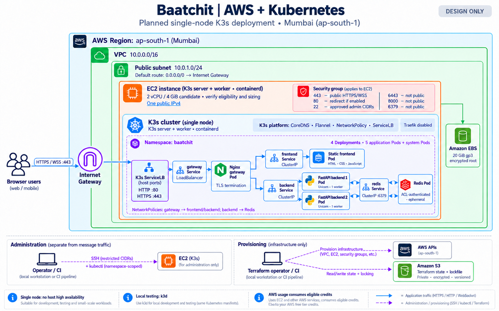

# Baatchit

**Live conversations, built with React, FastAPI, Redis and Kubernetes.**

Baatchit is a browser-based messaging app with accounts, persistent one-to-one conversations and saved message history. Sign in, find someone by username and return to the same conversation after reconnecting. A separate guest mode provides the temporary General room and session-based direct messages. The responsive React interface keeps separate drafts for each conversation.

[Run locally](docs/DEVELOPMENT.md) · [Complete project and interview guide](docs/PROJECT_INTERVIEW_GUIDE.md) · [Implementation evidence](docs/IMPLEMENTATION_STATUS.md) · [API contract](docs/API_SPECIFICATION.md) · [System design](docs/design/README.md)

## Project status

**The application is implemented and verified locally.** The repository includes frontend/backend source, container builds, Kubernetes manifests, Terraform and delivery workflows.

| Area | Current state |
| --- | --- |
| Browser chat and backend messaging | Implemented; unit, integration and browser checks passed |
| Local Kubernetes | Verified with four Deployments and five application Pods |
| Infrastructure code | Both Terraform roots validated; AWS provisioning remains pending |
| Release and deployment automation | Implemented; signed cloud release and rollback acceptance remain pending |
| Performance | Short local benchmark recorded; sustained AWS capacity remains to be measured |

Verification results below were recorded on **27 October 2026**. For subsequent automated runs, see [GitHub Actions](https://github.com/pawankgandhi15/Chat_App/actions/workflows/validate.yml).

**React migration — 28 October 2026:** The frontend now uses React 19 and Vite 8. The production bundle, six protocol/client tests and three browser tests with intercepted WebSockets were checked locally. The older full-stack and load results below describe the previous frontend; Docker/Kubernetes and load checks have not been repeated for this migration.

**Direct messaging — 28 October 2026:** The `chat.v2` protocol adds a list of currently connected sessions and targeted one-to-one messages across replicas. The existing `chat.v1` public-room protocol remains supported. See [Direct messaging](docs/DIRECT_MESSAGING.md) for behavior, security limits and current verification evidence.

**Accounts and saved history — 28 October 2026:** Added registration/login, stable account IDs, searchable usernames, persistent direct conversations, paginated history, revocable cookie sessions and idempotent message saving. PostgreSQL is the deployment database; SQLite supports single-machine development/tests. See [Accounts and history](docs/ACCOUNTS_AND_HISTORY.md) for setup, API, schema and evidence. Docker/PostgreSQL/Kubernetes checks for this milestone remain pending locally; the browser persistence checks use real SQLite and stub Redis publishing.

## Run locally

### Prerequisites

| Tool | Requirement |
| --- | --- |
| Python | 3.12 |
| Docker | Running with Linux containers enabled |
| k3d | 5.9.0, available on PATH or in `.local/bin/` |
| kubectl | 1.37.x on PATH |
| Node.js | 24 for the React/Vite development server, production build and frontend tests |

Clone the repository, or use your existing checkout:

~~~bash
git clone https://github.com/pawankgandhi15/Chat_App.git Baatchit
cd Baatchit
~~~

The project is named **Baatchit**. The clone URL above is the existing GitHub repository address; the command creates a local folder named `Baatchit`.

### Frontend only · React

Run from the repository root:

~~~bash
npm ci
npm run dev
~~~

Open **http://127.0.0.1:8080**. Vite listens on the loopback interface and refreshes the UI as source files change. This starts only the frontend; live chat needs the backend and Redis. On Windows PowerShell, use `npm.cmd` if execution policy blocks `npm.ps1`.

Use `npm run build` to generate `frontend/dist/`, and `npm run preview` to inspect that production build after stopping the dev server. Both default to port 8080 and fail if it is already in use. For an optional local WebSocket proxy, see [Development](docs/DEVELOPMENT.md#frontend-only-react-development).

### Windows · PowerShell

~~~powershell
py -3.12 -m venv .venv
.venv\Scripts\python.exe -m pip install --require-hashes -r requirements-dev.lock
.venv\Scripts\python.exe scripts/local.py up
~~~

### Linux / macOS

~~~bash
python3.12 -m venv .venv
. .venv/bin/activate
python -m pip install --require-hashes -r requirements-dev.lock
python scripts/local.py up
~~~

Open **http://localhost:8080** in two tabs. No AWS account is needed. The launcher builds the images, creates the local cluster and waits for all services.

Choose **Sign in for saved chats**, create an account and find another registered username. Use separate browser profiles/private windows for two different accounts; tabs in one browser profile share the login cookie. The launcher now also provisions a PostgreSQL PVC and initializes schema v1. Re-running `up` preserves data; `down` requires explicit confirmation and deletes local cluster data.

Try General by sending a message from one tab. For a direct conversation, wait for the other tab's session to appear under Direct messages and select it. Change a display name, then disconnect and reconnect to observe the new session ID. Unsent drafts stay in that tab; messages missed during a disconnect are not replayed.

### Inspect, rebuild and stop

Run `up` again after editing source to rebuild the images and update the local workloads. Inspect or remove the local environment with:

~~~powershell
.venv\Scripts\python.exe scripts/local.py status
.venv\Scripts\python.exe scripts/local.py down
~~~

On Linux/macOS with the virtual environment active, use `python scripts/local.py status` or `python scripts/local.py down`. The launcher uses its own explicit kubeconfig/context. Keep `.local/` untracked; it contains local cluster access material.

For tool installation and troubleshooting, see [Development](docs/DEVELOPMENT.md).

## What is implemented

- **Accounts and saved chats:** password login, permanent account IDs, unique direct conversations, authorized paginated history and idempotent saves in PostgreSQL.
- **Live messaging:** session-first `chat.v2` WebSockets for public and direct messages, with `chat.v1` compatibility and Redis Pub/Sub across backend replicas.
- **Responsive interface:** keyboard controls, connection feedback, safe text rendering and mobile layout.
- **Recovery:** bounded retries, retained unsent drafts and no automatic message resending.
- **Resource controls:** connection/rate limits, bounded queues, send deadlines and slow-client isolation.
- **Kubernetes:** four Deployments, five application Pods, readiness/liveness probes and enforced network isolation.
- **Delivery tooling:** Terraform, validation workflows, scanned/signed release bundles and previous-bundle restoration.

Detailed results and remaining acceptance work are recorded in [Implementation status](docs/IMPLEMENTATION_STATUS.md).

## Architecture

*Earlier guest-chat AWS design; the new PostgreSQL persistence layer is not shown in this image. Cloud resources have not been provisioned. [View full-size](docs/images/aws-k3s-architecture.png).*

~~~mermaid
flowchart LR
    Browser -->|HTTP / WebSocket| Gateway[Nginx gateway]
    Gateway --> Frontend[Static frontend]
    Gateway --> BackendA[FastAPI replica A]
    Gateway --> BackendB[FastAPI replica B]
    BackendA <-->|Pub/Sub| Redis
    BackendB <-->|Pub/Sub| Redis
    BackendA -->|Accounts and saved messages| PostgreSQL[(PostgreSQL)]
    BackendB -->|Accounts and saved messages| PostgreSQL
~~~

A backend validates each message, assigns its event ID and publishes it once. Both backends consume the event and deliver it to their connected clients. Each socket has an independent bounded writer queue.

That live-message path describes guest chat. Signed-in chats commit messages to PostgreSQL before acknowledgment; Redis carries member-specific refresh hints, and browsers retrieve history through authenticated APIs. A PostgreSQL platform Deployment/PVC is managed separately from the four application Deployments. See [the saved-chat architecture](docs/ACCOUNTS_AND_HISTORY.md#architecture-and-boundaries).

Local development uses k3d. The AWS target uses K3s/containerd on one EC2 host, with K3s ServiceLB exposing only the gateway. Redis and backend diagnostics stay private. Two backend Pods demonstrate distributed messaging; they do not provide host-level high availability.

## Technology stack

| Layer | Implementation |
| --- | --- |
| Interface | React 19, React DOM, JSX, CSS and Vite 8 |
| API and transport | Python 3.12, FastAPI, Uvicorn, Pydantic, WebSockets |
| Messaging | Redis Pub/Sub and redis.asyncio |
| Accounts and persistence | PostgreSQL, SQLAlchemy Core, psycopg; file-backed SQLite for local development/tests |
| Web serving | Nginx static server and reverse proxy |
| Runtime | Docker/OCI, k3d, K3s, containerd, Kustomize |
| Infrastructure code | Terraform for EC2, EBS, VPC and S3 state |
| Delivery | GitHub Actions, GHCR, Trivy, Cosign |
| Verification | pytest, Hypothesis, Node test runner, Playwright |

Python dependencies are hash-locked; JavaScript dependencies use exact versions and `package-lock.json`; container bases are pinned by digest. The frontend Dockerfile builds with Node and serves the compiled assets with Nginx. See [Configuration](docs/CONFIGURATION.md) for actual settings and [Technologies](docs/TECHNOLOGIES.md) for design rationale.

## Verification

**42 automated tests passed locally**, alongside runtime, infrastructure and image checks:

| Check | Recorded result |
| --- | --- |
| Python unit tests | 26 passed |
| JavaScript tests | 6 passed |
| Real Docker/Redis integration tests | 9 passed |
| Chromium desktop/mobile flow | 1 passed |
| Gateway smoke and Kubernetes network isolation | Passed |
| Kustomize overlays and event schema consistency | Passed |
| Terraform configuration | Both roots validated |
| Runtime image scans | All four images passed the fixable HIGH/CRITICAL vulnerability gate |

The image scan gate excludes unfixed and lower-severity findings. These results describe the tested local build; they do not certify a deployed AWS environment.

A short local run with **25 clients**, **5 aggregate messages/second** and **512-byte payloads** delivered all **7,500 expected events** during 60 seconds, with no duplicates and approximately **16 ms p95/p99** client-observed latency. This is local evidence, not a measured AWS capacity claim. The longer cloud test and node-memory target remain pending.

~~~powershell
.venv\Scripts\python.exe -m pytest tests/unit -q
node --test tests/frontend/*.test.js
.venv\Scripts\python.exe scripts/check_manifests.py
.venv\Scripts\python.exe scripts/smoke.py
~~~

The smoke check requires the local app to be running. Reproduce the short benchmark with:

~~~powershell
.venv\Scripts\python.exe scripts/load.py --warmup 5 --duration 60 --output artifacts/load-local.json
~~~

Integration tests use disposable Docker containers. Browser tests require Playwright's Chromium installation. See [Development](docs/DEVELOPMENT.md) for those commands and [Implementation status](docs/IMPLEMENTATION_STATUS.md) for the measurement conditions.

## CI/CD and AWS delivery

| Workflow | Trigger | Responsibility |
| --- | --- | --- |
| [Validate](.github/workflows/validate.yml) | Pull requests, pushes to `main`, reusable workflow calls | Application tests, local cluster checks and Terraform validation |
| [Release](.github/workflows/release.yml) | Manual; publication restricted to `main` | Validate, publish four images to GHCR, scan, generate SBOMs and sign images/bundle |
| [Deploy](.github/workflows/deploy.yml) | Manual on `main` using a controlled Linux runner | Verify the selected bundle, apply it, smoke-test and restore the previous accepted bundle on failure |

**A Git push triggers validation, not AWS provisioning or deployment.** Release publication needs a real HTTPS origin and registry/OIDC access. Deployment also needs a configured `aws-demo` environment, restricted kubeconfig, TLS/Redis Secrets and a runner labelled `baatchit-deployer`.

Terraform separates the protected S3 state bucket in `infra/bootstrap-state/` from the EC2/VPC workload in `infra/workload/`. Follow [Deployment](docs/DEPLOYMENT.md) for the reviewed provisioning, Secret bootstrap and release process. The AWS overlay contains placeholders and must be rendered into a verified release before deployment.

## Configuration and security

- Exact allowed origins and a supported `chat.v2` or `chat.v1` subprotocol are checked before accepting a WebSocket.
- The backend enforces a 16 KiB transport payload cap, 2,000 normalized code points, connection/rate budgets and bounded delivery queues.
- Redis uses an application ACL limited to the chat channel. Public mode reads its authenticated connection URI from a mounted Secret.
- Application containers run as non-root with read-only root filesystems and restricted privileges; NetworkPolicies isolate service traffic.
- Backend `/health`, `/live` and `/metrics` endpoints stay private. The gateway exposes only a minimal `/ready` response.
- Message bodies render as text. Drafts and recent messages remain in tab memory; no durable chat storage is configured.

See [Configuration](docs/CONFIGURATION.md) for settings and [Security](docs/SECURITY.md) for the wider threat model and acceptance goals.

## Repository layout

~~~text
backend/             FastAPI application and locked runtime dependencies
frontend/            React components, chat client, Vite build and Nginx server
gateway/             Local/HTTPS Nginx routing
redis/               Digest-pinned Redis release image
k8s/                 Base workloads, policies, platform resources and overlays
platform/k3d/        Disposable local cluster definition
infra/               Separate Terraform state and workload roots
scripts/             Local setup, checks, load, release and deployment tools
schemas/             Event and release contracts
tests/               Unit, JavaScript, integration and browser tests
.github/workflows/   Validation, manual release and manual deployment
docs/                Requirements, operational guides and HLD/LLD handbook
~~~

Application resources use the `baatchit` namespace and local cluster name, `k3d-baatchit` context, and `baatchit-*` image names. Existing checkouts created before the rename should follow the [rename notes](docs/DEVELOPMENT.md#existing-environments-after-the-rename) before starting the new environment.

## Documentation

### Product and Architecture

| Guide | Contents |
| --- | --- |
| [Complete Project and Interview Guide](docs/PROJECT_INTERVIEW_GUIDE.md) | End-to-end explanation, implementation evidence and 130 detailed interview questions covering concurrency, sharding, scaling, consistency and operations |
| [Requirements](docs/REQUIREMENTS.md) | User journeys, scope, acceptance criteria and measurable objectives |
| [Architecture](docs/ARCHITECTURE.md) | Service topology, event flow, concurrency and failure behavior |
| [System Design: HLD, LLD and Future Growth](docs/design/README.md) | Detailed design, sequence/data models, capacity planning, upgrade stages, migration and review templates |
| [Frontend & UI/UX](docs/FRONTEND.md) | Screen design, accessibility, browser state and integration |
| [Backend](docs/BACKEND.md) | Modules, messaging, validation, recovery and service engineering |
| [API Specification](docs/API_SPECIFICATION.md) | Routes, event schemas, input rules and close codes |
| [Direct Messaging](docs/DIRECT_MESSAGING.md) | Session discovery, v2 protocol, routing, privacy boundaries and failure behavior |
| [Accounts and History](docs/ACCOUNTS_AND_HISTORY.md) | Login, persistent identity, saved conversations, database setup, API, authorization and retry semantics |
| [Technologies](docs/TECHNOLOGIES.md) | Stack choices, compatibility considerations and candidate versions |
| [Project Structure](docs/PROJECT_STRUCTURE.md) | Module responsibilities and future layout proposals |
| [Decisions and Risks](docs/DECISIONS_AND_RISKS.md) | Architectural decisions, trade-offs and implementation risks |

### Development and Quality

| Guide | Contents |
| --- | --- |
| [Implementation Status](docs/IMPLEMENTATION_STATUS.md) | Delivered code, dated local evidence, reconciled decisions and remaining acceptance work |
| [Implementation Plan](docs/IMPLEMENTATION_PLAN.md) | Ordered milestones and verification gates |
| [Development](docs/DEVELOPMENT.md) | Working local setup, container workflows and debugging |
| [Configuration](docs/CONFIGURATION.md) | Environment settings, defaults and configuration examples |
| [Testing](docs/TESTING.md) | Unit, contract, integration, load and failure testing |
| [Security](docs/SECURITY.md) | Threat model, access boundaries, secret handling and release controls |

### Infrastructure and Operations

| Guide | Contents |
| --- | --- |
| [AWS Free Tier Requirements](docs/AWS_FREE_TIER_REQUIREMENTS.md) | Account eligibility, resources, access, cost review and teardown |
| [Kubernetes deployment](docs/KUBERNETES.md) | Primary k3d/K3s topology, Pods, Services, policies, probes and resource planning |
| [Infrastructure](docs/INFRASTRUCTURE.md) | AWS topology, Terraform design and state management |
| [CI/CD](docs/CICD.md) | Validation, image publication and delivery pipeline design |
| [Deployment](docs/DEPLOYMENT.md) | First deployment, release verification and rollback |
| [Operations](docs/OPERATIONS.md) | Monitoring, troubleshooting, recovery and cleanup |
| [Release Checklist](docs/RELEASE_CHECKLIST.md) | Readiness gates and release evidence |
| [Demo Guide](docs/DEMO_GUIDE.md) | Planned demonstration scenarios and evidence capture |

The design handbook and planning documents retain future proposals. Use the implementation status for measured results, the API specification for the wire contract, and the current development/configuration/deployment guides for runnable commands and defaults.

## Scope and deployment

Signed-in users have stable accounts, persistent direct conversations and saved history, including messages saved while a recipient is disconnected. Guest General/session chats remain temporary and their names unverified; guest history is not imported into accounts. Password accounts do not verify real-world identity. Service/database operators can read saved messages, and neither mode provides end-to-end encryption. Attachments, password recovery, group accounts, delivery/read receipts and push notifications remain outside the implemented scope.

The AWS Terraform defaults target a single 2-vCPU/4-GiB candidate in Mumbai. Review account eligibility, actual prices, credits and teardown arrangements before provisioning. K3s avoids a managed Kubernetes control plane, but EC2 and related resources still consume credits or money.

[Deployment](docs/DEPLOYMENT.md) describes the concrete provisioning and signed-release workflow. [AWS requirements](docs/AWS_FREE_TIER_REQUIREMENTS.md) provides the account/cost worksheet. No infrastructure is created by the local startup command.

## Contributing

Read [CONTRIBUTING.md](CONTRIBUTING.md). Keep implementation, wire contracts and documentation aligned, add checks for meaningful behavior changes, and distinguish measurements from targets.

See [CHANGELOG.md](CHANGELOG.md) for repository changes. The [original planning discussion](gemini-code-1792827209365.md) and unimplemented expansion plans remain historical/design context.
