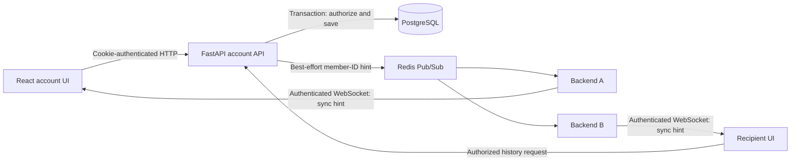

# Accounts, persistent conversations and message history

Implemented 28 October 2026. This is the current contract for **saved direct chats**. Guest General and guest direct messages still use the separate, temporary [v1/v2 protocols](DIRECT_MESSAGING.md).

## Using saved chats

1. Start the full application, then choose **Sign in for saved chats**.
2. Choose **Create an account**. Usernames contain 3–32 ASCII letters, digits, underscores or hyphens and are stored lowercase. Passwords contain 15–128 characters.
3. Sign in and find another registered username with the search field (at least two characters). Registered usernames are discoverable to other authenticated users.
4. Select the person and send a message. Both accounts return to the same conversation after reconnecting, refreshing or signing in again.
5. Use **Load older messages** to page through history. **Return to latest messages** resumes the current conversation view.
6. Sign out to revoke this browser's login. Signing out clears the current interface and in-memory drafts, but does not delete saved history.

The recipient does not need to be connected for a message to be saved. When they next sign in, the conversation and its history are available. This is database-backed catch-up, not a delivery/read receipt or a push-notification service. Guest identities and temporary guest messages are **not imported** into registered accounts; matching display names do not prove ownership.

## Architecture and boundaries



PostgreSQL is the deployment database. File-backed SQLite is an explicit single-machine development/test option using the same SQLAlchemy Core model. SQLite is not a substitute for testing PostgreSQL locks, container storage or multi-node operation. Public mode rejects SQLite and requires a PostgreSQL credential file.

Messages travel through the authenticated HTTP API and are committed before the response reports `status: saved`. Redis carries only a small internal `_saved` notification containing the two member IDs, not saved-message bodies. Each replica routes a coalesced `sync` hint to locally connected sessions belonging to those accounts. Browsers then request authorized history.

The notification is deliberately advisory. A commit can succeed while Redis publishing fails, or the HTTP response can be lost. The database remains authoritative. The client refreshes every 15 seconds, when the window regains focus, and on WebSocket sync hints. This repairs missed notifications but is not a transactional outbox or a durable event consumer. With large histories, clients load a contiguous latest page and can page backward to recover earlier messages.

## Schema v1

| Table | Responsibility and constraints |
| --- | --- |
| `accounts` | UUID account ID; unique lowercase username; salted password hash; creation time |
| `account_sessions` | SHA-256 digest of an opaque random login token, account FK, expiry; no raw session tokens |
| `conversations` | UUID; two ordered account FKs; unique pair; `last_seq` and update timestamp |
| `saved_messages` | UUID; conversation FK; sender FK; client request UUID; text; timestamp; sequence unique within conversation |
| `account_rate_limits` | Hashed limiter key and fixed time window, atomic shared counter |
| `schema_version` | Supported version: `1` |

Direct conversations have exactly two members represented by `user_a` and `user_b`. The UUIDs are sorted before insertion, with a unique pair and ordering check in the database. Opening the conversation from both sides concurrently returns one conversation. A future group feature should introduce explicit membership rows; do not overload this pair model.

Every history read, message write and conversation lookup verifies the authenticated account against the two members. An unknown conversation and a non-member conversation both return 404. The client cannot supply the message sender. All SQL uses bound parameters and all user text renders as React text.

## Consistency, retries and pagination

- A message transaction locks/updates its conversation row, assigns the next sequence, inserts the message and updates the conversation timestamp. Concurrent sends to one conversation are serialized. Different conversations can progress independently in PostgreSQL; SQLite serializes writes more broadly.
- `(sender_id, client_id)` is unique. Retrying the same request, text and conversation returns the existing message. Reusing that ID for different text or a different conversation returns 409. This is idempotent insertion, not a claim of exactly-once network delivery.
- The browser keeps the request ID for an uncertain send in that tab. An unchanged retry uses it again. Drafts clear only after a successful saved response, and only if the user has not edited the draft meanwhile. Refresh/sign-out clears unsaved in-memory drafts and pending request IDs.
- Message pages contain up to 50 rows in ascending conversation sequence. Supply `before=<seq>` to page backward. `next_before: null` means there are no earlier rows.
- Conversation pages contain up to 50 rows ordered by immutable UUID, with `after=<UUID>` and `next_cursor`. The UI sorts loaded conversations by activity. New conversations inserted behind an old cursor are discovered by periodic refresh from the first page.
- Each rendered message window is capped at 500 messages. Paging farther back drops newer rows from the displayed window; the database retains them. While browsing older history, automatic message refresh pauses; **Return to latest messages** resumes it.
- Sidebar dots indicate activity relative to this open tab, not durable unread counts or another person's read position.

The conflict-aware inserts and transaction boundaries use [SQLAlchemy's PostgreSQL support](https://docs.sqlalchemy.org/en/20/dialects/postgresql.html). They are also exercised against file-backed SQLite locally; PostgreSQL-specific concurrency tests are provided separately.

## Authentication and security

Passwords use salted scrypt (`N=32768`, `r=8`, `p=3`, 32 MiB working memory per hash). This is one of the [OWASP password-storage configurations](https://cheatsheetseries.owasp.org/cheatsheets/Password_Storage_Cheat_Sheet.html). Password length follows the 15-character minimum for a password-only account described in [OWASP authentication guidance](https://cheatsheetseries.owasp.org/cheatsheets/Authentication_Cheat_Sheet.html). Passwords are never stored as plaintext, returned by an endpoint or reflected in validation errors. Unknown usernames perform a dummy hash comparison.

Successful login issues a cryptographically random token in an `HttpOnly`, `SameSite=Strict`, path `/` cookie. Public mode also sets `Secure` and requires HTTPS origins. Only a token digest is stored. The default lifetime is seven days (`SESSION_DAYS`, 1–30). Login replaces this browser's previous token; logout deletes it. Login serializes on the account row and retains at most ten active sessions. WebSocket sessions recheck authentication before each hint and at least every 20 seconds; HTTP authorization checks happen on each request.

All mutating API calls require an exact allowed `Origin`, including registration and login. Missing/foreign origins are rejected. Request bodies must declare their length and fit within 16 KiB; the gateway applies the same size ceiling. The API sets `Cache-Control: no-store`, uses no permissive CORS, and does not store credentials in JavaScript/local storage. Non-browser API tests must explicitly set the allowed Origin and retain the cookie.

The account UI also sends `X-Account-ID` with its current account UUID and an `account_id` expectation when opening the notification socket. If a second tab changes the shared login cookie, the old UI cannot silently send as the new account: a mismatched expectation returns 401 and requires sign-in. These expectations are consistency guards, not credentials; the cookie remains authoritative.

Shared database counters limit authentication to 20 attempts per username and 100 per direct network peer per 15-minute window; the peer can be a shared gateway because forwarded headers are not blindly trusted. Conversation opening is limited to 30/minute and sending to 120/minute per authenticated account. Fixed windows allow boundary bursts. The gateway also limits request rates. Database and password work runs in four worker threads per replica with a four-connection pool; it does not block the async event loop. These are baseline controls, not a complete anti-abuse system.

An account proves control of its password, **not someone's real-world identity**. Email/phone verification, password reset/change, MFA, blocking/reporting, account deletion, automated retention, durable read receipts and E2EE are not implemented. Stored messages remain readable by authorized service/database operators. Deploy behind HTTPS, protect backups and restrict database credentials. The in-cluster PostgreSQL bootstrap uses the database owner's credentials for the local demo; production should separate migration ownership from a least-privilege runtime role with only required table/sequence access.

## Configuration and schema setup

| Setting | Meaning |
| --- | --- |
| `DATABASE_URL` | Local/test connection string; use `postgresql+psycopg://…` or `sqlite:///absolute/file.db` |
| `DATABASE_URL_FILE` | File containing that URI; mandatory when enabling accounts in public mode |
| `SESSION_DAYS` | Cookie/database session expiry, default 7 |
| `ALLOWED_ORIGINS` | Exact browser origin(s), used by both API mutations and WebSockets |
| `BAATCHIT_WS_TARGET` | Vite-only backend target; proxies both `/api` and `/ws` |

Use only one database credential source. Omitting both preserves guest-only server operation; account endpoints return 503. Once a database is configured, startup requires schema v1 and readiness also checks the database. Liveness remains a process check.

Run `python -m app.migrate` from `backend/` with the database and Redis settings configured before starting the account-enabled application. Redis need not be connected for this command; the settings parser still requires a syntactically valid Redis source. The initializer creates additive v1 tables and uses a PostgreSQL transaction advisory lock so simultaneous initializers cannot race. Re-running it is safe for v1; an unknown schema version fails closed. This is not an automatic destructive migration framework. Future schema changes require explicit versioned migrations and compatibility tests.

### Full local Kubernetes stack

With Docker Desktop running Linux containers:

```powershell
.venv\Scripts\python.exe -m pip install --require-hashes -r requirements-dev.lock
.venv\Scripts\python.exe scripts/local.py up
```

Stop any Vite process using port 8080 first. The launcher builds the app, preserves existing database credentials, applies `k8s/platform/database.yaml`, waits for PostgreSQL, runs a one-shot schema initializer and rolls out the app. It does not print database credentials. PostgreSQL uses a digest-pinned image, a private Service, ingress restricted to backend/migration Pods and a 2 GiB PVC. Migration Pods use a separate label so the backend Service never sends application traffic to them. The full topology is four application Deployments/five Pods plus one PostgreSQL Deployment/Pod (five Deployments/six running Pods total after migration completes).

The database platform resources are separate from signed app release bundles, so rolling back an application does not remove the database. Repeating `up` preserves the PVC. The default local-path volume survives Pod replacement but **not cluster deletion or loss of its node storage**. `scripts/local.py down` now explicitly asks for `DELETE`, because deleting this local cluster also deletes saved accounts/messages. Back up first if the data matters. CI supplies that confirmation only for its disposable test cluster.

### Native local development with SQLite

For a single local backend without PostgreSQL, run from the repository root:

```powershell
New-Item -ItemType Directory -Force .local | Out-Null
$env:DATABASE_URL = 'sqlite:///E:/Projects/chat_app/repo/.local/accounts.db'
$env:REDIS_URL = 'redis://127.0.0.1:6379/0'
$env:PYTHONPATH = 'backend'
.venv\Scripts\python.exe -m app.migrate
.venv\Scripts\python.exe -m uvicorn app.main:create_app --factory --host 127.0.0.1 --port 8000 --no-access-log --ws-max-size 16384 --ws-max-queue 4
```

Use your checkout's absolute path. In another terminal, set `BAATCHIT_WS_TARGET=http://127.0.0.1:8000` and run `npm.cmd run dev`. Do not place this SQLite file under a public web directory or use it across Kubernetes nodes. With Redis unavailable, same-process account hints and HTTP history still work; guest messaging/cross-replica hints and overall readiness remain degraded. This fallback is for development, not the deployment topology. It is not started automatically by frontend-only preview.

### Deployment preparation

Before an account-capable AWS release, an operator must provision PostgreSQL/storage and backups, allow the backend-to-database network path, supply `--database-url-file` to `scripts/bootstrap_secrets.py`, and initialize schema v1 using the new backend code. That script preserves an existing database secret; changing credentials is a separate coordinated rotation. The release bundle now requires `database-url`. Its validator still accepts older guest-only bundles for rollback compatibility.

The provided policy permits an in-namespace `app=postgres` endpoint on TCP 5432. An external database needs an explicit policy addition and the appropriate TLS/CA settings in its connection URI. Terraform does not provision RDS, storage backups or database users. The deployer role does not gain permissions to create Secrets/PVCs or migrate a schema. Run migrations under an operator identity before deployment; do not expose PostgreSQL publicly to make migration easier. PostgreSQL must be healthy/migrated before backend readiness can succeed.

Neither a single PostgreSQL Pod nor a local PVC provides high availability or a backup. Define a `pg_dump`/restore or managed-backup procedure, protect the resulting credentials/data, rehearse restore into a separate database, and establish retention before public use. Database rollback is separate from application rollback; never delete the PVC to roll back code.

## API contract

All routes below use the same-origin HttpOnly cookie. Only registration/login are unauthenticated. Mutation bodies are strict: unknown fields are rejected. UUID parameters must parse as UUIDs.

| Method and route | Input | Result |
| --- | --- | --- |
| `POST /api/auth/register` | `{username, password}` | 201 `{user: {id, username}}`, cookie |
| `POST /api/auth/login` | `{username, password}` | 200 user and new cookie |
| `GET /api/auth/me` | Cookie | Current user or 401 |
| `POST /api/auth/logout` | `{}` | Revokes token, clears cookie |
| `GET /api/users?q=bo` | Username prefix | Up to 20 other accounts: `{items: [{id, username}]}` |
| `GET /api/conversations?after=UUID` | Optional page cursor | `{items: [{id, peer, last_seq, updated_at}], next_cursor}` |
| `POST /api/conversations` | `{user_id: UUID}` | `{id: UUID}` for the unique direct conversation |
| `GET /api/conversations/{id}/messages?before=51` | Optional exclusive sequence bound | `{items: [...], next_before}` |
| `POST /api/conversations/{id}/messages` | `{client_id: UUID, text: string}` | `{message: {...}, status: "saved"}` |
| `WS /ws/accounts/live` | Cookie, allowed Origin, `chat.accounts.v1` | Server-only `{type: "sync"}` hints |

A saved message contains `id`, `conversation_id`, `seq`, `sender_id`, `client_id`, `text` and UTC `sent_at`. Text is normalized and limited to 2,000 Unicode code points. An empty normalized message is rejected. A WebSocket client sending application data is closed with 1008; messages are submitted through the authenticated HTTP endpoint. Session revocation closes that socket on its next authentication check. Normal app draining wakes subscribers and closes with 1012.

Errors: 400 invalid operation; 401 missing/expired login; 403 untrusted Origin; 404 inaccessible/missing resource; 409 username/idempotency conflict; 413 oversized/missing-length body; 422 invalid fields; 429 rate limit; 503 unavailable/unconfigured database. Responses do not include credentials or raw database exceptions.

## Verification and limitations of evidence

Local tests cover password hashing, session revocation/expiry, case-insensitive username uniqueness, concurrent conversation opening, concurrent sequenced writes, retry deduplication, pagination, restart via a new database engine, non-member read/write rejection, strict bodies, Origin checks, and a committed message while Redis publishing fails.

Real Chromium tests exercise account creation/login/logout, refresh, cross-account viewing, an offline recipient returning, safe text rendering, private-history denial, desktop/mobile layout, older-history pagination and retry after a committed send response is deliberately dropped. They use real HTTP/WebSocket endpoints and real SQLite, with Redis publishing stubbed.

`tests/integration/test_accounts_postgres.py` uses two engines against real PostgreSQL and is wired to a fresh PostgreSQL service in CI. It covers concurrent migrations, unique conversation creation, idempotency, sequence allocation, rollback, authorization and reconnecting to saved data. It requires an isolated `BAATCHIT_TEST_DATABASE_URL`; never point it at a user/production database. Local PostgreSQL/Kubernetes tests could not run because the Docker engine was stopped. No new production capacity, AWS deployment, backup-restore or security-audit claim follows from these local tests.

Primary implementation files: [storage.py](../backend/app/storage.py), [accounts.py](../backend/app/accounts.py), [migrate.py](../backend/app/migrate.py), [AccountChat.jsx](../frontend/src/AccountChat.jsx), [database platform](../k8s/platform/database.yaml).
