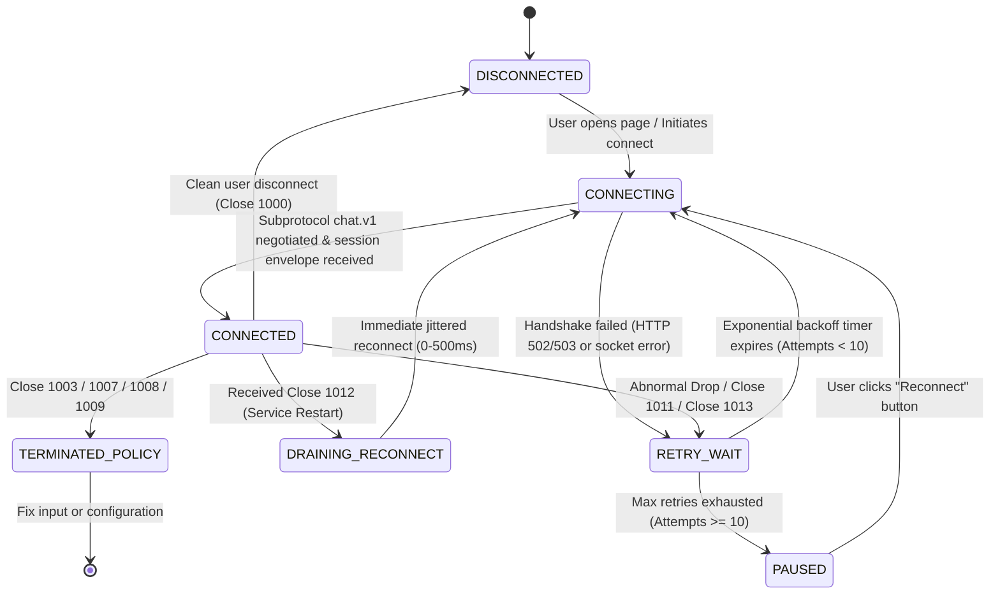

# API and WebSocket Specification

**Status:** Proposed implementation contract. See the [documentation index](../README.md).

**Protocol Design Revision 4 (2026-10-25):** Definitive wire protocol specification establishing discriminated JSON schemas, RFC 6455 WebSocket frame invariants, strict Unicode normalization rules, granular denial and close code semantics, and OpenMetrics telemetry exposition.

## HTTP & WebSocket Route Matrix

| Route | Protocol | Exposure | Auth / Origin Check | Response / Contract |
| --- | --- | --- | --- | --- |
| `/` | HTTP GET | Public (via Gateway) | None | Serve frontend static shell (`index.html`). |
| `/assets/*` | HTTP GET | Public (via Gateway) | None | Static CSS, JS, and SVG assets with cache headers. |
| `/health` | HTTP GET | Public / Internal | None | Dependency-aware readiness probe (checks Redis connectivity & subscriber loop). Returns HTTP 200 or 503. |
| `/live` | HTTP GET | Private Internal Only (Denied by Gateway) | None | Process event-loop responsiveness check. Returns HTTP 200 `{"status": "alive"}`. |
| `/metrics` | HTTP GET | Private Internal Only (Denied by Gateway) | None | Prometheus / OpenMetrics text exposition for scrapers. |
| `/ws/{username}` | WebSocket (WS/WSS) | Public (via Gateway) | `Origin` header validated against `ALLOWED_ORIGINS` | Bidirectional real-time messaging enforcing subprotocol `chat.v1`. |

---

## Health, Liveness & Metrics Specifications

### 1. Readiness Probe: `GET /health`
- **Purpose:** Gateway routing health check and container orchestration readiness probe.
- **Success (`200 OK`):** Returned only when the backend can execute `PING` on Redis within `REDIS_COMMAND_TIMEOUT_SECONDS` (1.0s) **AND** the subscriber heartbeat was acknowledged within `SUBSCRIBER_STALE_SECONDS` (10s) on the current generation nonce.
- **Failure (`503 Service Unavailable`):** Returned if the process is starting up, in `DRAINING` state, Redis is unreachable, or the subscriber coroutine has stalled.

```json
{
  "status": "healthy",
  "container_id": "backend-replica-a-7f9b8c",
  "timestamp": "2026-10-25T14:32:00.125Z",
  "release_id": "20261025.1-sha.e95405e",
  "subsystems": {
    "redis_connection": "connected",
    "subscriber_heartbeat": "fresh",
    "generation_nonce": 4,
    "active_connections": 18,
    "capacity_available": 46
  }
}
```

### 2. Process Liveness: `GET /live`
- Returns HTTP 200 `{"status": "alive", "timestamp": "..."}` as long as the Python `asyncio` event loop can dispatch coroutines. This probe **never** queries Redis.

### 3. Telemetry Exposition: `GET /metrics`
- Exposes OpenMetrics / Prometheus standard text exposition format:

```text
# HELP chat_connections_active Current number of active admitted client WebSocket connections
# TYPE chat_connections_active gauge
chat_connections_active{replica_id="backend-replica-a-7f9b8c"} 18

# HELP chat_messages_published_total Total messages published to Redis bus
# TYPE chat_messages_published_total counter
chat_messages_published_total{replica_id="backend-replica-a-7f9b8c",status="ok"} 4120
chat_messages_published_total{replica_id="backend-replica-a-7f9b8c",status="timeout"} 0
chat_messages_published_total{replica_id="backend-replica-a-7f9b8c",status="rate_limited"} 3

# HELP chat_deliveries_total Total outbound messages sent to local client sockets
# TYPE chat_deliveries_total counter
chat_deliveries_total{replica_id="backend-replica-a-7f9b8c",status="sent"} 74160
chat_deliveries_total{replica_id="backend-replica-a-7f9b8c",status="queue_overflow"} 1

# HELP chat_outbound_queue_bytes Total bytes currently queued across all client queues
# TYPE chat_outbound_queue_bytes gauge
chat_outbound_queue_bytes{replica_id="backend-replica-a-7f9b8c"} 14336
```

---

## WebSocket Handshake & Subprotocol Negotiation

1. **Subprotocol Negotiation:** The client must supply header `Sec-WebSocket-Protocol: chat.v1`. The server echoes `Sec-WebSocket-Protocol: chat.v1` in the HTTP 101 response. Sockets without this subprotocol are rejected prior to upgrade.
2. **Pre-Upgrade Denial Responses:** Utilizes ASGI WebSocket denial responses (`websocket.http.response.start` and `websocket.http.response.body`):
   - **Origin Forbidden:** HTTP 403 Forbidden (`{"error": "forbidden_origin"}`).
   - **Invalid Username:** HTTP 400 Bad Request (`{"error": "invalid_username"}`).
   - **Capacity Exhaustion / Draining:** HTTP 503 Service Unavailable (`{"error": "server_busy_or_draining"}`).
3. **Username Lexical Specification:** Must match regex `^[A-Za-z0-9_-]{1,32}$`. Exactly 1 to 32 ASCII alphanumeric characters, hyphens, or underscores. URL-encoded characters, path traversal segments (`../`), spaces, or non-ASCII characters are immediately rejected.

---

## Discriminated JSON Message Envelopes (`chat.v1`)

All JSON payloads exchanged over WebSocket or Redis Pub/Sub enforce `schema_version: 1` with a strict `type` discriminator.

### 1. Connection-Local `session` Envelope
Dispatched directly from the serving backend to the freshly connected socket. **Never** published to Redis.

```json
{
  "schema_version": 1,
  "type": "session",
  "connection_id": "5b2420aa-520f-4f0a-aea6-2a0d571098cf",
  "container_id": "backend-replica-a-7f9b8c",
  "user": "Alice_99",
  "sent_at": "2026-10-25T14:32:00.100Z"
}
```

### 2. Broadcast `chat` Envelope
Constructed by the publishing backend upon receiving valid plain text from a client, dispatched via Redis Pub/Sub, and fanned out to all connected clients.

```json
{
  "schema_version": 1,
  "event_id": "7228a607-018c-45bb-91fd-3a7a0bad84a3",
  "sent_at": "2026-10-25T14:32:01.125Z",
  "type": "chat",
  "user": "Alice_99",
  "text": "Hello, distributed real-time world! 🚀",
  "container_id": "backend-replica-a-7f9b8c",
  "time": "14:32:01 UTC"
}
```

### 3. Broadcast `system` Envelope
Generated by backends for advisory join, leave, or administrative notifications.

```json
{
  "schema_version": 1,
  "event_id": "c138d4f2-90ab-48e3-b31c-529a8a701df1",
  "sent_at": "2026-10-25T14:32:00.150Z",
  "type": "system",
  "user": "Alice_99",
  "text": "User Alice_99 has joined the room.",
  "container_id": "backend-replica-a-7f9b8c",
  "time": "14:32:00 UTC"
}
```

### Formal JSON Schema Definition (`events-v1.schema.json`)

```json
{
  "$schema": "https://json-schema.org/draft/2020-12/schema",
  "$id": "https://chatapp.internal/schemas/events-v1.schema.json",
  "title": "ChatAppV1EventEnvelope",
  "oneOf": [
    {
      "type": "object",
      "required": ["schema_version", "type", "connection_id", "container_id", "user", "sent_at"],
      "properties": {
        "schema_version": { "const": 1 },
        "type": { "const": "session" },
        "connection_id": { "type": "string", "format": "uuid" },
        "container_id": { "type": "string", "minLength": 1, "maxLength": 64 },
        "user": { "type": "string", "pattern": "^[A-Za-z0-9_-]{1,32}$" },
        "sent_at": { "type": "string", "format": "date-time" }
      },
      "additionalProperties": false
    },
    {
      "type": "object",
      "required": ["schema_version", "event_id", "sent_at", "type", "user", "text", "container_id", "time"],
      "properties": {
        "schema_version": { "const": 1 },
        "event_id": { "type": "string", "format": "uuid" },
        "sent_at": { "type": "string", "format": "date-time" },
        "type": { "enum": ["chat", "system"] },
        "user": { "type": "string", "minLength": 1, "maxLength": 32 },
        "text": { "type": "string", "minLength": 1, "maxLength": 2000 },
        "container_id": { "type": "string", "minLength": 1, "maxLength": 64 },
        "time": { "type": "string", "pattern": "^[0-9]{2}:[0-9]{2}:[0-9]{2} UTC$" }
      },
      "additionalProperties": false
    }
  ]
}
```

---

## Client Inbound Frame & Unicode Normalization Rules

Clients transmit raw plain text WebSocket frames (Opcode `0x1`).
1. **Reassembled Frame Byte Limit:** Enforce strict 16,384 bytes ($16\text{ KiB}$) ceiling across all reassembled WebSocket frames before application text parsing.
2. **Binary Frame Rejection:** Opcode `0x2` (Binary) frames immediately trigger close code `1003` (Unsupported Data).
3. **CRLF Normalization:** Convert `\r\n` pairs to single `\n` line-breaks; convert standalone `\r` to `\n`.
4. **Boundary Trimming:** Strip leading and trailing ASCII whitespace only (`U+0020`, `U+0009`, `U+000D`, `U+000A`). Do not strip non-breaking spaces (`U+00A0`) or ideographic spaces (`U+3000`). If the trimmed string is empty, the message is ignored, but the socket token bucket is charged.
5. **Forbidden Control Characters:** Reject messages containing ASCII C0 control characters (`U+0000` to `U+001F` except tab `\t` and newline `\n`) and DEL (`U+007F`) with close code `1008`.
6. **Code Point Length Accounting:** After trimming, count Unicode code points (scalar values). Length must be $\ge 1$ and $\le 2,000$ code points.
   - JavaScript implementation: `Array.from(trimmedText).length <= 2000` (correctly handles surrogate pairs and emojis).
   - Python implementation: `len(trimmed_text) <= 2000`.

---

## WebSocket Close Code Matrix

| Code | Standard Name | Trigger Scenario | Client Action |
| --- | --- | --- | --- |
| `1000` | Normal Closure | User clicks "Disconnect" or closes browser tab cleanly. | Terminal; no reconnect. |
| `1001` | Going Away | Browser window navigates to a new URL. | Terminal; no reconnect. |
| `1003` | Unsupported Data | Client transmitted a binary WebSocket frame. | UI displays protocol error; no automatic reconnect. |
| `1007` | Invalid Payload Data | Transport encountered malformed UTF-8 byte sequences. | UI displays encoding error; no automatic reconnect. |
| `1008` | Policy Violation | Disallowed characters, failed origin check, or invalid syntax. | UI displays policy error; no automatic reconnect. |
| `1009` | Message Too Big | Inbound frame reassembly exceeded 16,384 bytes. | UI alerts user message was too large; no auto-reconnect. |
| `1011` | Internal Server Error | Unhandled backend exception or unexpected Redis client failure. | UI transitions to reconnecting with exponential backoff. |
| `1012` | Service Restart | Planned container shutdown / drain (SIGTERM). | UI immediately attempts jittered reconnection to alternate replica. |
| `1013` | Try Again Later | Outbound queue overflow (slow consumer) or rate limit exhausted. | UI pauses briefly; reconnects with exponential backoff. |

---

## Browser Connection State Machine



### Jittered Exponential Backoff Algorithm:
$$T_{\text{backoff}} = \text{random}(0, \min(30, 2^{\text{attempt}})) \text{ seconds}$$
- Attempts counter starts at 0 and increments on each failed connection attempt.
- Reset to 0 after 30 seconds of stable `CONNECTED` state.
- Transition to `PAUSED` when $\text{attempt} \ge 10$.

---

## Related Guides

[Requirements](REQUIREMENTS.md) | [Architecture](ARCHITECTURE.md) | [Configuration](CONFIGURATION.md) | [Testing](TESTING.md) | [Security](SECURITY.md)

