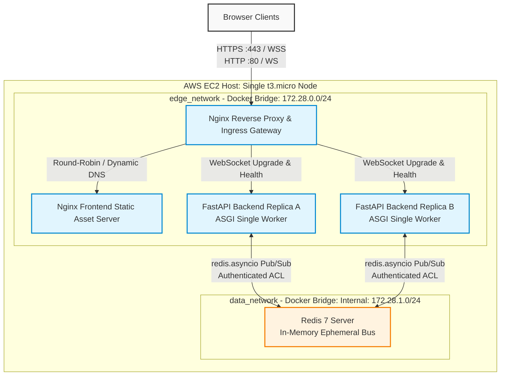
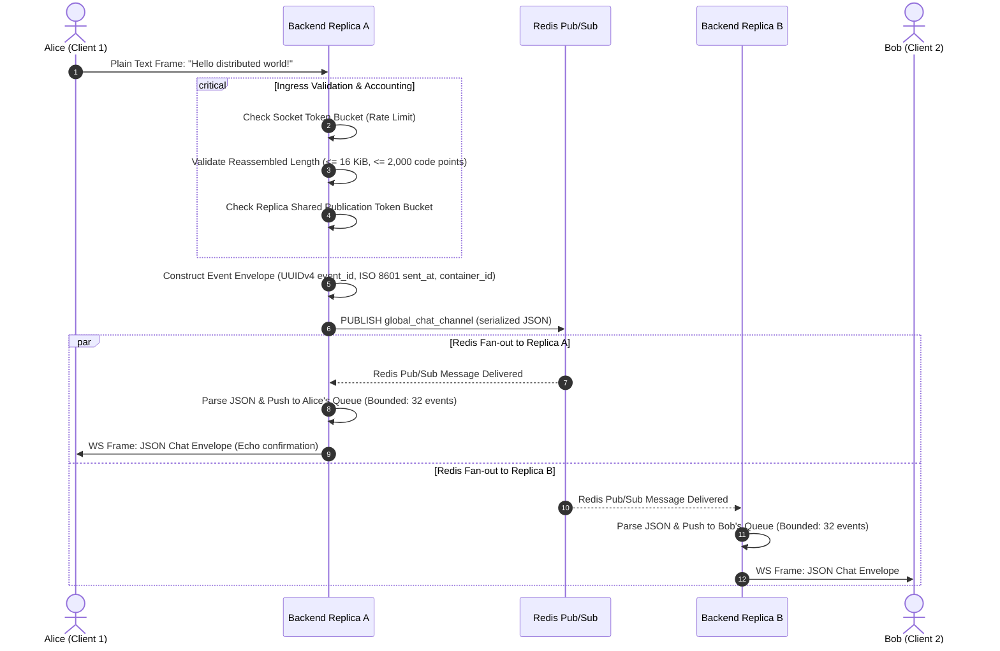

# System Architecture

**Status:** Proposed design, incorporating production-grade concurrency, network segmentation, and state machine models. See the [documentation index](../README.md).

**Design Revision 4 (2026-10-25):** Advanced architectural blueprint establishing asynchronous task trees, multi-tier container networking, generation-nonce subscriber supervision, and deterministic graceful drain protocols.

## High-Level Topology & Network Boundaries



The runtime deployment consists of **four Compose services operating as five application containers** (`gateway`, `frontend`, `backend` $\times 2$, and `redis`). 
- **Ingress Isolation:** The gateway is the sole container publishing host ports (`80` for ACME/local testing and `443` for TLS).
- **Network Segmentation:** Gateway and frontend reside exclusively on `edge_network`. Redis resides strictly on `data_network` (configured with `internal: true`, blocking all external egress). Backend replicas bridge both networks, acting as the strictly controlled application firewall between presentation and data tiers.

## Component Responsibilities & State Contracts

| Component | Responsibility | State Lifecycle | Concurrency Model |
| --- | --- | --- | --- |
| **Browser Client** | Render DOM via vanilla JS, maintain connection state machine, enforce local rate limits, handle jittered retries. | Ephemeral; last 500 chat messages retained in DOM only. | Single-threaded JavaScript event loop. |
| **Nginx Gateway** | Ingress TLS termination, HTTP security headers, request routing, WebSocket upgrade proxying, upstream DNS resolution (`127.0.0.11`). | Stateless connection proxy; maintains active TCP connection tables. | Event-driven multi-worker epoll. |
| **Nginx Frontend** | Serve static assets (`index.html`, `app.js`, `styles.css`) with strict caching and compression (gzip). | Immutable container image assets. | High-concurrency static file serving. |
| **FastAPI Backend (x2)** | Protocol negotiation (`chat.v1`), admission control, input validation, local connection management, Redis publication, and subscriber fan-out. | In-memory connection slots, bounded client delivery queues, subscriber generation counter. | Python 3.11+ `asyncio` event loop on single Uvicorn worker per replica. |
| **Redis Bus** | Distribute broadcast envelopes across backend replicas via `global_chat_channel`. | Ephemeral in-memory Pub/Sub channel; zero disk persistence (RDB/AOF disabled). | Single-threaded in-memory command execution. |

---

## Detailed Message & Protocol Sequences

### Sequence 1: Client Admission, Subprotocol Handshake & Session Inception

```mermaid
sequenceDiagram
    autonumber
    actor Client as Browser Client
    participant GW as Nginx Gateway
    participant Backend as FastAPI Backend (Replica A)
    participant Redis as Redis Pub/Sub

    Client->>GW: GET /ws/User_123 (Upgrade: websocket, Sec-WebSocket-Protocol: chat.v1)
    GW->>Backend: Proxy Upgrade (X-Forwarded-For, X-Real-IP, Host)
    
    critical Pre-Upgrade Admission Gate
        Backend->>Backend: Validate Origin against ALLOWED_ORIGINS
        Backend->>Backend: Validate Username regex ^[A-Za-z0-9_-]{1,32}$
        Backend->>Backend: Check Capacity (Active Sockets < MAX_CONNECTIONS)
        alt Policy Failure / Capacity Exceeded
            Backend-->>GW: HTTP 403 Forbidden / HTTP 503 Service Unavailable
            GW-->>Client: HTTP 403 / 503 Denial
        end
    end

    Backend-->>GW: HTTP 101 Switching Protocols (Sec-WebSocket-Protocol: chat.v1)
    GW-->>Client: HTTP 101 Switching Protocols

    rect rgb(232, 245, 233)
        Note over Backend,Client: Private Connection Inception (Bypasses Redis)
        Backend->>Backend: Allocate Connection Slot & UUID (e.g. 5b2420aa...)
        Backend->>Client: Send Local 'session' Event (connection_id, container_id, user)
        Client->>Client: Enable UI Send Input; Transition to CONNECTED state
    end

    rect rgb(255, 243, 224)
        Note over Backend,Redis: Advisory Broadcast Join
        Backend->>Redis: PUBLISH global_chat_channel (system join event)
        Redis-->>Backend: Fan-out to all subscribed replicas
    end
```

### Sequence 2: Real-time Message Publication & Distributed Fan-Out



### Sequence 3: Graceful Drain & Container Shutdown Protocol

```mermaid
sequenceDiagram
    autonumber
    actor Client as Connected Browser
    participant GW as Nginx Gateway
    participant Backend as FastAPI Backend
    participant Redis as Redis Pub/Sub
    actor Docker as Docker Daemon / Host

    Docker->>Backend: SIGTERM Signal (Container Stop Grace Period = 20s)
    Backend->>Backend: State -> DRAINING; Set /health -> 503 Service Unavailable
    Backend->>GW: Health Probe returns 503 (Gateway ceases new upstream routing)
    
    rect rgb(255, 235, 238)
        Note over Backend,Client: Drain Active WebSocket Sockets (10s Budget)
        Backend->>Client: WS Close Frame: Code 1012 (Service Restart)
        Client->>Client: Transition to RECONNECTING; Delay Jittered Reconnect to GW
        Backend->>Backend: Cancel & Await Outbound Socket Writer Tasks
    end

    rect rgb(238, 238, 238)
        Note over Backend,Redis: Release Shared Data Resources
        Backend->>Redis: Unsubscribe from global_chat_channel
        Backend->>Redis: Close Pub/Sub Connection & Publisher Pool
        Backend->>Backend: Cancel Subscriber Task & Supervisor Coroutines
    end

    Backend-->>Docker: Process Exit 0 (Completed cleanly within 10s < 20s grace)
```

---

## Asynchronous Task Tree & Concurrency Model

Each FastAPI backend replica operates under a strictly hierarchical `asyncio` task architecture rooted in the application `lifespan`:

```
FastAPI Lifespan (Root Context)
│
├── DependencySupervisorTask (Monitors Redis health, ticks heartbeats every 5s)
│   └── Maintains active subscriber connection generation (int nonce)
│
├── RedisSubscriberTask (Dedicated persistent connection to Redis)
│   ├── Subscribes to `global_chat_channel`
│   └── On event: Deserializes once -> Enqueues to ConnectionManager local client queues
│
└── ConnectionManager (Registry of Active Sockets: Map[UUID, ClientSession])
    │
    └── ClientSession (Per Admitted WebSocket Connection)
        ├── SocketReaderTask (Reads incoming WS frames, parses text, dispatches publish)
        ├── SocketWriterTask (Pulls from asyncio.Queue[Event], serializes, sends WS frame)
        └── OutboundQueue (asyncio.Queue, maxsize=32 events, byte ceiling=256 KiB)
```

### Invariants of the Task Tree:
1. **Single Writer Ownership:** Only the `SocketWriterTask` ever calls `websocket.send_text()`. Broadcast handlers never perform direct I/O on client sockets, eliminating concurrency races on the underlying transport buffer.
2. **Cancellation Propagation:** If either `SocketReaderTask` or `SocketWriterTask` terminates or encounters an exception, it signals the parent `ClientSession`, which atomically cancels the sibling task, frees the connection slot, and decrements active connection gauges.
3. **Shielded Teardown:** Cleanup handlers are wrapped in `asyncio.shield()` with strict 2-second timeouts to guarantee that OS socket descriptors and capacity slots are reclaimed even during abrupt client disconnections.

---

## Dynamic Upstream Resolution & Network Topology

Docker's internal DNS server (`127.0.0.11`) assigns dynamic internal IP addresses to containers upon creation or restart. To prevent Nginx from caching stale container IPs indefinitely when a backend replica is recreated:

```nginx
# Gateway Upstream Dynamic Resolution Configuration
resolver 127.0.0.11 valid=5s ipv6=off;

upstream backend_cluster {
    zone backend_zone 64k;
    server backend:8000 resolve;
}

upstream frontend_cluster {
    zone frontend_zone 64k;
    server frontend:80 resolve;
}
```

- **Shared Memory Zones (`zone`):** Open-source Nginx 1.27.3+ supports upstream dynamic DNS resolution via the `resolve` directive when paired with an upstream shared-memory `zone`.
- **Cache Invalidation:** Upstream DNS answers expire after 5 seconds (`valid=5s`), ensuring that within 5 seconds of container replacement, the gateway routes traffic to the new IP address.
- **Failover Buffering:** During the 5-second discovery window, `proxy_next_upstream error timeout http_502 http_503` ensures in-flight handshakes reaching a terminated container are immediately retried against the surviving replica before HTTP 101 upgrade completion.

---

## Memory Bounds & Backpressure Mathematical Model

On an AWS `t3.micro` instance with 1 GiB total physical RAM, memory exhaustion is the primary failure mode. The architecture defines a deterministic mathematical memory ceiling per backend replica:

$$\text{Memory}_{\text{peak}} = \text{Base}_{\text{runtime}} + N_{\text{max}} \times \left( Q_{\text{events}} \times S_{\text{event\_max}} + B_{\text{socket\_in}} + B_{\text{socket\_out}} \right) + P_{\text{redis\_buffers}}$$

Where configured parameters are:
- $\text{Base}_{\text{runtime}} \approx 45\text{ MiB}$ (Python runtime, FastAPI, Uvicorn, loaded libraries).
- $N_{\text{max}} = 64$ (Maximum concurrent admitted sockets per replica).
- $Q_{\text{events}} = 32$ (Maximum queued events in client outbound queue).
- $S_{\text{event\_max}} = 16\text{ KiB}$ ($16,384\text{ bytes}$ maximum serialized event envelope).
- $B_{\text{socket\_in}} = 16\text{ KiB}$ (Incoming reassembly frame buffer).
- $B_{\text{socket\_out}} = 16\text{ KiB}$ (Kernel socket output buffer headroom).
- $P_{\text{redis\_buffers}} \approx 8\text{ MiB}$ (Redis publisher connection pool + subscriber client buffer).

$$\text{Memory}_{\text{payload\_exposure}} = 64 \times (32 \times 16\text{ KiB} + 32\text{ KiB}) = 64 \times (512\text{ KiB} + 32\text{ KiB}) = 34.8\text{ MiB}$$

$$\text{Memory}_{\text{peak\_candidate}} = 45\text{ MiB} + 35\text{ MiB} + 8\text{ MiB} \approx 88\text{ MiB}$$

With a Docker container memory ceiling of `192 MiB` per backend replica, the system operates with a safety factor of $> 2.0\times$ above the maximum theoretical payload exposure, guaranteeing zero OOM kills under full queue saturation.

---

## Related Guides

[Requirements](REQUIREMENTS.md) | [API Specification](API_SPECIFICATION.md) | [Configuration](CONFIGURATION.md) | [Testing](TESTING.md) | [Operations](OPERATIONS.md)

