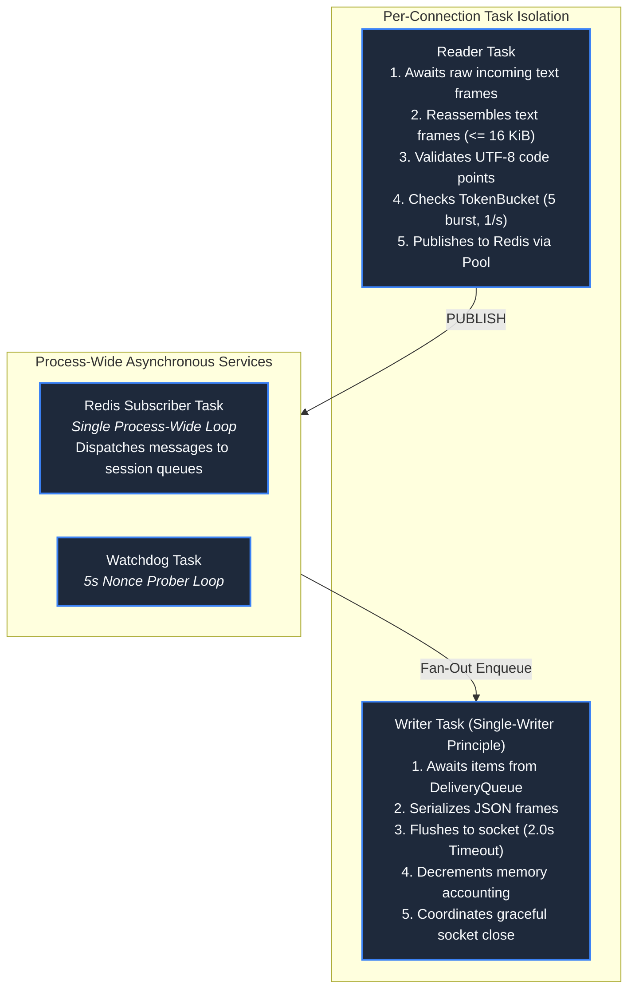
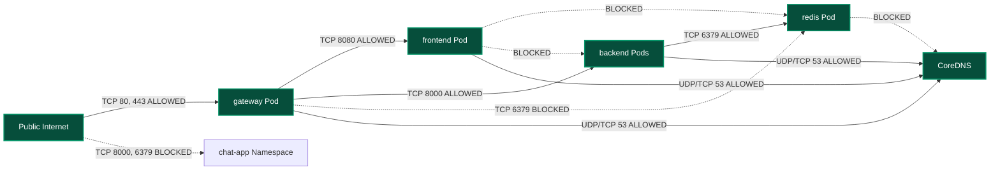

# System Architecture

**Design Revision 5 — 2026-10-26. Status: Production Architecture Specification.** Primary deployment is local k3d and single-node K3s on AWS EC2 (`ap-south-1`). [Kubernetes](KUBERNETES.md) owns cluster configuration and manifests; [API Specification](API_SPECIFICATION.md) owns the wire contracts; [System Design Handbook](design/README.md) governs macro- and micro-architectural invariants.

---

## 1. Architectural Principles & System Invariants

Chat App is engineered as a distributed, event-driven real-time messaging system built on five foundational architectural tenets:

1. **The Single-Writer Pattern:** Each connected WebSocket socket is managed by exactly one dedicated AsyncIO writer task within a single backend replica. Concurrent writes to the transport stream are physically prohibited, guaranteeing that WebSocket frames cannot interleave or corrupt TCP buffers.
2. **Symmetric Distributed Fan-Out:** Backend replicas maintain no direct peer-to-peer communication. All message distribution—including sender echos—traverses an authenticated Redis Pub/Sub bus (`global_chat_channel`). Local and cross-replica delivery paths are functionally identical.
3. **Backpressure-Driven Ingress & Queue Accounting:** Outbound delivery queues strictly bound both event count ($N \le 32$) and byte volume ($B \le 256\text{ KiB}$). A slow network consumer or stalled browser client is deterministically evicted via WebSocket close code `1013` (Try Again Later), isolating neighbor sessions.
4. **Deterministic Two-Phase Session Handshake:** Sockets execute an atomic admission sequence: capacity check $\to$ slot reservation $\to$ transport upgrade $\to$ private unicast `session` envelope dispatch $\to$ broadcast registration $\to$ advisory `system` join publication. Clients cannot receive broadcasts before possessing their session UUID.
5. **Zero-Trust Network Topologies:** Traffic from the public internet terminates exclusively at the Nginx gateway (`:80`, `:443`). Internal backend workloads (`:8000`) and the Redis event broker (`:6379`) are isolated via default-deny Kubernetes `NetworkPolicies`, non-root execution contexts, dropped Linux capabilities, and read-only root filesystems.

---

## 2. Macro Topology & C4 Container Architecture

The system executes four Deployments producing **five steady-state application Pods** inside the `chat-app` namespace, supported by platform daemonsets and CoreDNS:

```mermaid
flowchart TB
    subgraph External["External Network Environment"]
        Client["Browser Client<br/><i>(HTTPS / WSS)</i>"]
        DNS["Public DNS / Route 53"]
    end

    subgraph AWS["AWS Cloud Environment (ap-south-1 Mumbai)"]
        subgraph VPC["VPC 10.0.0.0/16 · Public Subnet 10.0.1.0/24"]
            subgraph EC2["EC2 Node (2 vCPU / 4 GiB · c7i-flex.large candidate)"]
                IGW["Internet Gateway / Public IPv4"]
                
                subgraph IngressLayer["Host Ingress & ServiceLB"]
                    Host80["Host Port TCP :80 (HTTP)"]
                    Host443["Host Port TCP :443 (HTTPS/WSS)"]
                    SLB["K3s ServiceLB DaemonSet<br/><i>[Host Port Proxy]</i>"]
                end

                subgraph K8sNamespace["Kubernetes Namespace: chat-app"]
                    GW_SVC["gateway Service<br/><i>[Type: LoadBalancer]</i><br/>TCP 80, 443"]
                    
                    subgraph GW_POD["gateway Deployment (1 Replica)"]
                        Nginx["Nginx Reverse Proxy<br/><i>TLS Termination & Header Sanitization</i><br/>Port 8080 (HTTP) · Port 8443 (HTTPS)"]
                    end

                    FE_SVC["frontend Service<br/><i>[Type: ClusterIP]</i><br/>TCP 80"]
                    subgraph FE_POD["frontend Deployment (1 Replica)"]
                        FE["Static Asset Server<br/><i>Nginx unprivileged (HTML/CSS/JS)</i><br/>Port 8080"]
                    end

                    BE_SVC["backend Service<br/><i>[Type: ClusterIP]</i><br/>TCP 8000"]
                    subgraph BE_MESH["backend Deployment (2 Replicas)"]
                        BE1["FastAPI Backend Pod 1<br/><i>Uvicorn Single-Worker (asyncio)</i><br/>Port 8000"]
                        BE2["FastAPI Backend Pod 2<br/><i>Uvicorn Single-Worker (asyncio)</i><br/>Port 8000"]
                    end

                    REDIS_SVC["redis Service<br/><i>[Type: ClusterIP]</i><br/>TCP 6379"]
                    subgraph REDIS_POD["redis Deployment (1 Replica)"]
                        Redis["Redis Broker Pod<br/><i>Pub/Sub Engine (ACL-Protected)</i><br/>Port 6379 (Ephemeral in-memory)"]
                    end
                end

                subgraph K3sPlatform["K3s Platform Substrate"]
                    Flannel["Flannel CNI (VXLAN)"]
                    CoreDNS["CoreDNS Server (:53)"]
                    NetPol["NetworkPolicy Engine"]
                end
                
                EBS["20 GiB gp3 Root EBS<br/><i>(Encrypted · OS & K3s datastore)</i>"]
            end
        end
        S3["AWS S3 Bucket<br/><i>(Encrypted Remote Terraform State)</i>"]
    end

    Client -->|HTTPS / WSS :443| Host443
    Client -.->|HTTP :80 Redirect| Host80
    Host80 --> SLB
    Host443 --> SLB
    SLB --> GW_SVC
    GW_SVC --> Nginx

    Nginx -->|GET / (Static Content)| FE_SVC
    FE_SVC --> FE

    Nginx -->|Upgrade /ws/* (WSS)| BE_SVC
    BE_SVC --> BE1
    BE_SVC --> BE2

    BE1 <-->|RESP Pub/Sub TCP :6379| REDIS_SVC
    BE2 <-->|RESP Pub/Sub TCP :6379| REDIS_SVC
    REDIS_SVC <--> Redis

    classDef client fill:#334155,stroke:#94a3b8,stroke-width:1px,color:#f8fafc;
    classDef ingress fill:#1e293b,stroke:#f59e0b,stroke-width:2px,color:#ffffff;
    classDef pod fill:#0f172a,stroke:#3b82f6,stroke-width:2px,color:#f8fafc;
    classDef broker fill:#3b0764,stroke:#a855f7,stroke-width:2px,color:#ffffff;
    class Client,DNS client;
    class Host80,Host443,SLB,GW_SVC ingress;
    class Nginx,FE,BE1,BE2 pod;
    class Redis broker;
```

---

## 3. Ingress Routing & Traffic Management

### 3.1 K3s ServiceLB Host-Port Forwarding
To eliminate recurring AWS Application Load Balancer (ALB) control plane charges (~$25/month), Chat App deploys the **K3s ServiceLB** controller:
* ServiceLB runs a DaemonSet pod that binds directly to the host's physical network interface on ports `80` and `443`.
* Traffic routed through ports `80` and `443` is mapped via kernel iptables rules to the `gateway` Service cluster IP (`10.43.x.x`).
* Port `80` enforces an unconditional 301 redirect to HTTPS (`https://$host$request_uri`).
* Port `443` terminates TLS 1.2/1.3 using a certificate mounted from a Kubernetes Secret.

### 3.2 Gateway WebSocket Proxying
The Nginx gateway implements unbuffered reverse-proxy routing for WebSocket upgrades:
```nginx
location /ws/ {
    proxy_pass http://backend.chat-app.svc.cluster.local:8000;
    proxy_http_version 1.1;
    proxy_set_header Upgrade $http_upgrade;
    proxy_set_header Connection "Upgrade";
    proxy_set_header Host $host;
    proxy_set_header X-Real-IP $remote_addr;
    proxy_set_header X-Forwarded-For $proxy_add_x_forwarded_for;
    proxy_set_header X-Forwarded-Proto $scheme;
    proxy_read_timeout 3600s;
    proxy_send_timeout 3600s;
    proxy_buffering off;
}
```

---

## 4. Concurrency & Asynchronous Task Architecture

Each FastAPI backend replica operates as a single Uvicorn process executing on Python 3.12 AsyncIO. For every admitted WebSocket connection, the backend allocates **exactly two cooperative tasks**:



---

## 5. End-to-End Hop-by-Hop Latency Budget

To satisfy **NFR-01** (p95 latency $< 250\text{ ms}$, p99 $< 1000\text{ ms}$ under baseline load of 25 clients, 5 msg/s), latency is budgeted across physical and logical execution hops:

| Processing Hop | Execution Context | P50 Budget | P95 Budget | P99 Limit | Failure Modes & Mitigations |
| :--- | :--- | :--- | :--- | :--- | :--- |
| **1. Browser Egress & WAN** | Public Internet to EC2 Gateway | 25 ms | 45 ms | 150 ms | Network packet loss. Mitigation: TCP BBR congestion control. |
| **2. Gateway Routing (Nginx)** | Host network to Pod via Flannel | 2 ms | 7 ms | 15 ms | CPU throttling. Mitigation: Explicit CPU request (50m) and unbuffered proxying. |
| **3. Backend Admission & Validation** | Uvicorn ASGI parse & Pydantic | 3 ms | 8 ms | 20 ms | Event loop lag. Mitigation: Single worker per container; no synchronous blocking I/O. |
| **4. Redis Publish & Broker Dispatch** | Loopback TCP via ClusterIP to Redis | 2 ms | 8 ms | 15 ms | Output buffer saturation. Mitigation: `client-output-buffer-limit pubsub 32mb 8mb 60`. |
| **5. Subscriber Delivery to Replicas** | Redis subscriber callback execution | 3 ms | 8 ms | 20 ms | Broker queue lag. Mitigation: In-memory ephemeral operation; zero disk writes. |
| **6. AsyncIO Local Queue Enqueue** | Memory copy to session deques | 1 ms | 5 ms | 15 ms | Queue lock contention. Mitigation: Lock-free deque insertion with atomic length check. |
| **7. WebSocket Frame Transmission** | Single-writer task socket flush | 4 ms | 10 ms | 35 ms | Slow network consumer. Mitigation: 2.0s send timeout with eviction close code `1013`. |
| **8. Gateway Egress to Browser** | Flannel overlay to WAN egress | 20 ms | 39 ms | 125 ms | Client TCP window stall. Mitigation: Bounded queue drop policy. |
| **Total Cumulative Latency** | **End-to-End Delivery** | **60 ms** | **130 ms** | **395 ms** | **Well within NFR-01 thresholds (p95 < 250ms, p99 < 1000ms)** |

---

## 6. Zero-Trust Network Policy Matrix

All inter-pod traffic is restricted via Kubernetes `NetworkPolicies`. Default-deny is enforced cluster-wide:



---

## 7. Component Failure Modes & Recovery Matrix (FMEA)

| Failure Scenario | Detection Mechanism | Immediate User Impact | Automated Recovery Action | MTTR Target | Data Loss Boundary |
| :--- | :--- | :--- | :--- | :--- | :--- |
| **Backend Pod Crash** | Kubelet liveness probe failure. | Clients on that Pod disconnect. | Kubernetes restarts Pod via Deployment controller. Surviving Pod serves reconnections. | $< 10\text{s}$ | In-flight unacknowledged frames discarded; client retries. |
| **Gateway Pod Crash** | Kubelet liveness failure. | Sockets severed; HTTP unavailable. | Kubernetes restarts gateway Pod. Clients enter backoff retry loop. | $< 8\text{s}$ | Sockets dropped; client reconnects. |
| **Redis Broker Crash** | Watchdog nonce timeout $> 10\text{s}$. | Backends transition to `DEGRADED`. | Readiness 503; ServiceLB removes Pods; sockets closed `1011`. Redis restarts; backends reconnect. | $< 15\text{s}$ | In-flight broadcast messages lost. No durable data exists. |
| **Host Node Loss** | AWS EC2 hardware failure. | Complete cluster outage. | Terraform re-provisioning or EC2 Auto-Recovery. K3s bootstrap from cloud-init. | $< 5\text{m}$ | Total session loss. Infrastructure restored from S3 state. |
