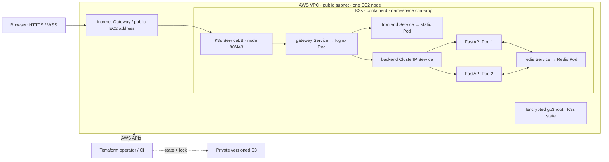

# System Architecture

**Design revision 5 — 2026-10-26. Status: design only.** Primary deployment is local k3d and single-node K3s on AWS. [Kubernetes](KUBERNETES.md) owns cluster configuration; [API](API_SPECIFICATION.md) owns the wire contract.

## Topology

Four Deployments create five steady-state application Pods. Platform Pods are additional. ServiceLB runs on the node; no managed AWS load balancer is involved. Redis is reachable only from backends under the proposed NetworkPolicies. Port 8000 is cluster-private. S3 is outside the message path.

A two-backend topology demonstrates distributed fan-out. Node, disk, gateway and Redis are single points of failure. A stopped EC2 node stops the entire application.

## Request and session lifecycle

1. Browser loads static assets through the TLS gateway and selects an anonymous display name.
2. It connects to `/ws/{username}` with subprotocol `chat.v1`.
3. Gateway forwards the upgrade to the backend Service. Only ready backend endpoints receive new connections.
4. Backend checks origin, username, dependency readiness and capacity; reserves admission before accepting.
5. One writer emits a private `session` event first. No Redis broadcast may overtake it.
6. After session initialization, a join event is published. The browser enables sending only after validating the session.
7. Accepted client text is normalized, bounded and wrapped in a server event before publication.
8. Every backend consumes Redis events and enqueues them to local clients. The publisher does not also echo locally.

Display names are not authentication. The session UUID identifies this socket, but broadcast events do not include a sender connection UUID; the UI must not infer verified ownership from a matching name.

## State ownership

| State | Owner | Lifetime / loss behavior |
| --- | --- | --- |
| Draft, view state, up to 500 rendered events | Browser tab | Draft preserved on reconnect; missed events cannot be recovered. |
| Socket identity, queue, writer, rate bucket | One backend process | Lost on process exit; rebuilt on a new session. |
| Publisher budget and connection pool | One backend process | Local resource limits, not global tenant quotas. |
| Broadcast stream | Redis Pub/Sub | No persistence, acknowledgment or historical replay. |
| Kubernetes desired state and Secrets | K3s datastore | Separate from message data; protected and recoverable through platform procedures. |
| Infrastructure state | Private S3 backend | Sensitive metadata; versioned and independently protected. |

## Backend concurrency

Each Pod runs one Uvicorn worker. A process owns a subscriber supervisor, publisher pool and session registry. A session owns receive and writer tasks plus a bounded outbound queue. The subscriber enqueues without waiting for socket writes.

Queue bounds apply to both event count and encoded bytes. On overflow or a send timeout, close the affected session with 1013 and release accounting exactly once. Cancellation and cleanup must be idempotent across disconnect, timeout, drain and dependency failure.

Publisher timeouts can have ambiguous outcomes. Do not blindly retry and duplicate an event. Redis Pub/Sub is at-most-once; the healthy test target is a measurement, not a delivery guarantee during faults.

## Health and termination

`/live` checks event-loop responsiveness. `/health` checks publisher connectivity, acknowledged subscription, subscriber heartbeat freshness and drain state. Send nonce-tagged subscriber probes every 5s; fail readiness after 10s staleness. A successful publisher PING does not establish subscriber health.

On dependency failure, reject new sessions and terminate affected sockets with 1011. Reconnect the subscriber using bounded backoff and a fresh generation nonce; restore readiness only after the new subscription and probe are confirmed.

On planned termination, stop admission and fail readiness, then close active sockets with 1012 and drain within 10s. Complete cleanup within the 20s Pod grace, including any preStop hook. Verify signal ordering with the selected server implementation. Endpoint removal can race with connection attempts; clients must handle failed handshakes.

## Network and trust boundaries

- Public: gateway HTTPS/WSS; HTTP only for redirect or a deliberate certificate challenge arrangement.
- Cluster: gateway to frontend/backend, backends to Redis, required DNS and authorized diagnostics.
- Administration: restricted SSH and node-local kubectl; no public API, Redis or backend ports.
- Release: verified digests/configuration from GHCR and a signed release bundle; namespace-scoped deployer.
- Secrets: mounted files, encryption at rest and restricted access. Kubernetes manifests in Git contain references, not credentials.

Nginx uses Service DNS/ClusterIPs; Kubernetes updates backend endpoints as Pods change. Do not carry forward Docker's `127.0.0.11` resolver or bridge-network names. Recreating a Service can change its ClusterIP and requires gateway resolution/reload verification.

## Failure expectations

| Failure | Expected behavior | Limitation |
| --- | --- | --- |
| One backend removed | Remaining ready Pod serves new sessions; affected clients retry. | Existing sockets on the removed Pod are lost. |
| Redis lost | Readiness fails; sessions close; subscriber recovers after restoration. | Events during outage are lost. |
| Slow browser | Its writer/queue is bounded and disconnected. | Host-level congestion can still affect peers. |
| Gateway restarted | Connections reconnect after gateway returns. | Singleton gateway has an interruption. |
| Node lost | Rebuild infrastructure/platform and deploy verified release. | No automatic cross-node failover. |
| Bad release | Restore complete prior bundle and verify messaging. | Rollback is a sequence, not a multi-resource atomic transaction. |

## Acceptance boundary

Validate the 25-client, 5-message/s experiment and recovery objectives in [requirements](REQUIREMENTS.md). Collect node and Pod measurements, including rollout peaks. [Testing](TESTING.md), [deployment](DEPLOYMENT.md) and [operations](OPERATIONS.md) define the evidence needed before claiming success.

## Detailed design and future changes

The [system design handbook](design/README.md) collects HLD, LLD, sequence diagrams, data/protocol considerations, capacity planning and staged architecture upgrades. Use its migration playbook and proposal/ADR templates before changing the selected topology or introducing new product contracts.

