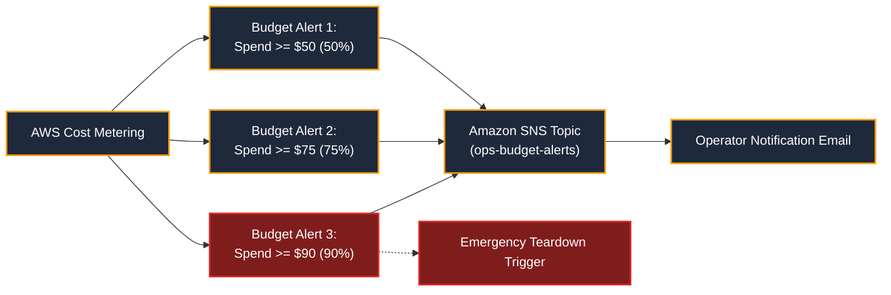

# AWS Free Tier & $100 Credit Budget Governance

**Design Revision 5 — 2026-10-26. Status: Financial & Cloud Governance Specification.** This document provides the mathematical budget formulations, itemized cloud cost ledgers, automated billing alerts, and teardown verification protocols for Baatchit on AWS.

---

## 1. Credit Policy & Entitlement Framework

AWS provides eligible new accounts with an initial promotional credit allocation of **$100.00** (with potential promotional milestone credits up to another $100.00). The Baatchit infrastructure is strictly budgeted against the primary **$100.00 ceiling**.

### Governance Principles
1. **Gross Spend vs Credit Offsets:** All cost models calculate **gross AWS on-demand charges**. Credits offset billable line items at month-end, but gross spend must remain strictly within the allocation.
2. **Mandatory Contingency Reserve:** To guard against regional pricing fluctuations, EBS snapshot charges, and delayed billing meter ingestion, a **$20.00 contingency reserve** is locked. Net usable demonstration funds cannot exceed **$80.00**.
3. **Zero Billed Out-of-Pocket Target:** If the active account balance is insufficient or credit eligibility expires, deployment to AWS is immediately halted; development reverts to local `k3d`.

---

## 2. Itemized Cloud Cost Ledger (Mumbai `ap-south-1`)

The baseline infrastructure operates a single-node K3s cluster. Monthly gross charges are itemized as follows:

| Resource Item | Specification / Dimension | Unit Rate (ap-south-1) | Quantity / Hours | Gross Monthly Cost | Credit Status |
| :--- | :--- | :--- | :--- | :--- | :--- |
| **EC2 Compute** | `c7i-flex.large` (2 vCPU / 4 GiB) | \$0.0476 / hr | 720 hours | \$34.27 | Eligible Free Tier / Credit |
| **Root EBS Volume** | 20 GiB gp3 General Purpose SSD | \$0.096 / GB-month | 20 GiB-month | \$1.92 | Credit Offset |
| **Public IPv4** | In-use public IPv4 address | \$0.005 / address-hr | 720 hours | \$3.60 | Credit Offset |
| **Data Egress** | Public internet egress transfer | Free up to 100 GB | $< 5\text{ GB}$ (Demo) | \$0.00 | Free Tier Tier 1 |
| **S3 Storage & Locks**| State bucket & native lockfile | \$0.025 / GB-month | $< 0.1\text{ GB}$ | \$0.01 | Free Tier Tier 1 |
| **Total Monthly Gross**| — | — | — | **\$39.79** | **Fully Covered ($40.21 buffer)** |

---

## 3. Mathematical Budget Duration Formulation

Let:
* $B_{\text{avail}}$: Actual verified credit balance in the target AWS account.
* $C_{\text{ceiling}} = \min(B_{\text{avail}}, \$100.00)$.
* $R_{\text{reserve}} = \$20.00$ (Non-negotiable buffer).
* $U_{\text{usable}} = \max(0, C_{\text{ceiling}} - R_{\text{reserve}})$.
* $R_{\text{hourly}} = \frac{\$39.79}{720\text{ hours}} \approx \$0.05526\text{ per hour}$.

The maximum authorized continuous running duration ($H_{\text{max}}$) is computed as:

$$H_{\text{max}} = \frac{U_{\text{usable}}}{R_{\text{hourly}}} = \frac{\$80.00}{\$0.05526/\text{hr}} \approx 1,447\text{ hours } (\approx 60.3\text{ days})$$

**Operational Directive:** Because the demonstration requires only active verification windows (typically 2 to 4 hours per run), the $80 usable credit provides more than 300 independent deployment rehearsals.

---

## 4. Automated AWS Budgets & Alerting Architecture

To prevent runaway billing from unexpected workloads or forgotten instances, Terraform configures three AWS Budget alerts linked to Amazon SNS email notifications:



* **Alert Tier 1 (50% / $50.00):** Informational status report; verifies steady-state burn rate.
* **Alert Tier 2 (75% / $75.00):** Escalated warning; requires operator review of active tests and teardown schedule.
* **Alert Tier 3 (90% / $90.00):** Critical alarm; triggers immediate mandatory execution of `terraform destroy`.

---

## 5. Pre-Provisioning Verification Checklist

Before running `terraform apply` on AWS, the operator must complete and record this verification gate:

- [ ] Verify active account credit balance in AWS Billing Console $\ge \$100.00$.
- [ ] Confirm AWS Region is set to `ap-south-1` (Mumbai).
- [ ] Verify `c7i-flex.large` instance launch quota $> 0$ in region.
- [ ] Ensure Multi-Factor Authentication (MFA) is active on the deploying IAM identity.
- [ ] Confirm no existing billable orphaned Elastic IPs, NAT Gateways, or unattached EBS volumes exist.
- [ ] Configure `terraform.tfvars` with specific authorized administrator CIDR (`/32` or `/24`).
- [ ] Set calendar reminder for scheduled teardown within 4 hours of launch.

---

## 6. Post-Demonstration Teardown & Billing Verification Protocol

1. **Execute Infrastructure Teardown:**
   ```bash
   cd infra/workload && terraform destroy -auto-approve
   ```
2. **Audit Residual AWS Resources:**
   ```bash
   # Confirm 0 running EC2 instances
   aws ec2 describe-instances --region ap-south-1 \
     --filters "Name=instance-state-name,Values=running,pending" \
     --query "Reservations[].Instances[].InstanceId"

   # Confirm 0 unattached EBS volumes
   aws ec2 describe-volumes --region ap-south-1 \
     --filters "Name=status,Values=available" \
     --query "Volumes[].VolumeId"

   # Confirm 0 Elastic IPs
   aws ec2 describe-addresses --region ap-south-1 --query "Addresses[].PublicIp"
   ```
3. **Billing Reconciliation:** Re-inspect the AWS Billing Console 24 hours post-teardown to verify that all usage meters have dropped to zero and credits have offset gross charges.
