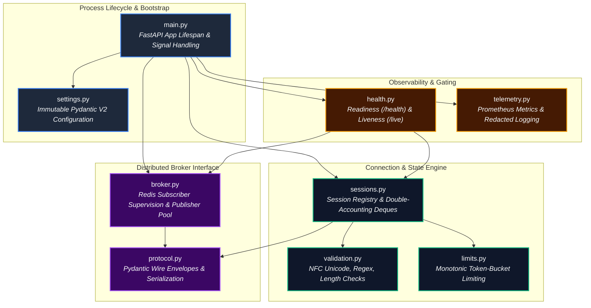
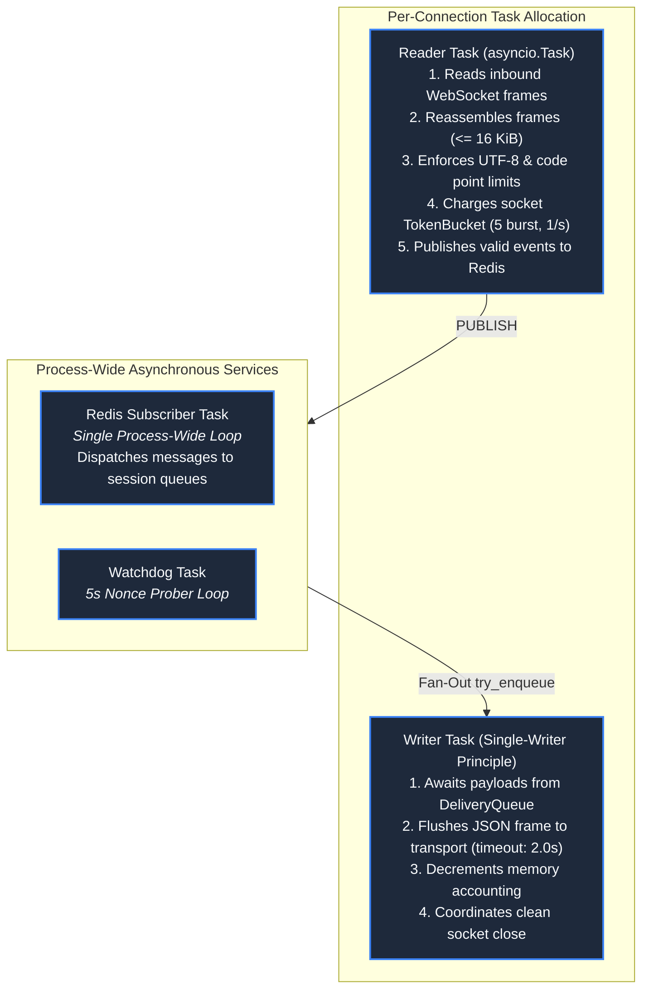
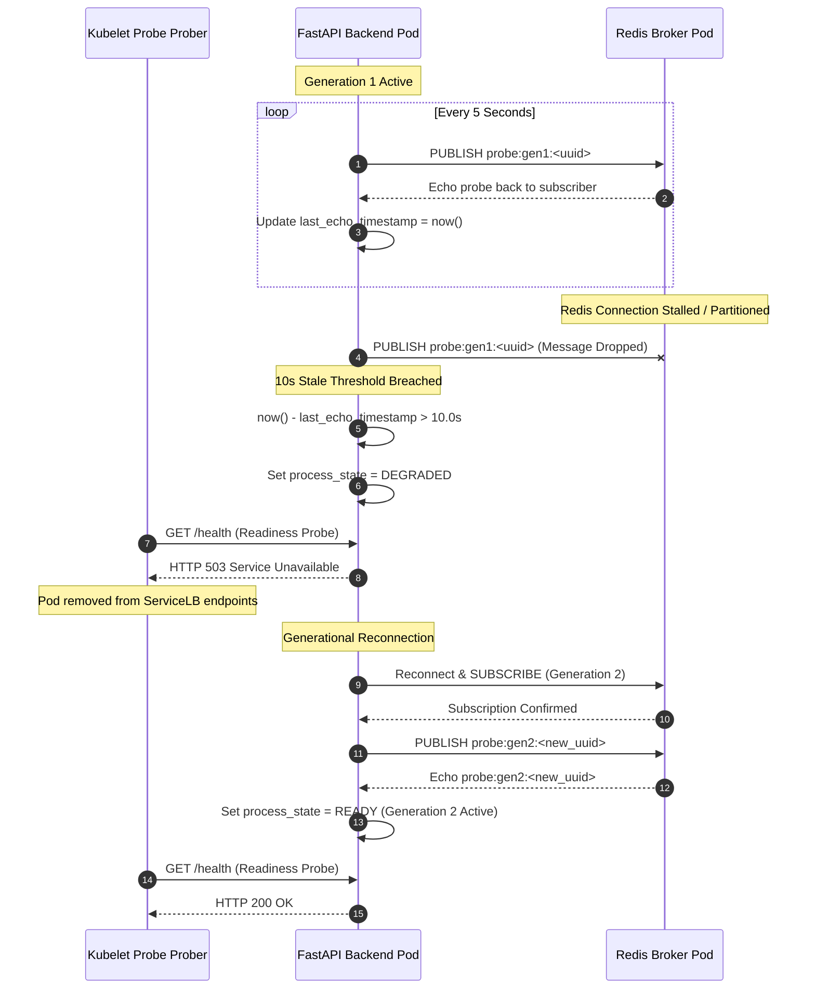
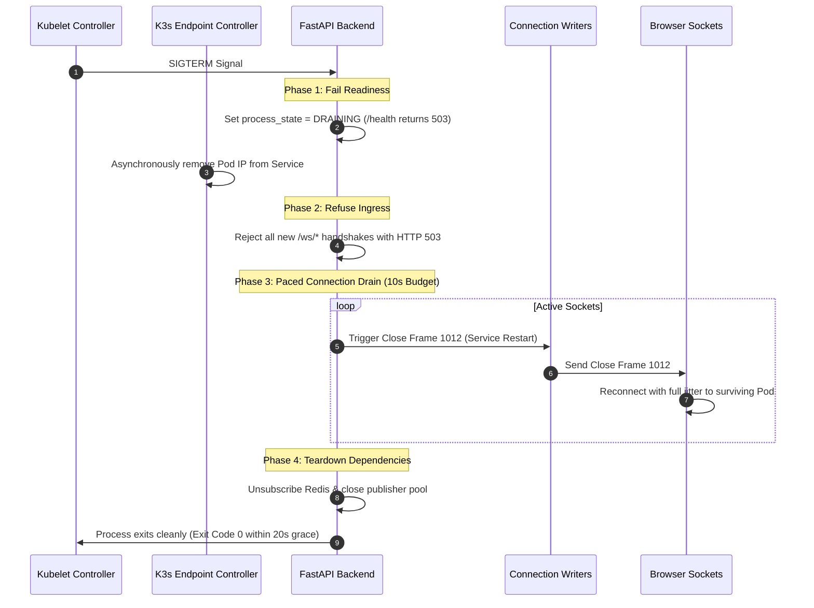

# Backend Technology, Concurrency & Engineering Guide

**Design Revision 5 — 2026-10-26. Status: Production Architecture Specification.** This document provides the engineering specifications for the Python 3.12 / FastAPI backend runtime, AsyncIO concurrency models, Redis Pub/Sub supervision, backpressure mechanics, and graceful shutdown lifecycle for Chat App.

---

## 1. Backend Architecture & Modular Decomposition

The backend service runs on Python 3.12 using FastAPI and Uvicorn. To eliminate hidden global state and ensure testability, all components are initialized via FastAPI's `lifespan` manager and explicitly injected into the application state:



---

## 2. Asynchronous Concurrency & Task Topology

For each accepted WebSocket connection, the backend allocates **exactly two cooperative AsyncIO tasks**, enforcing the Single-Writer Principle:



### Invariant Rules
1. **The Single-Writer Principle:** The `Reader Task` is strictly forbidden from writing to the raw WebSocket stream (including ping/pong control frames). All network transmissions flow through the dedicated `Writer Task`.
2. **Unbuffered Dispatch:** The `Redis Subscriber Task` iterates across active sessions and invokes `try_enqueue()`. It never awaits I/O or network flushes, guaranteeing that slow consumers cannot delay broadcast distribution to healthy peers.

---

## 3. Double-Accounting Delivery Queue Mechanics

To isolate slow consumers and guarantee that memory remains bounded under network congestion, each session owns a private `DeliveryQueue` enforcing strict **double accounting**:

$$\text{len}(Q) \le 32 \quad \text{AND} \quad \sum_{e \in Q} \text{len}(e.\text{payload\_bytes}) \le 262,144 \text{ bytes } (256\text{ KiB})$$

```python
from collections import deque
from dataclasses import dataclass

@dataclass(slots=True)
class DeliveryQueue:
    max_items: int = 32
    max_bytes: int = 262_144
    items: deque = deque()
    current_bytes: int = 0
    closed: bool = False

    def try_enqueue(self, payload: bytes) -> bool:
        if self.closed:
            return False
        size = len(payload)
        if len(self.items) >= self.max_items or (self.current_bytes + size) > self.max_bytes:
            return False  # Queue saturated: slow consumer detected
        self.items.append(payload)
        self.current_bytes += size
        return True

    def pop_left(self) -> bytes | None:
        if not self.items:
            return None
        payload = self.items.popleft()
        self.current_bytes -= len(payload)
        return payload
```

* **Eviction Policy:** When `try_enqueue()` returns `False` or a socket write times out ($> 2.0\text{s}$), the backend terminates the socket with close code `1013` (Try Again Later) and purges all queued bytes from process memory.

---

## 4. Redis Pub/Sub Supervision & Generational Heartbeat Probing

To guarantee subscriber liveliness and detect silent network partitions, the backend executes a background watchdog prober:



---

## 5. Graceful Drain & Kubernetes Lifecycle Timeline

When the container receives `SIGTERM` from the Kubelet during a rolling deployment, the backend coordinates a multi-stage graceful shutdown:



---

## 6. Observability & Low-Cardinality Prometheus Metrics

Metrics are exposed at `GET /metrics` in standard OpenMetrics exposition format. Metric labels are strictly bounded to prevent high-cardinality memory leaks:

| Metric Name | Type | Labels | Description |
| :--- | :--- | :--- | :--- |
| `chat_connections_active` | Gauge | `replica_id` | Current number of active admitted client WebSocket connections. |
| `chat_messages_published_total` | Counter | `replica_id`, `status` (`ok`, `timeout`, `rate_limited`) | Total messages published to Redis bus. |
| `chat_deliveries_total` | Counter | `replica_id`, `status` (`sent`, `queue_overflow`, `timeout`) | Total outbound frames flushed to local client sockets. |
| `chat_outbound_queue_bytes` | Gauge | `replica_id` | Total memory bytes currently queued across all client queues. |
| `chat_heartbeat_latency_seconds` | Histogram | `replica_id` | End-to-end round-trip latency of generational watchdog nonces. |
