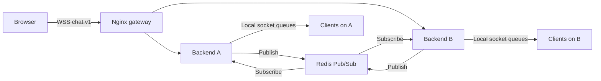

# Backend Technology and Engineering Guide

**Status:** Specification for future implementation; no backend, tests or deployment have been implemented. Created 2026-10-26.

This guide consolidates backend technologies, service boundaries, protocol handling, data flow, concurrency, validation, security, observability and delivery requirements. Read it with the [frontend guide](FRONTEND.md). It describes an anonymous, single-room demonstration on one host; two replicas do not provide host-level high availability.

## 1. Responsibilities and Boundaries

Each backend accepts browser WebSockets through the gateway, validates connection/message policy, publishes normalized events to Redis and delivers subscribed events to its own connected clients. Each replica owns only its local sessions, rate budgets, tasks and delivery queues. Redis provides shared live fan-out.

There is no user database, login service, message-history API, durable queue or presence database in the baseline. Display names are not authenticated identities. Adding accounts, rooms, uploads, moderation storage or durable history requires new security, API, storage and migration designs.

## 2. Technology Stack

| Technology | Role | Implementation requirement |
| --- | --- | --- |
| Python | Backend runtime | Use a supported, reviewed Python release compatible with the selected dependencies; current design targets Python 3.11+. |
| FastAPI | ASGI application and routes | App factory/lifespan ownership, HTTP health routes and WebSocket admission. |
| Starlette | Underlying ASGI/WebSocket behavior | Verify handshake denial and close behavior with the actual Uvicorn transport. |
| Uvicorn | ASGI server | One worker per backend container; two separately addressable containers. |
| Pydantic / pydantic-settings | Event models and startup settings | Strict field/range validation; fail startup on unsafe public configuration. |
| `redis.asyncio` / redis-py | Redis publisher and dedicated subscriber connections | Bounded pools, timeouts, authentication and explicit cleanup. |
| Redis | Ephemeral shared Pub/Sub bus | Disable RDB/AOF persistence; restrict channels and commands through ACLs. |
| `hiredis` | Optional accelerated Redis parsing | Retain only if compatible and useful in measured tests. |
| Structured logging / metrics client | Operational evidence | Redacted JSON logs and bounded-cardinality private metrics. |
| pytest, pytest-asyncio, HTTPX, Hypothesis | Unit, HTTP, property and lifecycle checks | Execute tests in the project's containerized harness; use real Redis for integration. |
| Docker, Compose and Nginx gateway | Packaging, replicas and ingress | Reviewed image locks, private backend port, limits and WebSocket proxying. |

See [technologies](TECHNOLOGIES.md) for earlier candidate pins. No lockfile or compatibility run exists yet; resolve FastAPI/Starlette/Uvicorn/transport versions together and recheck supported patches before implementation. The metrics, property-test and browser-test packages still need explicit dependency selection and locks.

Use FastAPI's lifespan context to own shared resources and shutdown, as described in the [official lifespan documentation](https://fastapi.tiangolo.com/advanced/events/).

## 3. Integration Architecture

The backend listens on container port 8000 and joins both `edge_network` and `data_network`. Redis listens on 6379 only within the internal data network; gateway and frontend do not join that network. The gateway alone publishes application ports 80/443 on the host.

A WebSocket remains attached to its selected backend until it closes. Redis removes the need to deliver all senders to the same replica; it does not migrate an open socket. Reconnection establishes a new session and may select either replica. No sticky-session dependency is needed for the baseline.

## 4. Routes and Event Contracts

| Interface | Exposure | Responsibility |
| --- | --- | --- |
| `GET /health` | Gateway/public and internal | 200 only while dependency-aware readiness is satisfied; otherwise 503. |
| `GET /live` | Internal; gateway denies public access | Event-loop liveness independent of Redis. |
| `GET /metrics` | Internal; gateway denies public access | Scrapeable operational measurements. |
| `/ws/{username}` | Public through gateway | Mandatory `chat.v1`, origin validation, admission and live text messaging. |

The gateway/frontend serves `/` and `/assets/*`; those are not backend HTML routes. No REST create/list-message routes are part of the baseline.

| Event | Source and destination | Required fields |
| --- | --- | --- |
| `session` | Serving backend directly to the new local connection | `schema_version`, `type`, `connection_id`, `container_id`, `user`, `sent_at`. |
| `chat` | Backend → Redis → all subscribed backends → local sockets | `schema_version`, `event_id`, `sent_at`, `type`, `user`, `text`, `container_id`, `time`. |
| `system` | Backend → Redis → local sockets across replicas | Same broadcast fields, with `type: system`; advisory join/leave text. |

Clients send raw plain text. The server assigns UUIDv4 event IDs, UTC timestamps and replica identity; clients cannot submit trusted envelope fields. `time` is derived from the same timestamp as `sent_at`. A `session` event is private to one connection and never enters Redis.

The [API specification](API_SPECIFICATION.md) owns exact schemas, frame/field validation and denial/close codes. Keep shared fixtures and the future `schemas/events-v1.schema.json` consistent with it rather than maintaining an independent schema in this guide.

## 5. Planned Modules and State Ownership

| Planned module | Owned responsibility |
| --- | --- |
| `backend/app/main.py` | Construct FastAPI app, register routes and wire dependencies. |
| `settings.py` | Parse startup settings, secret-file references and relational constraints. |
| `protocol.py` | Normalize input, validate names, build/validate typed envelopes and serialize events. |
| `lifecycle.py` | STARTING/READY/DEGRADED/DRAINING state, dependency supervision and cleanup. |
| `limits.py` | Monotonic token buckets, admission reservations and bounded accounting. |
| `manager.py` | Local session registry, per-client queues, writers and idempotent disconnect. |
| `messaging.py` | Publisher pool, subscriber generation, reconnect and heartbeat handling. |
| `observability.py` | Redacted logging and metrics with bounded label sets. |

Keep these layers independently testable. Routes orchestrate validation and session work; they do not embed Redis retry loops or manipulate arbitrary metrics globals. Inject Redis adapters, monotonic clocks and UUID/time providers where deterministic tests require them.

One connection owns one admission reservation, a UUID, immutable display name, reader/writer tasks and a bounded outbound queue. Release the reservation exactly once regardless of whether admission fails, session sending fails, transport disconnects or shutdown cancels work.

## 6. Connection and Message Lifecycle

1. **Validate admission:** Require `chat.v1`, allowlisted Origin, a valid ASCII username, healthy dependency state and available local capacity before upgrade. Do not hold an event-loop lock across network I/O.
2. **Reserve capacity:** Account for concurrent handshakes atomically so the replica limit cannot be oversubscribed.
3. **Establish session:** Accept with `chat.v1`, create the writer and send the private `session` event first. Gate broadcast eligibility until that first write completes.
4. **Publish advisory join:** After session setup and subscriber readiness, publish a system event through Redis. Join/leave messages are best effort, not an authoritative occupancy ledger.
5. **Receive text:** Charge the socket budget, enforce transport limits, normalize and validate text, then charge the replica publication budget as specified.
6. **Create and publish one event:** Serialize an event once and publish with a command timeout. Do not also insert it directly into local client queues.
7. **Consume and fan out:** Each subscriber validates broadcasts and enqueues them to its local sessions. The sender receives its own message through this same Redis path.
8. **Write independently:** Each connection's sole writer drains its queue with bounded send time. The subscriber never waits for a slow socket write.
9. **Disconnect and clean up:** Cancel/await child tasks, unregister the session, clear accounting and attempt advisory leave only within a bounded cleanup budget.

FastAPI's WebSocket denial behavior depends on the negotiated ASGI server extensions. Validate the selected server/transport combination with real pre-upgrade tests; do not infer support from framework version numbers alone. The browser UI may only observe a generic failure rather than the denial response body.

## 7. Input Validation and Abuse Controls

- Username: match `^[A-Za-z0-9_-]{1,32}$`; reject path/encoding tricks using the API's lexical policy.
- Transport: text only; enforce the 16,384-byte limit on the fully reassembled inbound message, including fragmented traffic. Reject binary input with `1003`.
- Normalize CRLF and standalone CR to LF, then trim boundary space, tab, CR and LF only. Do not silently apply additional Unicode compatibility normalization.
- Reject forbidden ASCII C0 controls except tab/newline, and DEL. Validate 1–2,000 Unicode code points after normalization. A normalized empty frame is ignored but still charged to the socket limiter.
- Bound all parsers, queues and command waits. Do not retry a failed publish indefinitely or accept unbounded publisher backlog.
- Apply origin and handshake limits in addition to per-socket limits. Opening new sockets can reset socket-local budgets; these controls do not establish per-person identity or an account-level abuse defense.
- Use policy-specific close handling from the API, including `1008` for policy violations, `1009` for transport oversize, `1013` for temporary resource/rate pressure and `1011` for dependency/internal failure.

Public-mode configuration requires secret-file Redis credentials and a precise origin allowlist. Validate missing, malformed and `null` origins according to the explicit environment policy; do not rely on HTTP CORS middleware to protect a WebSocket handshake. Origin checks reduce unwanted browser connections but do not authenticate non-browser clients.

## 8. Configuration and Candidate Limits

The [configuration reference](CONFIGURATION.md) owns environment-variable names, allowed ranges and defaults. Validate configuration once at startup rather than changing limits while sessions are active.

| Setting or limit | Current candidate value | Engineering implication |
| --- | --- | --- |
| Backend replicas / workers | 2 replicas, 1 worker each | Independent local registries and rate budgets. |
| `MAX_CONNECTIONS_PER_REPLICA` | 64 | Admission ceiling, not a demonstrated capacity result. |
| `RATE_MESSAGES_PER_SECOND` / `RATE_BURST` | 2 / 5 | Per-socket token bucket; use a monotonic clock. |
| `PUBLISH_RATE_PER_SECOND` / `PUBLISH_BURST` | 20 / 40 | Per-replica shared budget, not one global Redis-enforced limiter. |
| `OUTBOUND_QUEUE_EVENTS` / `OUTBOUND_QUEUE_BYTES` | 32 / 262144 | Enforce both limits, including correct byte release on dequeue/cancellation. |
| `SEND_TIMEOUT_SECONDS` | 2 seconds | Disconnect a slow consumer without blocking peers. |
| `REDIS_COMMAND_TIMEOUT_SECONDS` | 1 second | Bound publication/readiness waits. |
| `SUBSCRIBER_HEARTBEAT_SECONDS` / `SUBSCRIBER_STALE_SECONDS` | 5 / 10 seconds | Require heartbeat interval below stale threshold; account for command/probe delays. |
| `SHUTDOWN_DRAIN_SECONDS` / container stop grace | 10 / 20 seconds | Allow cleanup before forced termination. |
| Backend container memory | 192 MiB each | Candidate deployment cap; measure real RSS, buffers and OOM behavior. |
| Redis container memory | 64 MiB | Includes Redis overhead and client buffers; `maxmemory` is not a process RSS cap. |

Also validate `APP_ENV`, `RELEASE_ID`, `ALLOWED_ORIGINS`, `CHANNEL_NAME` and the environment-appropriate Redis credential source. Never print the resolved Redis URI. Choose and document an explicit publisher pool limit and transport buffering/ping configuration before implementation; do not inherit unreviewed library defaults.

The aggregate proposed application-container caps sum to 528 MiB. This arithmetic does not guarantee host memory headroom: kernel, Docker, Redis buffers, connection overhead, image extraction and deployment activity must be measured.

## 9. Redis Semantics, Readiness and Recovery

Redis Pub/Sub is at-most-once and does not replay messages missed while a subscriber is disconnected. A successful `PUBLISH` or its subscriber count does not acknowledge delivery to every browser. Do not retry a publication after an ambiguous timeout unless an explicit deduplication contract is introduced. See [Redis Pub/Sub delivery semantics](https://redis.io/docs/latest/develop/pubsub/).

Use a bounded publisher pool and a separate subscription connection. Enter READY only after subscription acknowledgement and a probe proving that the current subscriber generation can consume events. Publisher PING alone is insufficient: a live publisher can coexist with a stalled subscriber.

Heartbeat probes must have a distinguishable, bounded internal format and must never be delivered as user chat. Assign a new generation on subscriber replacement, and discard stale acknowledgements. Choose and document the heartbeat channel/payload and corresponding ACL permissions before coding; the current event schema covers public envelopes rather than this internal control format.

On dependency failure, mark readiness false, stop new admissions and apply the documented active-socket policy. Reconnect Redis with bounded exponential delay and jitter, closing obsolete resources each time. Return to READY only after current-generation subscription/probe success. Do not manufacture history, joins or successful deliveries to conceal a gap.

## 10. Backpressure, Concurrency and Shutdown

Only the per-session writer sends data frames. Route the initial session write through that owner too; prevent broadcasts from overtaking it. Reader and subscriber code enqueue bounded work rather than competing for socket writes.

Queue admission must check event count and serialized UTF-8 byte count together. On overflow or a send timeout, stop accepting work for that client and disconnect it with `1013`. Ensure the closing path cannot leave a blocked writer, leaked slot or retained large queue. Shared-event references may reduce copying, but each client's byte budget still accounts for its delivery obligation.

On SIGTERM, transition to DRAINING, return readiness 503 and reject fresh admission. Close existing sockets with `1012` within the drain budget, cancel/await session tasks, close Redis subscriber/publisher resources, and stop background supervision before the container grace window ends. Cleanup must be bounded and idempotent; do not shield it indefinitely from cancellation.

An open-source Nginx upstream does not automatically become an active `/health` polling load balancer merely because the route exists. Keep backend admission self-protecting and test the selected passive failure/routing strategy during replacement. Avoid promising that an existing WebSocket can be transparently handed to another replica. See [Nginx passive and active health checks](https://docs.nginx.com/nginx/admin-guide/load-balancer/http-health-check/).

## 11. Security and Privacy

| Boundary | Required control |
| --- | --- |
| Browser → gateway | HTTPS/WSS for public use, reviewed headers and handshake limits. |
| Gateway → backend | Private container routing; overwrite forwarding headers and restrict trusted proxy handling. |
| Backend → Redis | Secret-mounted credentials, minimal ACL commands and allowed Pub/Sub channels. |
| Container → host | Non-root runtime, read-only filesystem where feasible, dropped capabilities, no Docker socket and bounded writable paths. |
| Build → deployment | Reviewed dependency locks, scanned digest-pinned images and release verification. |
| App → logs/metrics | No message bodies, credentials, full username-bearing request paths or unbounded per-user labels. |

Redis ACL channel patterns are distinct from key patterns. Review the current illustrative ACL against the selected Redis version before use; grant only the exact channel pattern and commands needed for publication, subscription and probes. See [Redis ACL rules](https://redis.io/docs/latest/operate/oss_and_stack/management/security/acl/). Replace example passwords with generated secrets. Also leave sufficient process headroom below the Redis cgroup cap rather than assuming `maxmemory 64mb` fits inside a 64 MiB container.

TLS transport protection does not provide end-to-end message encryption or verified user identity. Follow the [security guide](SECURITY.md) for secret rotation, release signing and incident response.

## 12. Observability and Operational Experience

Expose connection, accepted/rejected message, publication, delivery, queue pressure, dependency-state, reconnect and shutdown measurements. Use bounded labels such as replica, outcome and failure class. Never label metrics by username, connection UUID, raw URL or message text.

Log structured lifecycle outcomes and timings. If event IDs are logged for correlation, control access and retention without adding message content. Disable or sanitize default access logs where `/ws/{username}` would otherwise record identifiers. Keep stack traces and secret-bearing exception data out of public responses.

Readiness should report useful diagnostics to authorized operators while avoiding credential or configuration leakage. A public `/health` response requires deliberate review of the detailed example in the API guide; do not expose private diagnostics through `/metrics` or `/live` at the gateway.

Frontend UX depends on consistent close codes, session-first ordering and honest delivery semantics. Operators need health, queue pressure and Redis subscriber evidence to distinguish a dependency failure from a slow client. See [operations](OPERATIONS.md).

## 13. Testing and Acceptance Evidence

| Layer | Required scenarios |
| --- | --- |
| Unit/property | Settings rejection, username parsing, Unicode boundaries, event serialization, token-bucket timing and queue accounting. |
| Contract | Session-first ordering, exact envelope schema, timestamps, close-code behavior and pre-upgrade denial with the real transport. |
| Integration | Cross-replica fan-out, sender receives one Redis echo, authenticated Redis and denied channels/commands. |
| Failure/recovery | Redis loss, stalled subscriber, stale generation probe, ambiguous publish timeout, replica replacement and graceful shutdown. |
| Resource/adversarial | Concurrent admission race, fragmented oversized input, binary frames, slow-reader isolation, cancellation leaks and finite buffering. |
| Deployment | Public diagnostics blocked, digest/manifest verification, synthetic messaging check and rollback rehearsal. |
| Performance | Reproducible candidate load, latency distributions, delivery gaps/duplicates, CPU credits, RSS and host headroom. |

Use the requirements' current candidate experiment: 25 concurrent clients, 5 aggregate messages/second, 512-byte payloads, a 2-minute warmup and 30-minute steady interval. Targets are p95 below 250 ms, p99 below 1,000 ms, at least 99.9% timely delivery under the defined healthy run, and host `MemAvailable` of at least 256 MiB. The 64-connection admission default is separate from that tested workload. These are unverified objectives, not capacity claims.

Record environment, exact dependencies/image digests, CPU credit mode, configuration, raw measurements and failures. An in-memory mock cannot prove Redis delivery or ASGI transport behavior. Test in containers and retain evidence using the [testing plan](TESTING.md) and [release checklist](RELEASE_CHECKLIST.md).

## 14. Implementation Order and Unresolved Details

1. Reconcile contracts and dependency locks; settle transport, Redis pool and heartbeat control format.
2. Implement settings, normalization, typed envelopes and deterministic limiter/accounting units.
3. Add lifespan-managed Redis resources and readiness without public sessions.
4. Add admission, session-first writer ownership, publication and cross-replica fan-out.
5. Add bounded queues, dependency recovery, metrics and graceful cleanup.
6. Integrate the frontend/gateway and prove normal, failure and load behavior.
7. Package verified images and complete the deployment/rollback evidence.

Existing guides contain conflicting summaries: some mention 100 clients or 50 per replica while the requirements' NFR table defines 25 clients for the experiment and configuration defines a 64-per-replica ceiling. Some prose also mentions Unicode NFKC while the API lists only newline normalization and ASCII boundary trimming. Follow the authoritative owner for each concern and reconcile those summaries before claiming implementation conformance.

Other prerequisites include a tested denial-capable ASGI transport, correct Redis channel ACL syntax, a safe Redis memory/buffer envelope, an explicit publication-timeout policy and a deployment runner with permitted network access. Documentation of these decisions does not establish that the implementation or security review has passed.

## Related Guides

[Frontend](FRONTEND.md) | [Requirements](REQUIREMENTS.md) | [API](API_SPECIFICATION.md) | [Architecture](ARCHITECTURE.md) | [Configuration](CONFIGURATION.md) | [Security](SECURITY.md) | [Testing](TESTING.md) | [Project structure](PROJECT_STRUCTURE.md) | [AWS requirements](AWS_FREE_TIER_REQUIREMENTS.md)
