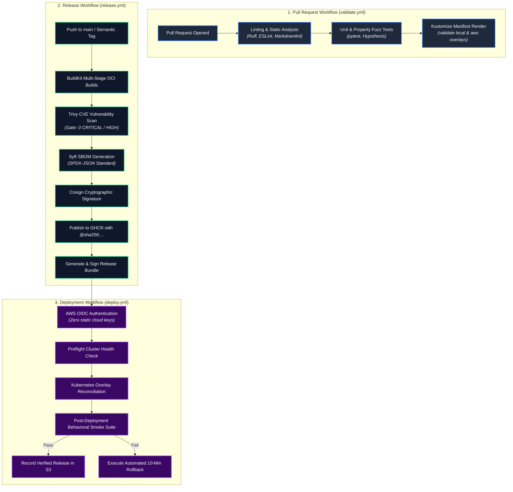

# Continuous Integration & Continuous Delivery (CI/CD)

**Design Revision 5 — 2026-10-26. Status: Production Engineering Specification.** This document provides the architectural specifications, workflow topologies, cryptographic supply-chain security pipelines, and automated quality gates implemented in GitHub Actions for Chat App.

---

## 1. Master Pipeline Architecture

The delivery lifecycle is separated into three decoupled, least-privilege GitHub Actions workflows:



---

## 2. Pipeline Stages & Quality Gates

### Stage 1: Validation Workflow (`.github/workflows/validate.yml`)
* **Trigger:** All pull requests targeting `main` and direct pushes to feature branches.
* **Permissions:** Read-only repository access (`contents: read`). Zero cloud secrets exposed.
* **Gates:**
  1. Python static analysis using `ruff` and type verification using `mypy --strict`.
  2. JavaScript linting with `eslint` (verifying zero external libraries or unsafe DOM injections).
  3. Unit and property-based test suites executed in parallel via `pytest -v --cov=app tests/unit tests/property`.
  4. Declarative schema validation: renders `k8s/overlays/local` and `k8s/overlays/aws` through `kubectl kustomize` and verifies against Kubernetes OpenAPI schemas via `kubeconform`.

### Stage 2: Release & Provenance Workflow (`.github/workflows/release.yml`)
* **Trigger:** Merges to `main` branch.
* **Permissions:** `contents: read`, `packages: write`, `id-token: write` (for OIDC cryptographic signing).
* **Gates:**
  1. Multi-stage Docker BuildKit builds for `gateway`, `frontend`, and `backend`.
  2. Vulnerability scanning using Trivy (`trivy image --exit-code 1 --severity CRITICAL,HIGH`).
  3. Automated generation of Software Bill of Materials (SBOM) using `syft` attached as an OCI layer.
  4. Cryptographic signing of immutable container digests using `cosign sign`.
  5. Publication of signed release manifests to versioned artifact storage.

### Stage 3: Deployment & Automated Rollback Workflow (`.github/workflows/deploy.yml`)
* **Trigger:** Successful completion of `release.yml`.
* **Permissions:** Scoped AWS OIDC role with restricted EC2 deployment permissions.
* **Gates:**
  1. **Preflight Verification:** Validates that the host EC2 node possesses $\ge 1.0\text{ GiB}$ free `MemAvailable` and that K3s is in a `Ready` state.
  2. **Kustomize Reconciliation:** Reconciles the production overlay (`k8s/overlays/aws`).
  3. **Rollout Verification:** Awaits rollout completion (`kubectl rollout status deployment/backend --timeout=180s`).
  4. **Smoke Suite Execution:** Runs end-to-end WebSocket tests, validating subprotocol negotiation, session envelope reception, and cross-replica message delivery.
  5. **Automated Rollback:** If any smoke test step fails, automatically triggers `scripts/rollback.sh`.

---

## 3. Cryptographic Supply-Chain Security & SLSA Compliance

To guarantee supply-chain integrity (SLSA Level 3 compliance):

```bash
# 1. Sign container image digest using Cosign
cosign sign --yes \
  --key env://COSIGN_PRIVATE_KEY \
  "${IMAGE_URI}@${IMAGE_DIGEST}"

# 2. Attach SPDX-JSON SBOM to container registry
syft packages "${IMAGE_URI}@${IMAGE_DIGEST}" -o spdx-json=sbom.spdx.json
cosign attach sbom --sbom sbom.spdx.json "${IMAGE_URI}@${IMAGE_DIGEST}"

# 3. Verify signature prior to deployment
cosign verify \
  --key env://COSIGN_PUBLIC_KEY \
  "${IMAGE_URI}@${IMAGE_DIGEST}"
```

---

## 4. Formal Release Manifest Schema (`schemas/release.schema.json`)

```json
{
  "$schema": "https://json-schema.org/draft/2020-12/schema",
  "$id": "https://chatapp.internal/schemas/release.schema.json",
  "title": "ChatAppReleaseManifest",
  "type": "object",
  "required": ["schema_version", "release_id", "source_commit", "created_at", "images", "config_hashes"],
  "properties": {
    "schema_version": { "const": 1 },
    "release_id": { "type": "string", "pattern": "^[0-9]{8}\\.[0-9]+-sha\\.[a-f0-9]{7}$" },
    "source_commit": { "type": "string", "pattern": "^[a-f0-9]{40}$" },
    "created_at": { "type": "string", "format": "date-time" },
    "images": {
      "type": "object",
      "required": ["gateway", "frontend", "backend", "redis"],
      "properties": {
        "gateway": { "type": "string", "pattern": "^.+@sha256:[a-f0-9]{64}$" },
        "frontend": { "type": "string", "pattern": "^.+@sha256:[a-f0-9]{64}$" },
        "backend": { "type": "string", "pattern": "^.+@sha256:[a-f0-9]{64}$" },
        "redis": { "type": "string", "pattern": "^.+@sha256:[a-f0-9]{64}$" }
      }
    },
    "config_hashes": {
      "type": "object",
      "required": ["kustomize_base", "kustomize_aws"],
      "properties": {
        "kustomize_base": { "type": "string", "pattern": "^[a-f0-9]{64}$" },
        "kustomize_aws": { "type": "string", "pattern": "^[a-f0-9]{64}$" }
      }
    }
  },
  "additionalProperties": false
}
```
