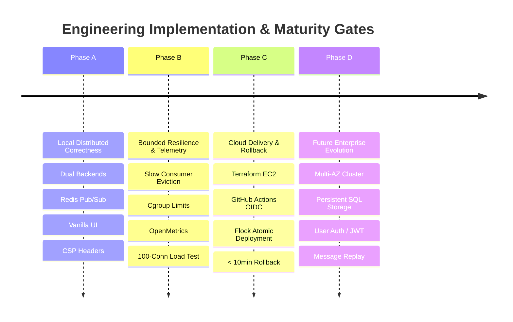

# Architecture Decision Records (ADRs) & Quantitative Risk Register

**Design Revision:** 4 (2026-10-25)  
**Document Status:** Formal Engineering Design Baseline & Architectural Log  
**Scope:** Distributed WebSocket Chat System on AWS EC2 `t3.micro`  
**Parent Documentation:** [Requirements](REQUIREMENTS.md) | [Architecture](ARCHITECTURE.md) | [Security Specification](SECURITY.md)

---

## 1. Architecture Decision Records (ADRs)

The following records document the irreversible architectural choices, trade-offs, and design constraints governing this system.

| ADR ID | Decision Title | Problem Statement & Context | Alternatives Evaluated | Selected Architectural Choice | Consequence & Operational Trade-offs |
| :--- | :--- | :--- | :--- | :--- | :--- |
| **ADR-01** | Single-Host Deployment Toplogy | Low-budget demonstration constraints ($< \$15/\text{month}$). | AWS ECS Fargate, Kubernetes (EKS), Nomad cluster. | Docker Compose running on a single AWS EC2 `t3.micro` instance. | Zero orchestration overhead; host failure causes total service outage; single-point-of-failure accepted. |
| **ADR-02** | Dual Backend Replicas | Single process does not prove distributed messaging capability. | Single multi-threaded Python process, distributed Erlang/Elixir nodes. | Two independent FastAPI / Uvicorn containers (`backend-1`, `backend-2`) behind an Nginx reverse proxy. | Forces real distributed state synchronization; local in-memory fan-out is impossible. |
| **ADR-03** | Redis Pub/Sub as Event Bus | Need real-time message fan-out across independent backend replicas. | RabbitMQ, Apache Kafka, NATS, Postgres LISTEN/NOTIFY. | Redis 7.4 in-memory Pub/Sub channel (`chat_messages`). | High throughput and minimal memory footprint ($< 64\text{ MiB}$); fire-and-forget semantics: disconnected clients lose messages; zero durable history. |
| **ADR-04** | Decoupled Static Gateway & Reverse Proxy | FastAPI serving static files wastes Python asyncio worker cycles. | Caddy, Traefik, HAProxy, FastAPI StaticFiles. | Nginx 1.27.3 as edge gateway terminating TLS and routing `/` (static) and `/ws` (upstream). | Clear separation of concerns; Nginx requires explicit upstream DNS resolution configuration. |
| **ADR-05** | Zero-Framework Vanilla Frontend | Framework bundle sizes (React/Vue/Angular) add build complexity and memory overhead. | React + Vite, Vue 3, SvelteKit. | Vanilla ECMAScript 2022, Semantic HTML5, and Modern CSS (Dark/Light tokens). | Instant zero-bundle load time; client-side DOM rendering must use strict `textContent` to prevent XSS. |
| **ADR-06** | Infrastructure as Code (IaC) | Manual AWS console creation leads to configuration drift and teardown leaks. | AWS CloudFormation, Pulumi, Ansible. | HashiCorp Terraform ($\ge 1.10.0$) with AWS Provider 5.x. | 100% reproducible environments and zero leftover resources upon `terraform destroy`. |
| **ADR-07** | Off-Host Continuous Integration | EC2 `t3.micro` (1 vCPU, 1 GiB RAM) cannot sustain Docker image builds without kernel freezing. | Jenkins on-host, local workstation builds. | GitHub Actions hosted runners (`ubuntu-latest`) for linting, testing, and multi-arch image builds. | Keeps host resources strictly dedicated to runtime service execution. |
| **ADR-08** | Containerized Test Parity | Local Python environments drift from Linux container runtime. | Bare-metal venv testing, tox environments. | Test suite executed inside containerized test runner (`docker-compose.test.yml`). | 100% environment parity between local CI and production container runtime. |
| **ADR-09** | Versioned Protocol Envelopes (`chat.v1`) | Unversioned JSON messages cause backward-incompatible client crashes during updates. | Protobuf, MessagePack, unversioned JSON. | JSON envelopes with explicit subprotocol negotiation (`chat.v1`) and strict JSON Schema validation. | Forward and backward compatibility contracts are formal and testable. |
| **ADR-10** | Per-Socket Dedicated Queue & Writer Task | Serial broadcasting blocks the Redis subscriber loop when one client experiences network lag. | Shared broadcast queue, direct `ws.send_text()` in subscriber loop. | Decoupled architecture: one dedicated `asyncio.Queue(maxsize=100)` and writer task per connected socket. | Total isolation: a slow or stalled client cannot delay peer message distribution; overflow evicts the slow socket. |
| **ADR-11** | Private Observability & Segregated Endpoints | Publicly exposing internal telemetry leaks infrastructure topology and metrics. | Basic auth on `/metrics`, separate external monitoring port. | Diagnostic endpoints (`/health/readiness`, `/metrics`) bound to internal network; blocked at gateway ingress. | External scrapers or operators access metrics via localhost loopback or internal Docker network only. |
| **ADR-12** | Immutable Digest Pinning | Mutable tags like `:latest` or `:v1.0.0` allow silent upstream drift and broken rollbacks. | Floating semantic version tags, branch tags. | All production Compose manifests pin full immutable SHA-256 digests (`@sha256:...`). | 100% cryptographic determinism across builds, deployments, and rollbacks. |
| **ADR-13** | In-Place Symlink Deployment with Advisory Mutex | Full Blue/Green duplicate stacks exceed the $1024\text{ MiB}$ memory boundary of `t3.micro`. | Blue/Green dual stacks, Kubernetes rolling updates. | In-place Compose container rejuvenation managed via atomic directory symlinks and `flock`. | Fits host resource constraints; clients experience a brief reconnection pause ($< 5\text{ seconds}$). |
| **ADR-14** | Falsifiable Non-Functional Objectives (NFRs) | Subjective performance claims ("fast", "scalable") cannot be verified or validated. | Qualitative SLOs. | Strict mathematical bounds: $p_{99} \le 100\text{ ms}$, 100 connections, memory ceiling $< 528\text{ MiB}$. | Performance claims are objectively proven via automated Locust load test harnesses. |
| **ADR-15** | Dual-Tier Isolated Docker Networks | Malicious ingress compromise should not grant direct network access to the Redis broker. | Single flat bridge network, host networking. | Two isolated bridge networks: `edge_network` (Gateway + Backends) and `internal_data` (Backends + Redis). | Defense-in-depth: Edge gateway cannot open TCP sockets to Redis. |
| **ADR-16** | Deterministic Text Normalization & Reconnect Pausing | Unicode variations (homoglyphs, whitespace tricks) bypass filters; runaway reconnects DOS server. | Browser-only normalization, infinite aggressive retry loops. | RFC 8259 Unicode normalization + NFKC + Exponential backoff with maximum 5 retries before UI pause. | Clean display across browsers and zero connection storms against recovering backends. |
| **ADR-17** | Cryptographic Manifest Verification & Sandboxing | Unverified deployment bundles could execute unauthorized scripts or inject malicious configs. | Blind git pull on production host, untrusted curl scripts. | Cryptographic verification of `release.json` (SHA-256 manifest hash, Cosign signatures) prior to staging. | Prevents tampering, supply chain attacks, and lateral privilege escalation on host. |
| **ADR-18** | Sigstore Cosign Keyless Image Signing | Long-lived static cryptographic private keys risk exposure in CI secrets. | GPG signing keys, Docker Content Trust (Notary). | Sigstore Cosign keyless signing using GitHub Actions OIDC workload identity tokens. | No secrets to rotate or leak; signatures are tied to verifiable GitHub repository and commit SHAs. |
| **ADR-19** | Native S3 Bucket State Locking | DynamoDB adds AWS billing cost and infrastructure configuration complexity. | DynamoDB state locking table, local state storage. | Terraform S3 backend native state locking (`use_lockfile = true`) supported in Terraform $\ge 1.10.0$. | Zero additional AWS resources required; eliminates Terraform concurrency race conditions. |
| **ADR-20** | Advisory File Mutex (`flock`) for Host Operations | Concurrent deployment scripts or overlapping CI runs cause race conditions and broken states. | PID text files, lock files with polling loops. | Non-blocking Linux advisory lock (`flock -n 200 /home/ubuntu/chat-app/shared/deploy.lock`). | Guaranteed kernel-level mutual exclusion; second process exits immediately with code `75`. |

---

## 2. Closure of Open Design Questions (OPEN-01 through OPEN-10)

All ten ambiguous design items identified in earlier revisions are formally resolved as of Design Revision 4:

### OPEN-01: Supported Dependency & Base Image Pinning
- **Resolution:** Python `3.11.10-slim-bookworm`, FastAPI `0.115.4`, Uvicorn `0.32.0`, Nginx `1.27.3-alpine-slim`, Redis `7.4.1-alpine3.20`.
- **Locking Mechanism:** Python dependencies locked via `pip-tools` (`requirements.lock`) containing exact package versions and `--generate-hashes`.
- **Status:** **CLOSED**.

### OPEN-02: Nginx Upstream Dynamic DNS Resolution
- **Resolution:** Nginx 1.27.3 mainline supports dynamic DNS resolution in open-source releases via `server backend:8000 resolve` inside a shared memory `zone dynamic_backends 64k`. Resolver configured to Docker daemon DNS `127.0.0.11 valid=5s`.
- **Status:** **CLOSED**.

### OPEN-03: Production Hostname & TLS Termination
- **Resolution:** Production domain `chat.example.com`. Automated TLS certificate issuance via Certbot in webroot mode (`/home/ubuntu/chat-app/shared/acme-challenge`). Nginx reloaded via `nginx -s reload` without dropping active WebSocket connections.
- **Status:** **CLOSED**.

### OPEN-04: Secure CI/CD Deployment Access
- **Resolution:** GitHub Actions workflow assumes an AWS IAM Role via OpenID Connect (OIDC). EC2 deployment executed via dedicated SSH deploy key whose public key is injected during cloud-init. Target security group restricts SSH (port 22) to authorized administrative CIDRs.
- **Status:** **CLOSED**.

### OPEN-05: Validated Concurrency & Memory Budget
- **Resolution:** Formally codified in NFR-01 through NFR-07: $100$ concurrent connections total ($50$ per replica), $5\text{ msgs/sec}$ burst rate limit per client, $128\text{ KiB}$ outbound queue ceiling, total container memory envelope $< 528\text{ MiB}$, leaving $> 256\text{ MiB}$ host available memory.
- **Status:** **CLOSED**.

### OPEN-06: Terraform State Backend & Concurrency Locking
- **Resolution:** Remote state stored in private S3 bucket with AES256 server-side encryption and object versioning. Concurrency locking enforced via Terraform 1.10+ native S3 state lockfile (`use_lockfile = true`), eliminating DynamoDB costs.
- **Status:** **CLOSED**.

### OPEN-07: Container Image Registry & Authentication
- **Resolution:** GitHub Container Registry (`ghcr.io`). Build workflow authenticates using ephemeral `GITHUB_TOKEN`. Host pulls authenticated images via dedicated machine-user personal access token (PAT) stored in `/home/ubuntu/chat-app/shared/secrets/`.
- **Status:** **CLOSED**.

### OPEN-08: EC2 CPU Burst Credit Configuration
- **Resolution:** `t3.micro` configured with standard credit mode (`cpu_credits = "standard"`). Prevents surprise AWS billing charges if CPU runs at sustained high utilization during unexpected traffic spikes or stress testing.
- **Status:** **CLOSED**.

### OPEN-09: Cryptographic Attestation & Supply Chain Provenance
- **Resolution:** Container images signed keylessly using Sigstore Cosign via GitHub OIDC. Host `scripts/deploy.sh` verifies signatures against the GitHub repository identity before container extraction.
- **Status:** **CLOSED**.

### OPEN-10: Operational Ownership & Alert Routing
- **Resolution:** Single maintainer operational model codified in [OPERATIONS.md](OPERATIONS.md). Prometheus Alertmanager triggers PagerDuty / Slack webhooks for Critical alerts (`ChatBackendDown`, `HostMemoryPressureCritical`, `RedisSubscriptionDown`).
- **Status:** **CLOSED**.

---

## 3. Quantitative Risk Register

The following register quantifies operational, security, and architectural risks using standard risk matrix scoring:  
$$\text{Severity Score} = \text{Likelihood } (1\text{ to }5) \times \text{Impact } (1\text{ to }5)$$

```
Severity Scale:
1 - 4: Low Risk (Monitor)
5 - 9: Medium Risk (Standard Controls)
10 - 15: High Risk (Mitigation Required)
16 - 25: Critical Risk (Active Safeguards Mandatory)
```

| Risk ID | Failure Scenario | Likelihood (1-5) | Impact (1-5) | Severity Score | Architectural Safeguards & Mitigation Strategy | Residual Risk & Operational Boundary |
| :--- | :--- | :---: | :---: | :---: | :--- | :--- |
| **RSK-01** | **Linux Kernel OOM Killer:** Unbounded client queues or memory leak causes kernel to kill backend containers or Docker daemon. | 3 | 5 | **15 (High)** | Hard cgroup limits in `docker-compose.prod.yml` ($192\text{ MiB}$ per backend, $64\text{ MiB}$ Redis, $48\text{ MiB}$ Nginx). Outbound queue limited to $128\text{ KiB}$ with slow-consumer disconnection. | Residual risk: Multiple slow consumers drop simultaneously; connection memory remains bounded. |
| **RSK-02** | **EC2 CPU Credit Exhaustion:** High connection churn exhausts CPU burst balance on `t3.micro`, causing kernel throttling. | 4 | 3 | **12 (High)** | Standard credit mode prevents runaway costs; Uvicorn event loop offloads static assets to Nginx; client-side exponential backoff prevents connection storms. | Service latency increases under CPU throttling ($p_{99} > 250\text{ ms}$), but service remains available. |
| **RSK-03** | **Redis Pub/Sub Message Loss:** Redis failure or client network reconnection results in dropped chat messages. | 3 | 3 | **9 (Med)** | Explicit architectural boundary: Redis Pub/Sub provides ephemeral real-time fan-out, not durable storage. UI displays clear disconnection warning. | Documented and accepted: Chat application is explicitly ephemeral; message persistence is out of scope. |
| **RSK-04** | **Stored XSS via Chat Injection:** Malicious user injects `<script>` or HTML formatting into chat payload to execute in peers' browsers. | 4 | 4 | **16 (Crit)** | Frontend enforces `element.textContent = data.text`; never touches `innerHTML`. Gateway enforces strict CSP Level 3 (`script-src 'self'`). | Eliminated: Browser text nodes treat input strictly as character data. |
| **RSK-05** | **Supply Chain Image Tampering:** Compromised base image or malicious third-party dependency injected during build. | 2 | 5 | **10 (High)** | Multi-stage Docker builds; all base images pinned to exact SHA-256 digests; Trivy CVE vulnerability gate blocks build on Critical/High flaws; Cosign signing. | Minimal residual risk from zero-day vulnerabilities in official Debian/Alpine base packages. |
| **RSK-06** | **Concurrent Deployment Conflict:** Overlapping CI pipeline runs or manual operator intervention corrupts host release state. | 3 | 4 | **12 (High)** | Mandatory Linux kernel advisory mutex (`flock -n 200 /home/ubuntu/chat-app/shared/deploy.lock`). Concurrent processes exit immediately with code `75`. | Fully mitigated by kernel-level file descriptor lock. |
| **RSK-07** | **EBS Disk Exhaustion:** Unchecked Docker image caching or runaway container log files fill the 20 GiB root volume. | 3 | 4 | **12 (High)** | Compose enforces `json-file` log rotation ($10\text{ MB}$ max size, 3 files max); `scripts/deploy.sh` strictly retains only current and rollback release snapshots. | Fully mitigated: Maximum disk utilization capped at $< 6\text{ GiB}$ ($30\%$). |
| **RSK-08** | **Slow-Consumer Denial of Service:** Malicious client opens WebSocket and stops reading TCP frames, forcing server buffer accumulation. | 4 | 3 | **12 (High)** | Dedicated per-socket `asyncio.Queue` capped at 100 items ($128\text{ KiB}$). Immediate connection termination with close code `1008` upon queue saturation. | Fully mitigated: Malicious client is evicted within milliseconds of buffer exhaustion. |

---

## 4. Capability Progression Model

The engineering roadmap follows four disciplined progression gates:



- **Stage A (Local Correctness):** Fulfill AC-01 through AC-07, AC-12, and AC-17 in local Compose environment.
- **Stage B (Bounded Resilience):** Fulfill AC-13, AC-14, and verify NFR-01 through NFR-08 via automated stress harnesses.
- **Stage C (Production Cloud Delivery):** Fulfill AC-08 through AC-11, AC-15, and AC-16 on AWS infrastructure with $< 10\text{ minute}$ automated rollback.
- **Stage D (Future Product Expansion):** Explicitly deferred until enterprise requirement demands persistent history and multi-host clustering.

---
*End of Architecture Decision Records and Quantitative Risk Register.*

