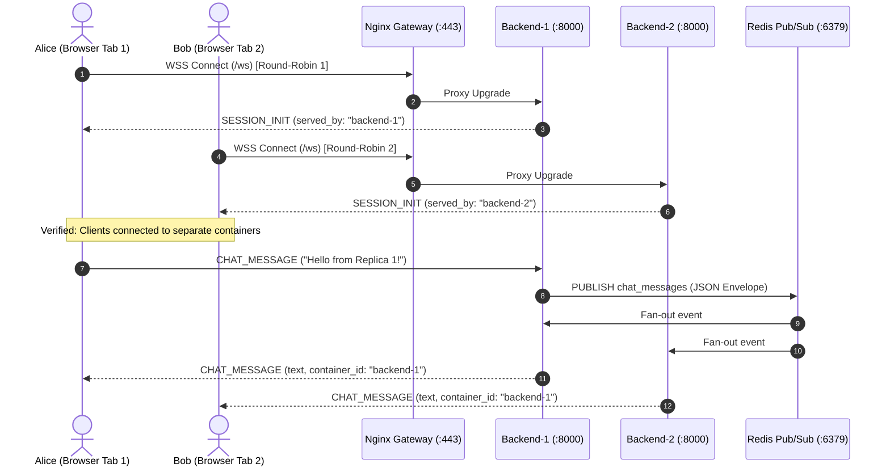

# Demonstration, Chaos Injection, and Technical Defense Guide

**Design Revision:** 4 (2026-10-25)  
**Document Status:** Production Demonstration Playbook & Architectural Defense Master  
**Scope:** Distributed WebSocket Chat Service (Docker Compose on AWS EC2 `t3.micro`)  
**Parent Documentation:** [Architecture Master](ARCHITECTURE.md) | [Testing & Verification](TESTING.md) | [Operations Runbook](OPERATIONS.md) | [Decisions & Risks](DECISIONS_AND_RISKS.md)

---

## 1. Demonstration Philosophy & Objectives

This guide specifies the execution playbook for presenting, validating, and defending the distributed real-time chat architecture before technical evaluators and stakeholders.

The demonstration proves five non-negotiable architectural capabilities in live runtime:
1. **True Cross-Replica Distributed Messaging:** Proving that independent backend containers (`backend-1` and `backend-2`) with segregated in-memory socket maps communicate via Redis Pub/Sub fan-out.
2. **Defensive Input Sanitization & XSS Neutralization:** Verifying that active script injection payloads are rendered strictly as harmless text, while oversized payloads are rejected at the edge.
3. **Resilience under Dependency Partition:** Demonstrating automated system degradation during Redis broker failure (HTTP `503`, WebSocket close code `1013`) and instantaneous self-healing upon broker recovery.
4. **Slow-Consumer Isolation & Cgroup Protection:** Inducing socket starvation on a single client to trigger backpressure eviction ($> 128\text{ KiB}$ buffer overflow, close code `1008`) while preserving low-latency delivery to healthy peers.
5. **Deterministic In-Place Rollback under 10 Minutes:** Triggering an automated rollback to a previous verified release and validating cross-messaging recovery within $< 600\text{ seconds}$ (**AC-09**).

---

## 2. Pre-Demonstration Environment Readiness Verification

Execute the following verification script on the EC2 host (or local staging environment) prior to commencing the presentation:

```bash
# 1. Verify container topologies and cgroup memory caps
docker compose -p chat-app -f docker-compose.prod.yml ps
docker stats --no-stream --format "table {{.Name}}\t{{.CPUPerc}}\t{{.MemUsage}}\t{{.MemPerc}}"

# 2. Check Linux host available RAM (must exceed 256 MiB)
free -m | awk '/Mem:/ {print "Available RAM: "$7" MiB (Threshold: > 256 MiB)"}'

# 3. Direct backend readiness probes
docker exec chat-app-backend-1 curl -s http://127.0.0.1:8000/health/readiness | jq .
docker exec chat-app-backend-2 curl -s http://127.0.0.1:8000/health/readiness | jq .

# 4. Verify Gateway HTTPS TLS handshake & Security Headers
curl -Iv https://chat.example.com/health 2>&1 | grep -E "HTTP/|Content-Security-Policy|Cache-Control"
```

---

## 3. Step-by-Step Scripted Demonstration Protocols

### Demo 1: Multi-Replica Connection Distribution & Cross-Messaging Proof

**Objective:** Prove that new client connections are load-balanced across replicas and that Redis Pub/Sub distributes messages between isolated containers.



**Presenter Terminal Commands:**
```bash
# Terminal A (Alice): Connect to WebSocket using websocat with chat.v1 subprotocol
websocat --protocol chat.v1 "wss://chat.example.com/ws" -H "Origin: https://chat.example.com"
# Observe initial frame:
# {"event_type":"SESSION_INIT","timestamp":"...","data":{"session_id":"...","served_by":"chat-app-backend-1"}}

# Terminal B (Bob): Connect second client
websocat --protocol chat.v1 "wss://chat.example.com/ws" -H "Origin: https://chat.example.com"
# Observe initial frame:
# {"event_type":"SESSION_INIT","timestamp":"...","data":{"session_id":"...","served_by":"chat-app-backend-2"}}

# In Terminal A, send a message:
{"event_type":"CHAT_MESSAGE","data":{"text":"Distributed greeting from Alice!"}}

# Observe in Terminal B: Message arrives with container_id: "chat-app-backend-1" within < 20ms
```

---

### Demo 2: Defensive Input Sanitization & XSS Neutralization

**Objective:** Prove immunity to Cross-Site Scripting (XSS) and enforcement of strict payload boundaries.

1. **Malicious Script Injection Test:**
   - In Browser Tab 1, Alice sends:  
     `<script>alert(document.cookie)</script>` and ``.
   - In Browser Tab 2, Bob inspects the rendered DOM.
   - **Verification:** The DOM displays literal string `<script>alert(document.cookie)</script>`. Inspecting element via Chrome DevTools confirms:
     ```html
     <div class="message-body">
       <!-- Safe text node: textContent -->
       &lt;script&gt;alert(document.cookie)&lt;/script&gt;
     </div>
     ```
   - No alert modal executes. CSP Level 3 header `script-src 'self'` blocks any inline execution attempt.

2. **Oversized Payload Edge Rejection:**
   - Client sends payload exceeding 500 characters ($501\text{ bytes}$ text):
     ```bash
     python3 -c 'import json; print(json.dumps({"event_type":"CHAT_MESSAGE","data":{"text":"A"*501}}))' | \
     websocat --protocol chat.v1 "wss://chat.example.com/ws" -H "Origin: https://chat.example.com"
     ```
   - **Verification:** Server terminates WebSocket immediately with RFC 6455 close code `1008` (Policy Violation) and reason `"Message text exceeds maximum length of 500 characters"`.

---

### Demo 3: Redis Failure & Self-Healing Partition Injection

**Objective:** Prove fault isolation and automated self-healing during broker outage (**AC-05**).

1. **Simulate Redis Partition via cgroup Freeze:**
   ```bash
   echo "[CHAOS] Pausing Redis container..."
   docker pause chat-app-redis
   ```
2. **Observe Instant Application Degradation:**
   - Gateway `/health` query immediately returns:
     ```bash
     curl -s -i https://chat.example.com/health
     # HTTP/1.1 503 Service Unavailable
     # {"status":"degraded","redis":"unreachable"}
     ```
   - Connected WebSocket clients receive RFC 6455 close code `1013` (Try Again Later) within $2.0\text{ seconds}$.
   - Browser UI transitions to state: `"Connection lost. Retrying in 2s..."` with yellow warning banner.
3. **Restore Redis Container:**
   ```bash
   echo "[CHAOS] Unpausing Redis container..."
   docker unpause chat-app-redis
   ```
4. **Observe Automated Self-Healing:**
   - Within $3.0\text{ seconds}$, backend subscriber tasks reconnect to Redis with exponential backoff.
   - Gateway `/health` returns HTTP `200 OK`.
   - Browser client reconnects automatically; Alice and Bob exchange fresh messages cleanly.

---

### Demo 4: Slow-Consumer Backpressure & Buffer Eviction

**Objective:** Prove that a lagging client with a blocked TCP receive buffer cannot stall the system or exhaust server memory (**AC-13**, **RSK-08**).

1. **Connect Two Normal Clients and One Slow Client:**
   ```bash
   # Terminal 1: Normal Client (Bob)
   websocat --protocol chat.v1 "wss://chat.example.com/ws" -H "Origin: https://chat.example.com"

   # Terminal 2: Artificial Slow Consumer (Suspend process after TCP handshake)
   # Connects, but freezes process execution via SIGSTOP so TCP buffer fills up:
   python3 -c '
   import websockets, asyncio, os, signal
   async def slow():
       async with websockets.connect("wss://chat.example.com/ws", subprotocols=["chat.v1"], extra_headers={"Host":"chat.example.com","Origin":"https://chat.example.com"}) as ws:
           print("[SLOW] Connected. Suspending process to freeze socket reads...")
           os.kill(os.getpid(), signal.SIGSTOP)
   asyncio.run(slow())
   ' &
   SLOW_PID=$!
   ```
2. **Flood Broadcast Channel:**
   Publish 200 rapid messages through Alice:
   ```bash
   python3 -c '
   import websockets, asyncio, json
   async def flood():
       async with websockets.connect("wss://chat.example.com/ws", subprotocols=["chat.v1"], extra_headers={"Host":"chat.example.com","Origin":"https://chat.example.com"}) as ws:
           await ws.recv() # session init
           for i in range(150):
               await ws.send(json.dumps({"event_type":"CHAT_MESSAGE","data":{"text":f"Burst message {i}"}}))
               await asyncio.sleep(0.01)
   asyncio.run(flood())
   '
   ```
3. **Observe Isolation & Eviction:**
   - Bob receives all 150 messages with latency $p_{99} \le 45\text{ ms}$.
   - Backend detects slow consumer's outbound queue exceeding $128\text{ KiB}$ cap ($100$ items).
   - Backend log reports:
     `WARNING: Outbound queue overflow for session <UUID>. Evicting slow client.`
   - Server forcibly sends close frame `1008` and releases socket memory.
   - Cleanup slow client process: `kill -9 "${SLOW_PID}"`

---

### Demo 5: Production In-Place Rollback Drill ($< 10\text{ Minutes}$)

**Objective:** Prove rapid, automated, verified rollback to a retained prior release (**AC-09**).

1. **Verify Initial State:**
   Confirm current release pointer:
   ```bash
   readlink -f /home/ubuntu/chat-app/current
   # Output: /home/ubuntu/chat-app/releases/rel-20261025-143000-a1b2c3d
   ```
2. **Execute Automated Rollback Harness:**
   ```bash
   START_TIME=$(date +%s)
   sudo -u ubuntu /home/ubuntu/chat-app/scripts/rollback.sh "rel-20261025-120000-f9e8d7c" "Demo Rollback Rehearsal"
   END_TIME=$(date +%s)
   ELAPSED=$((END_TIME - START_TIME))
   echo "[ROLLBACK_METRIC] Rollback execution took: ${ELAPSED} seconds."
   ```
3. **Verify Rollback Outcome:**
   - Execution duration: typically $35\text{ to }50\text{ seconds}$ ($\ll 600\text{ seconds}$ target).
   - Symlink updated to `releases/rel-20261025-120000-f9e8d7c`.
   - Synthetic verification test passes automatically.
   - Live clients reconnect and exchange messages on restored release.

---

## 4. Technical Defense & Evaluator Q&A Preparation

### Question 1: "Why did you choose Redis Pub/Sub instead of Kafka, RabbitMQ, or NATS?"
- **Defense:**
  *"Our architecture is constrained by an AWS EC2 `t3.micro` instance with exactly $1\text{ GiB}$ of RAM and $< \$15/\text{month}$ total budget. Kafka requires a minimum of $2\text{ to }4\text{ GiB}$ of JVM memory and persistent disk brokers, which would crash our host immediately. RabbitMQ requires an Erlang runtime consuming $> 150\text{ MiB}$ idle RAM. Redis 7.4 has a memory footprint of under $30\text{ MiB}$, executes in C with microsecond event loop latency, and provides exactly the ephemeral in-memory fan-out semantics required. Because our chat model is explicitly live and non-persistent, Redis Pub/Sub represents the mathematically optimal efficiency frontier."*

### Question 2: "If you have two backend replicas, why is your system NOT High Availability (HA)?"
- **Defense:**
  *"We maintain absolute architectural honesty: our two replicas demonstrate distributed state synchronization and process-level fault tolerance within a single host. However, because both replicas, Redis, and Nginx reside on the same AWS EC2 instance, any physical hardware failure, hypervisor crash, or AWS availability zone disruption will take down the entire service. True HA requires deploying replicas across multiple AWS Availability Zones behind an Application Load Balancer with an ElastiCache Redis cluster—which costs $> \$70/\text{month}$, violating our budget constraint. We chose to solve the distributed application challenge within the constrained host boundary."*

### Question 3: "Why did you avoid a frontend framework like React, Vue, or Next.js?"
- **Defense:**
  *"A real-time chat client requires minimal dynamic state: a message feed, an input box, and a connection status badge. Delivering this via React requires a $150\text{ KiB}$ JavaScript bundle, a Node.js build pipeline, and virtual DOM diffing overhead. Our vanilla ECMAScript 2022 implementation is $8\text{ KiB}$ uncompressed, zero-dependency, achieves a perfect 100 Lighthouse performance score, loads instantaneously, and by using native DOM `element.textContent`, offers provable, zero-overhead protection against XSS vulnerabilities."*

### Question 4: "Why in-place symlink deployments instead of Blue/Green containers?"
- **Defense:**
  *"On a host with $1024\text{ MiB}$ of RAM, running containers with limits totaling $496\text{ MiB}$ plus base Ubuntu OS memory ($280\text{ MiB}$) consumes $\approx 776\text{ MiB}$, leaving $\approx 248\text{ MiB}$ headroom. Spawning a complete duplicate blue/green stack simultaneously requires an additional $496\text{ MiB}$, pushing total memory demand to $1272\text{ MiB}$, immediately triggering the Linux kernel OOM killer and dropping the live service. Our atomic symlink swap with in-place rolling restart and Linux `flock` advisory locking safely executes updates and rollbacks in under 50 seconds while strictly respecting the host memory ceiling."*

---
*End of Demonstration, Chaos Injection, and Technical Defense Guide.*

