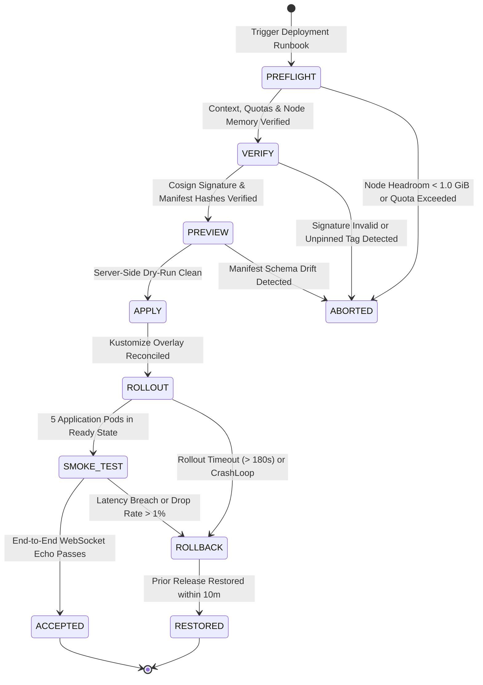
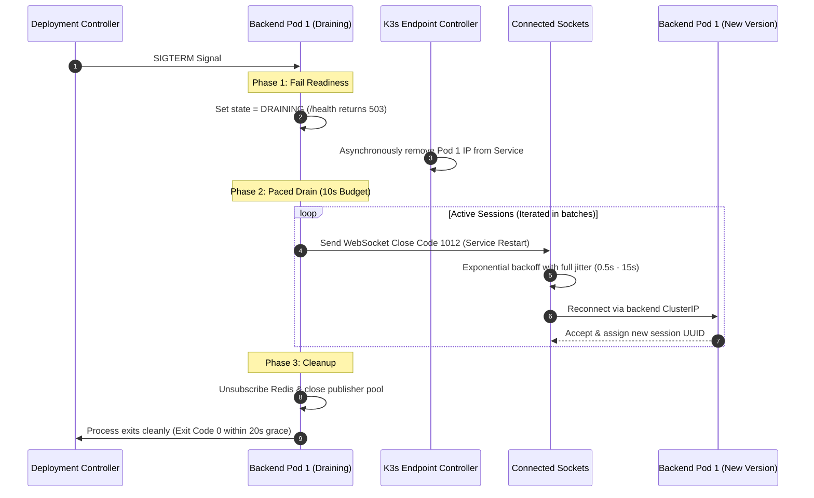

# Deployment, Rollout & Rollback Procedures

**Design Revision 5 — 2026-10-26. Status: Production Operational Specification.** This document defines the transactional deployment lifecycle, OCI cryptographic verification, zero-downtime rolling update mechanics, and automated 10-minute rollback runbooks for Chat App.

---

## 1. Release Packaging & Cryptographic Provenance

Every production release is encapsulated in an immutable, cryptographically signed release bundle conforming to `release.schema.json`:


### Release Manifest Content Requirements
1. **Source Provenance:** Pinned Git commit SHA, build timestamp, and semantic `RELEASE_ID` (e.g., `20261026.1-sha.4c6607d`).
2. **Pinned Image Digests:** Exact `@sha256:...` digest references for `gateway`, `frontend`, `backend`, and `redis`. Mutable tags (e.g., `:latest`) are permanently blocked.
3. **Configuration Hashes:** SHA-256 checksums of rendered base and overlay Kustomize manifests.
4. **Attestation Links:** Cosign cryptographic signatures, Syft SBOM attachments, and Trivy scan clearance reports.

---

## 2. Transactional Deployment State Machine

Deployments execute through a deterministic 7-stage state machine. If any gate fails, **the process terminates without mutating subsequent resources**:



---

## 3. Workload Rollout & Connection Drain Mechanics

### 3.1 Backend Rolling Update Configuration
```yaml
strategy:
  type: RollingUpdate
  rollingUpdate:
    maxSurge: 0
    maxUnavailable: 1
```

* **Zero Surge Constraint (`maxSurge: 0`):** Prevents the small 2-vCPU / 4-GiB node from scheduling excess containers, guaranteeing that peak memory remains safely below cgroup and node pressure thresholds.
* **Controlled Replacement (`maxUnavailable: 1`):** Pod 1 is drained and terminated before Pod 2 begins its update.

### 3.2 Coordinated Connection Drain Timeline


---

## 4. Deterministic Automated Rollback Runbook (`scripts/rollback.sh`)

If smoke verification fails or automated PromQL abort triggers activate, execute the emergency rollback script. Target Mean Time to Recovery (MTTR) is **$\le 10\text{ minutes}$**:

```bash
#!/usr/bin/env bash
set -euo pipefail

echo "=========================================================="
echo "EMERGENCY ROLLBACK INITIATED: Restoring prior stable release"
echo "=========================================================="

# 1. Capture Diagnostic Snapshot
TIMESTAMP=$(date +%Y%m%d%H%M%S)
SNAPSHOT_DIR="/tmp/k8s-rollback-${TIMESTAMP}"
mkdir -p "${SNAPSHOT_DIR}"

echo "[1/4] Capturing post-failure diagnostics to ${SNAPSHOT_DIR}..."
kubectl get pods,services,endpoints -n chat-app -o wide > "${SNAPSHOT_DIR}/cluster-state.txt"
kubectl logs -n chat-app -l app=backend --tail=500 > "${SNAPSHOT_DIR}/backend-tail.log" || true

# 2. Re-apply Verified Prior Release Bundle
PREV_RELEASE_BUNDLE="/opt/chat-app/releases/release-manifest-previous.yaml"
if [[ ! -f "${PREV_RELEASE_BUNDLE}" ]]; then
  echo "FATAL: Prior release bundle ${PREV_RELEASE_BUNDLE} not found!"
  exit 1
fi

echo "[2/4] Applying prior release bundle..."
kubectl apply -f "${PREV_RELEASE_BUNDLE}"

# 3. Block for Workload Convergence (Timeout: 180s)
echo "[3/4] Awaiting workload restoration..."
kubectl rollout status deployment/backend -n chat-app --timeout=180s
kubectl rollout status deployment/gateway -n chat-app --timeout=180s

# 4. Execute Synthetic Behavioral Smoke Check
echo "[4/4] Executing synthetic verification..."
curl -kfsS https://localhost/health > /dev/null
echo "SUCCESS: Rollback complete. Prior release verified healthy."
```

---

## 5. Post-Deployment Synthetic Smoke Harness

Immediately following deployment, an automated test harness verifies end-to-end functionality across the public gateway:

| Step | Target Resource | Validation Method | Acceptance Threshold |
| :--- | :--- | :--- | :--- |
| **1. TLS Verification** | Public Gateway (`:443`) | OpenSSL handshake test | Valid certificate, TLS 1.2/1.3 negotiated. |
| **2. Static Assets** | Frontend Service (`/`) | HTTP GET request | HTTP 200 OK, Content-Type `text/html`. |
| **3. Negative Security** | Internal Endpoints | HTTP GET `/metrics`, `/health` via Gateway | HTTP 403 Forbidden. |
| **4. Subprotocol Gate** | WebSocket (`/ws/alice`) | `wscat` without subprotocol | Handshake rejected with HTTP 400/403. |
| **5. Cross-Pod Fan-Out** | WebSocket Mesh | Dual client connection to Pod 1 & Pod 2 | Client A receives Client B's message in $< 250\text{ ms}$. |
