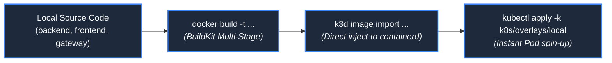

# Local Development & Engineering Workflow

**Design Revision 5 — 2026-10-26. Status: Developer Environment Specification.** This document provides the step-by-step local development workflow, k3d cluster creation, container build/import pipelines, and testing procedures for Chat App.

---

## 1. Prerequisites & Tooling Stack

Local development runs entirely on developer workstations without requiring cloud infrastructure or incurring AWS charges:

| Tool | Required Version | Purpose |
| :--- | :--- | :--- |
| **Docker Desktop / Engine** | `>= 24.0.0` | Linux container engine; hosts k3d nodes and executes BuildKit builds. |
| **k3d** | `>= 5.7.0` | Provisions lightweight multi-node K3s Kubernetes clusters inside local Docker. |
| **kubectl** | `>= 1.30.0` | Kubernetes CLI for cluster inspection and manifest application. |
| **Kustomize** | Built-in (`kubectl -k`) | Declarative configuration overlay management (`k8s/overlays/local`). |
| **Python** | `3.12.x` | Local backend development, virtual environments, and test execution. |
| **wscat** | `>= 5.2.0` | CLI utility for testing raw WebSocket subprotocol handshakes. |

---

## 2. Local k3d Cluster Provisioning Runbook

To achieve exact parity with the AWS EC2 K3s production environment, the local cluster disables Traefik and exposes K3s ServiceLB on ports `8080` (HTTP) and `8443` (HTTPS):

```bash
#!/usr/bin/env bash
set -euo pipefail

CLUSTER_NAME="chat-app-dev"

echo "Creating local k3d cluster: ${CLUSTER_NAME}..."
k3d cluster create "${CLUSTER_NAME}" \
  --servers 1 \
  --agents 0 \
  --port "8080:80@loadbalancer" \
  --port "8443:443@loadbalancer" \
  --k3s-arg "--disable=traefik@server:0" \
  --wait

echo "Verifying cluster connectivity..."
kubectl cluster-info
kubectl get nodes -o wide
```

---

## 3. Container Build & Local Import Workflow

Application images are built locally and imported directly into the k3d cluster's containerd image store, bypassing external registries:



```bash
# 1. Build immutable application containers
docker build -t chatapp/gateway:local ./gateway
docker build -t chatapp/frontend:local ./frontend
docker build -t chatapp/backend:local ./backend

# 2. Inject images directly into the k3d containerd runtime
k3d image import -c chat-app-dev \
  chatapp/gateway:local \
  chatapp/frontend:local \
  chatapp/backend:local \
  redis:7.4.1-alpine
```

---

## 4. Local Manifest Deployment & Health Verification

Deploy the local overlay and block until all five application Pods reach the `1/1 Ready` state:

```bash
# 1. Apply local Kustomize overlay
kubectl apply -k k8s/overlays/local/

# 2. Block until all workloads achieve Ready status (timeout: 90s)
kubectl wait --namespace chat-app \
  --for=condition=ready pod \
  --selector=app.kubernetes.io/part-of=chat-app \
  --timeout=90s

# 3. Inspect running Pods and Services
kubectl get pods,services,endpoints -n chat-app -o wide
```

---

## 5. Developer Verification & Interactive Testing

### 5.1 Static Frontend Verification
```bash
curl -I http://localhost:8080/
# Expected: HTTP/1.1 200 OK, Content-Type: text/html
```

### 5.2 WebSocket Handshake & Subprotocol Verification
```bash
# 1. Positive Handshake: chat.v1 subprotocol negotiated
wscat -c ws://localhost:8080/ws/developer_alice -s chat.v1
# Connected (press CTRL+C to quit)
# < {"schema_version":1,"type":"session","connection_id":"...","user":"developer_alice",...}
# < {"schema_version":1,"type":"system","text":"developer_alice joined the chat",...}

# 2. Negative Handshake: Invalid subprotocol rejected
wscat -c ws://localhost:8080/ws/developer_alice -s invalid.v1
# Expected: Handshake rejected with HTTP 400 or HTTP 403
```

### 5.3 Inspecting Internal Telemetry via Port-Forwarding
Because the gateway denies public access to `/metrics` and `/health`, use authorized kubectl port-forwarding:
```bash
kubectl port-forward -n chat-app svc/backend 8000:8000 &
PID=$!

# Inspect Prometheus metrics
curl -s http://localhost:8000/metrics | grep chat_

# Inspect detailed health status
curl -s http://localhost:8000/health | jq .

kill $PID
```

---

## 6. Chaos Testing & Dependency Recovery Drills

Validate self-healing behavior by simulating dependencies and replica failures:

```bash
# Drill 1: Redis Broker Restart
echo "Terminating Redis broker Pod..."
kubectl delete pod -n chat-app -l app=redis

# Observe backend transitioning to DEGRADED (503) and auto-reconnecting
kubectl logs -n chat-app -l app=backend -f --tail=20

# Drill 2: Rolling Backend Restart
echo "Executing zero-downtime rolling restart..."
kubectl rollout restart deployment/backend -n chat-app
kubectl rollout status deployment/backend -n chat-app
```

---

## 7. Clean Local Teardown Runbook

When development or testing is complete, destroy the local k3d cluster to free workstation memory:

```bash
k3d cluster delete chat-app-dev
```
