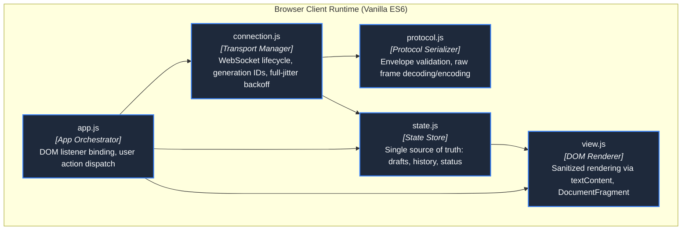
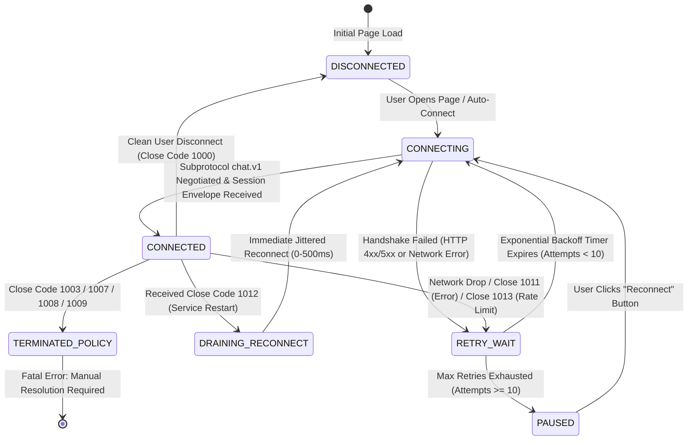
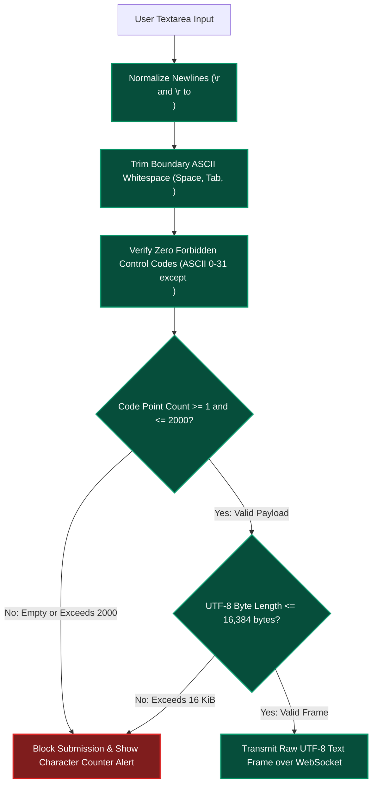

# Frontend Technology, UI/UX & Client Architecture

**Design Revision 5 — 2026-10-26. Status: Production Architecture Specification.** This document provides the engineering specifications for the client-side presentation layer, native ES6 module architecture, DOM sanitization pipeline, and connection resilience state machine for Chat App.

---

## 1. Client Architecture & Modular Design

The frontend executes natively in the browser without third-party frameworks, build-step transpilations, or external CDN dependencies. It is structured into five cohesive ES6 modules:



### Module Responsibilities & Boundary Invariants

| Module | Primary Responsibility | Critical Invariant & Security Constraint |
| :--- | :--- | :--- |
| `app.js` | Top-level lifecycle management and UI event routing. | Connects user interactions to transport calls; never performs direct DOM mutations. |
| `connection.js` | Encapsulates native `WebSocket` instance, retry timers, and generation IDs. | Owns connection generation tokens; silently discards late callbacks from obsolete sockets. |
| `protocol.js` | Parses inbound JSON envelopes and validates schemas; serializes outbound plain text. | Validates `schema_version: 1` and expected fields before passing data to state; rejects malformed events. |
| `state.js` | Single source of truth for UI state: active session, connection status, drafts, message buffer. | Bounded memory: caps displayed history at 500 entries (FIFO eviction); preserves drafts across reconnects. |
| `view.js` | Renders DOM updates using `textContent` and `DocumentFragment` batching. | **Strict XSS Defense:** Zero usage of `innerHTML`, `outerHTML`, or raw HTML injection; preserves user reading scroll. |

---

## 2. Browser Connection Lifecycle & Resilient State Machine



### Full Jitter Exponential Backoff Algorithm
To prevent thundering herds from swamping backend replicas during a rolling restart or node recovery, `connection.js` applies **Exponential Backoff with Full Jitter**:

$$t_{\text{sleep}} = \text{random}\left(0, \, \min\left(T_{\text{max}}, \, T_{\text{base}} \times 2^{\text{attempt}}\right)\right)$$

Where:
* $T_{\text{base}} = 0.5\text{ seconds}$
* $T_{\text{max}} = 15.0\text{ seconds}$
* $\text{attempt} \in [0, 10]$

```javascript
// connection.js - Resilient Backoff Implementation
function calculateBackoffDelay(attempt) {
    const base = 0.5;
    const max = 15.0;
    const exponential = Math.min(max, base * Math.pow(2, attempt));
    return Math.random() * exponential * 1000; // milliseconds
}
```

* **Session Reset Rule:** The retry counter resets to 0 only after maintaining an active `CONNECTED` state for at least 30 consecutive seconds.
* **Terminal Paused State:** After 10 consecutive failed connection attempts, the client enters `PAUSED`. It retains the user's uncommitted message draft and displays a prominent "Reconnect" action.

---

## 3. Strict Input Normalization & XSS Defense Pipeline

Incoming text from the user input textarea undergoes strict client-side validation before dispatch, matching the backend validation pipeline:



### Precise Code Point Accounting
JavaScript string `.length` counts UTF-16 code units, which miscounts 4-byte Unicode characters (e.g., emojis such as 🚀 count as 2 code units). The client enforces length on **Unicode code points**:

```javascript
// Correct code point counting supporting surrogate pairs
function getCodePointLength(text) {
    return Array.from(text).length;
}
```

---

## 4. UI/UX Design System & Layout Specification

```text
+-------------------------------------------------------------------+
|  Chat App               [● Connected]           [Theme: Dark]     |
|  Display Name: Guest_a92f                       [Disconnect]      |
+-------------------------------------------------------------------+
|  [21:15:30] [System] Welcome to Chat App! Messages are ephemeral.  |
|  [21:15:32] [alice_99]: Hello, distributed real-time mesh!        |
|  [21:15:35] [bob_12]: Hi Alice! Running on Kubernetes K3s.       |
|                                                                   |
|                                              [↓ New Messages]     |
+-------------------------------------------------------------------+
|  [Connection Notice: Reconnecting in 2.4s... (Draft Preserved)]   |
|  +-------------------------------------------------------------+  |
|  | Write a message... (Shift+Enter for newline)                |  |
|  +-------------------------------------------------------------+  |
|  Character Count: 42 / 2000                       [Send Message]  |
+-------------------------------------------------------------------+
```

### Design Tokens & CSS Variables (`css/style.css`)
```css
:root {
    --color-canvas: #0f172a;
    --color-surface: #1e293b;
    --color-surface-border: #334155;
    --color-text: #f8fafc;
    --color-text-muted: #94a3b8;
    --color-accent: #3b82f6;
    --color-accent-hover: #2563eb;
    --color-status-connected: #10b981;
    --color-status-reconnecting: #f59e0b;
    --color-status-error: #ef4444;
    
    --font-stack: -apple-system, BlinkMacSystemFont, "Segoe UI", Roboto, Helvetica, Arial, sans-serif;
    --font-mono: ui-monospace, SFMono-Regular, Menlo, Monaco, Consolas, monospace;
    
    --radius-control: 8px;
    --radius-panel: 12px;
    --content-max-width: 960px;
}
```

---

## 5. Accessibility (WCAG 2.2 AA) & Assistive Technology Standards

1. **Semantic Landmarks:** Structure uses `<header>`, `<main>`, `<section>`, and `<footer>` elements with distinct ARIA roles.
2. **Accessible Live Regions:** The message log is assigned `role="log"` with `aria-live="polite"` and `aria-atomic="false"`. Screen readers announce newly arrived messages without interrupting user speech.
3. **Contrast Compliance:** All text tokens maintain a minimum contrast ratio of **4.5:1** against surface backgrounds; UI borders maintain **3:1** against the canvas.
4. **Keyboard Walkthrough:** Full keyboard navigation support (`Tab`, `Shift+Tab`, `Enter` to submit, `Shift+Enter` for newlines). Focus indicators utilize a 2px high-contrast outline with a 2px offset (`outline: 2px solid var(--color-accent); outline-offset: 2px;`).
5. **Reduced Motion:** Adheres to `@media (prefers-reduced-motion: reduce)`, disabling all transitions and micro-animations.
