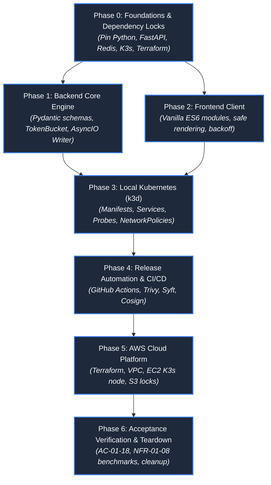

# Implementation Plan & Milestone Roadmap

> Design reference: the runnable implementation and measured results are recorded in [Implementation status](IMPLEMENTATION_STATUS.md). Use [Development](DEVELOPMENT.md), [Configuration](CONFIGURATION.md) and [Deployment](DEPLOYMENT.md) for current commands and defaults. The illustrative blueprints below are not the deployed source files.

**Design Revision 5 — 2026-10-26. Status: Production Engineering Roadmap.** This document defines the sequential implementation phases, work packages, exit criteria, and deliverable artifacts for building and releasing Baatchit on Kubernetes.

---

## 1. Master Milestone Roadmap

---

## 2. Detailed Phase Specifications & Deliverables

### Phase 0: Foundations, Ecosystem Locks & Contracts
* **Scope:** Finalize dependency versions, generate cryptographic lockfiles, validate ASGI server extensions, and configure base schemas.
* **Key Tasks:**
  1. Pin Python 3.12 dependencies via `pip-compile` into `backend/requirements.lock` with SHA-256 hashes.
  2. Finalize `schemas/events-v1.schema.json` and `schemas/release.schema.json`.
  3. Validate Uvicorn ASGI WebSocket rejection extensions (`websocket.http.response.start`).
  4. Select pinned base container images (`python:3.12-slim`, `nginxinc/nginx-unprivileged:alpine`, `redis:7.4-alpine`).
* **Exit Gate:** Verified lockfiles committed; JSON schemas validate against draft 2020-12 standards.

---

### Phase 1: Backend Core Application Engine
* **Scope:** Build the standalone Python 3.12 / FastAPI AsyncIO runtime and Redis Pub/Sub integration.
* **Key Tasks:**
  1. Implement `settings.py` with Pydantic V2 immutable configuration and `REDIS_URL_FILE` reader.
  2. Implement `validation.py` with NFC normalization, regex, and code point bounds.
  3. Implement `limits.py` with monotonic `TokenBucket` limiters.
  4. Implement `sessions.py` with atomic slot reservations and `DeliveryQueue` ($N \le 32$, $B \le 256\text{ KiB}$).
  5. Implement `broker.py` with Redis subscriber supervision and 5s generational nonce watchdog.
  6. Implement `main.py` with lifespan management and 10s graceful drain on `SIGTERM`.
* **Exit Gate:** 100% unit and property test pass rate; contract tests prove session-first ordering.

---

### Phase 2: Frontend Vanilla ES6 Client
* **Scope:** Implement the native browser presentation tier without third-party frameworks.
* **Key Tasks:**
  1. Structure HTML5 layout (`frontend/index.html`) with semantic landmarks and WCAG 2.2 AA ARIA live regions.
  2. Implement CSS3 design tokens (`frontend/css/style.css`) with responsive mobile flexbox and dark mode.
  3. Implement ES6 modules: `protocol.js`, `connection.js` (full jitter backoff), `state.js` (500-message cap), and `view.js` (`textContent` rendering).
* **Exit Gate:** Zero XSS execution on malicious payloads; automated Playwright browser tests pass.

---

### Phase 3: Local Kubernetes Integration (k3d)
* **Scope:** Build multi-stage OCI containers and deploy the 5-pod workload in local k3d.
* **Key Tasks:**
  1. Write rootless Dockerfiles for `gateway`, `frontend`, and `backend`.
  2. Construct `k8s/base/` manifests: Deployments, Services, ConfigMaps, and NetworkPolicies.
  3. Construct `k8s/overlays/local/` mapping localhost `8080`/`8443` to cluster `80`/`443`.
  4. Verify inter-service network policy enforcement (gateway $\to$ Redis blocked).
* **Exit Gate:** AC-01 (5 Ready Pods), AC-02 (Cross-replica fan-out), and AC-14 (NetworkPolicy isolation) pass.

---

### Phase 4: Release Automation & Cryptographic Supply Chain
* **Scope:** Implement GitHub Actions pipelines with SLSA Level 3 provenance.
* **Key Tasks:**
  1. Author `.github/workflows/validate.yml` for PR linting, tests, and Kustomize checks.
  2. Author `.github/workflows/release.yml` with Trivy scanning, Syft SBOM, and Cosign image signing.
  3. Author `.github/workflows/deploy.yml` with automated rollback triggers.
* **Exit Gate:** Cosign verification succeeds; zero High/Critical vulnerabilities in deployed images.

---

### Phase 5: AWS Cloud Platform & Node Bootstrap
* **Scope:** Provision AWS VPC, EC2 instance, security groups, and remote S3 state via Terraform.
* **Key Tasks:**
  1. Initialize S3 state bucket with native locking (`use_lockfile = true`) in `infra/bootstrap-state/`.
  2. Apply `infra/workload/main.tf` provisioning VPC, subnet, security groups, and `c7i-flex.large` EC2 instance.
  3. Execute `user_data.sh` cloud-init script installing K3s with ServiceLB and disabling Traefik.
  4. Configure Let's Encrypt TLS certificate and deploy production overlay (`k8s/overlays/aws`).
* **Exit Gate:** Public HTTPS/WSS reachable on domain; security groups block unapproved ports.

---

### Phase 6: Acceptance Verification, Benchmarking & Teardown
* **Scope:** Execute the full 30-minute load benchmark, chaos drills, and final clean teardown.
* **Key Tasks:**
  1. Execute distributed k6 load test: 25 clients, 5 msg/s, 512-byte payloads for 30 minutes.
  2. Verify latency percentiles (NFR-03: p95 $< 250\text{ ms}$, p99 $< 1,000\text{ ms}$) and node headroom (NFR-06: $\ge 512\text{ MiB}$).
  3. Rehearse 10-minute automated rollback (`scripts/rollback.sh`).
  4. Execute clean infrastructure destruction (`terraform destroy`).
* **Exit Gate:** All 18 Acceptance Criteria (AC-01–18) and 8 NFRs verified; zero lingering cloud spend.
