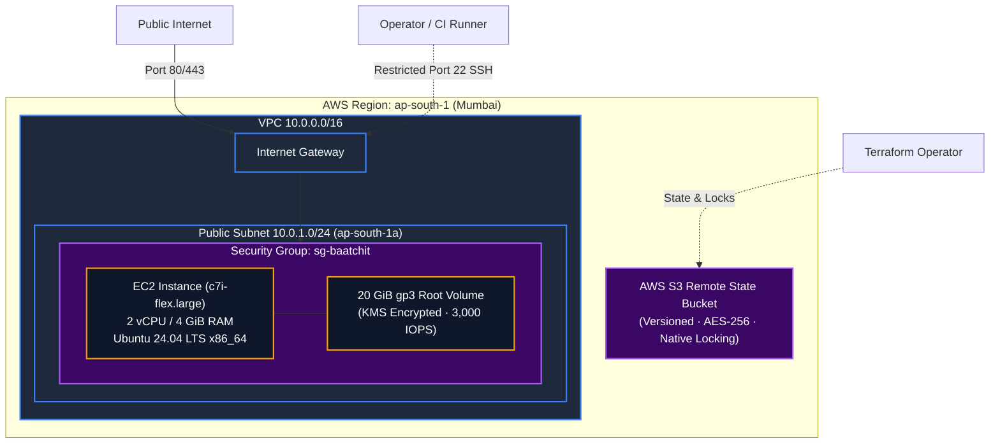

# AWS Infrastructure as Code (Terraform) & Host Bootstrap

> Design reference: the runnable implementation and measured results are recorded in [Implementation status](IMPLEMENTATION_STATUS.md). Use [Development](DEVELOPMENT.md), [Configuration](CONFIGURATION.md) and [Deployment](DEPLOYMENT.md) for current commands and defaults. The illustrative blueprints below are not the deployed source files.

**Design Revision 5 — 2026-10-26. Status: Production Architecture Specification.** This document provides the declarative Terraform 1.10+ HCL specifications, AWS VPC architecture, security group rules, IMDSv2 policies, and EC2 K3s host bootstrap scripts for Baatchit.

---

## 1. Cloud Architecture & Resource Topology

The infrastructure provisions a minimal, highly secure VPC footprint in AWS Mumbai (`ap-south-1`) designed to operate strictly within the $100 credit demonstration budget:



---

## 2. Production Terraform HCL Blueprint (`infra/workload/main.tf`)

```hcl
terraform {
  required_version = ">= 1.10.0"
  required_providers {
    aws = {
      source  = "hashicorp/aws"
      version = "~> 5.75.0"
    }
  }
  backend "s3" {
    bucket       = "baatchit-tfstate-ap-south-1-prod"
    key          = "workload/terraform.tfstate"
    region       = "ap-south-1"
    encrypt      = true
    use_lockfile = true # Native S3 locking (Terraform 1.10+; zero DynamoDB charges)
  }
}

provider "aws" {
  region = var.aws_region
  default_tags {
    tags = {
      Project     = "Baatchit"
      Environment = var.environment
      ManagedBy   = "Terraform"
      Owner       = var.owner_tag
    }
  }
}

# 1. VPC & Networking
resource "aws_vpc" "main" {
  cidr_block           = "10.0.0.0/16"
  enable_dns_hostnames = true
  enable_dns_support   = true
  tags = { Name = "baatchit-vpc" }
}

resource "aws_internet_gateway" "igw" {
  vpc_id = aws_vpc.main.id
  tags   = { Name = "baatchit-igw" }
}

resource "aws_subnet" "public" {
  vpc_id                  = aws_vpc.main.id
  cidr_block              = "10.0.1.0/24"
  availability_zone       = "${var.aws_region}a"
  map_public_ip_on_launch = true
  tags = { Name = "baatchit-public-subnet" }
}

resource "aws_route_table" "public" {
  vpc_id = aws_vpc.main.id
  route {
    cidr_block = "0.0.0.0/0"
    gateway_id = aws_internet_gateway.igw.id
  }
  tags = { Name = "baatchit-public-rt" }
}

resource "aws_route_table_association" "public" {
  subnet_id      = aws_subnet.public.id
  route_table_id = aws_route_table.public.id
}

# 2. Strict Security Group
resource "aws_security_group" "k3s_node" {
  name        = "baatchit-node-sg"
  description = "Ingress control for Baatchit single K3s node"
  vpc_id      = aws_vpc.main.id

  # Public HTTPS / WSS
  ingress {
    description = "Public HTTPS and WSS traffic to Nginx Gateway"
    from_port   = 443
    to_port     = 443
    protocol    = "tcp"
    cidr_blocks = ["0.0.0.0/0"]
  }

  # Public HTTP Redirect
  ingress {
    description = "Public HTTP redirect to HTTPS"
    from_port   = 80
    to_port     = 80
    protocol    = "tcp"
    cidr_blocks = ["0.0.0.0/0"]
  }

  # Restricted Administrative SSH
  ingress {
    description = "Restricted administrative SSH from approved CIDRs only"
    from_port   = 22
    to_port     = 22
    protocol    = "tcp"
    cidr_blocks = var.admin_ssh_cidrs
  }

  # Standard Outbound Egress
  egress {
    description = "Allow all outbound traffic for OCI image pulls and updates"
    from_port   = 0
    to_port     = 0
    protocol    = "-1"
    cidr_blocks = ["0.0.0.0/0"]
  }
}

# 3. Compute Node (c7i-flex.large candidate)
resource "aws_instance" "k3s_host" {
  ami                         = var.ubuntu_ami_id
  instance_type               = "c7i-flex.large" # 2 vCPU / 4 GiB candidate
  subnet_id                   = aws_subnet.public.id
  vpc_security_group_ids      = [aws_security_group.k3s_node.id]
  associate_public_ip_address = true
  key_name                    = var.ec2_key_name

  root_block_device {
    volume_size           = 20
    volume_type           = "gp3"
    iops                  = 3000
    throughput            = 125
    encrypted             = true
    delete_on_termination = true
    tags                  = { Name = "baatchit-root-ebs" }
  }

  # Mandatory IMDSv2 Hardening (SSRF Protection)
  metadata_options {
    http_endpoint               = "enabled"
    http_tokens                 = "required" # Require session token (IMDSv2)
    http_put_response_hop_limit = 1          # Block container hop-through to host metadata
  }

  user_data = file("${path.module}/user_data.sh")

  tags = { Name = "baatchit-k3s-node" }
}
```

---

## 3. Host Node Bootstrap Script (`infra/workload/user_data.sh`)

Executed via cloud-init upon initial EC2 instance launch to configure Linux kernel parameters and install K3s:

```bash
#!/usr/bin/env bash
set -euo pipefail

# 1. Apply High-Performance Network Sysctl Settings
cat << 'EOF' > /etc/sysctl.d/99-baatchit.conf
fs.file-max = 2097152
net.core.somaxconn = 4096
net.ipv4.tcp_max_syn_backlog = 4096
net.ipv4.ip_local_port_range = 1024 65535
net.ipv4.tcp_tw_reuse = 1
net.ipv4.tcp_fin_timeout = 15
net.core.default_qdisc = fq
net.ipv4.tcp_congestion_control = bbr
EOF
sysctl --system

# 2. Configure File Descriptor Limits
cat << 'EOF' > /etc/security/limits.d/99-nofile.conf
*    soft nofile 65536
*    hard nofile 65536
root soft nofile 65536
root hard nofile 65536
EOF

# 3. Install K3s (Single Node: Embedded SQLite, Disable Traefik, Enable ServiceLB)
export INSTALL_K3S_VERSION="v1.31.2+k3s1"
curl -sfL https://get.k3s.io | sh -s - \
  --disable traefik \
  --write-kubeconfig-mode 644

# 4. Wait for Node Ready
until /usr/local/bin/kubectl get nodes | grep -q " Ready"; do
  sleep 2
done

echo "K3s installation and node bootstrap complete."
```

---

## 4. Lifecycle & Destruction Protocols

When load testing or demonstration concludes, all cloud resources must be systematically destroyed to prevent credit leakage:

```bash
# 1. Review destruction plan
terraform plan -destroy -out=destroy.tfplan

# 2. Execute automated teardown
terraform apply destroy.tfplan

# 3. Verify zero lingering billable assets
aws ec2 describe-instances --filters "Name=tag:Project,Values=Baatchit" --query "Reservations[].Instances[].State.Name"
aws ec2 describe-volumes --filters "Name=tag:Project,Values=Baatchit" --query "Volumes[].VolumeId"
```
