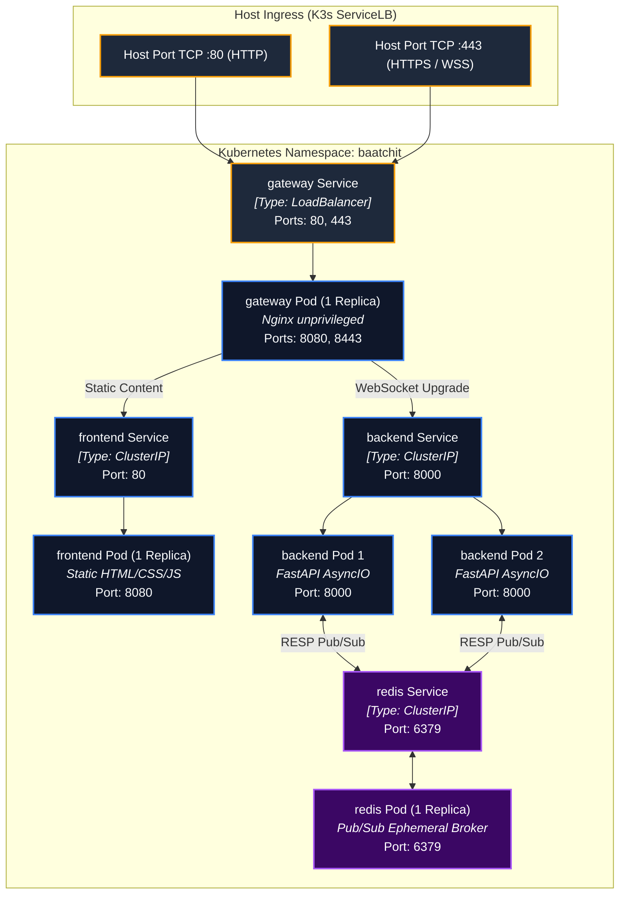

# Kubernetes Deployment Design & Manifest Specification

**Design Revision 5 — 2026-10-26. Status: Production Architecture Specification.** This document provides the declarative Kubernetes manifest specifications, resource allocation models, NetworkPolicies, and lifecycle probe contracts for Baatchit.

---

## 1. Deployment Environments & Workload Contract

The application executes on **Kubernetes (K3s)** across two environments with exact manifest parity managed via Kustomize:

| Dimension | Local Development (k3d) | AWS Demonstration (K3s on EC2) |
| :--- | :--- | :--- |
| **Orchestrator** | k3d v5.7+ (K3s inside Docker) | K3s v1.31+ on Ubuntu 24.04 LTS |
| **Compute Sizing** | Workstation Docker allocation | 1x EC2 `c7i-flex.large` (2 vCPU / 4 GiB RAM) |
| **Storage Engine** | Local host volume / emptyDir | 20 GiB gp3 encrypted EBS root |
| **Public Ports** | Localhost `8080` (HTTP), `8443` (HTTPS) | Public IPv4 `:80` (Redirect), `:443` (TLS) |
| **Ingress Controller**| K3s ServiceLB (host-port proxy) | K3s ServiceLB (host-port proxy) |
| **Namespace** | `baatchit` | `baatchit` |

---

## 2. Pod & Service Topology

Four Deployments create **five steady-state application Pods** plus supporting platform daemonsets:



---

## 3. Production Manifest Blueprints

### 3.1 Backend Deployment (`k8s/base/backend/deployment.yaml`)
```yaml
apiVersion: apps/v1
kind: Deployment
metadata:
  name: backend
  namespace: baatchit
  labels:
    app.kubernetes.io/name: backend
    app.kubernetes.io/part-of: baatchit
spec:
  replicas: 2
  strategy:
    type: RollingUpdate
    rollingUpdate:
      maxSurge: 0
      maxUnavailable: 1
  selector:
    matchLabels:
      app: backend
  template:
    metadata:
      labels:
        app: backend
    spec:
      terminationGracePeriodSeconds: 20
      securityContext:
        runAsNonRoot: true
        runAsUser: 10001
        runAsGroup: 10001
        fsGroup: 10001
        seccompProfile:
          type: RuntimeDefault
      containers:
      - name: backend
        image: ghcr.io/pawankgandhi15/baatchit-backend:sha256-pinned
        imagePullPolicy: IfNotPresent
        securityContext:
          allowPrivilegeEscalation: false
          readOnlyRootFilesystem: true
          capabilities:
            drop:
            - ALL
        ports:
        - containerPort: 8000
          name: http-ws
        envFrom:
        - configMapRef:
            name: backend-config
        env:
        - name: REDIS_URL_FILE
          value: "/etc/secrets/redis/url"
        volumeMounts:
        - name: redis-auth
          mountPath: "/etc/secrets/redis"
          readOnly: true
        - name: tmp-volume
          mountPath: "/tmp"
        resources:
          requests:
            cpu: 100m
            memory: 128Mi
          limits:
            cpu: 500m
            memory: 256Mi
        startupProbe:
          httpGet:
            path: /live
            port: 8000
          initialDelaySeconds: 2
          periodSeconds: 2
          failureThreshold: 10
        readinessProbe:
          httpGet:
            path: /health
            port: 8000
          periodSeconds: 2
          timeoutSeconds: 1
          failureThreshold: 1
        livenessProbe:
          httpGet:
            path: /live
            port: 8000
          periodSeconds: 10
          timeoutSeconds: 1
          failureThreshold: 3
      volumes:
      - name: redis-auth
        secret:
          secretName: redis-credentials
          items:
          - key: redis-url
            path: url
      - name: tmp-volume
        emptyDir:
          medium: Memory
          sizeLimit: 16Mi
```

---

## 4. Zero-Trust NetworkPolicy Declarations

Inter-pod network isolation is enforced via declarative `NetworkPolicies` executed by K3s's built-in network policy controller:

### 4.1 Default-Deny All Ingress and Egress
```yaml
apiVersion: networking.k8s.io/v1
kind: NetworkPolicy
metadata:
  name: default-deny-all
  namespace: baatchit
spec:
  podSelector: {}
  policyTypes:
  - Ingress
  - Egress
```

### 4.2 Backend NetworkPolicy (`k8s/base/network-policies/backend.yaml`)
```yaml
apiVersion: networking.k8s.io/v1
kind: NetworkPolicy
metadata:
  name: backend-netpol
  namespace: baatchit
spec:
  podSelector:
    matchLabels:
      app: backend
  policyTypes:
  - Ingress
  - Egress
  ingress:
  - from:
    - podSelector:
        matchLabels:
          app: gateway
    ports:
    - protocol: TCP
      port: 8000
  egress:
  - to:
    - podSelector:
        matchLabels:
          app: redis
    ports:
    - protocol: TCP
      port: 6379
  - to:
    - namespaceSelector: {}
      podSelector:
        matchLabels:
          k8s-app: kube-dns
    ports:
    - protocol: UDP
      port: 53
    - protocol: TCP
      port: 53
```

---

## 5. Resource Sizing & Node Headroom Formulation

The resource envelope allocates strict cgroup constraints across all steady-state application containers:

| Pod Deployment | Replicas | CPU Request / Limit | Memory Request / Limit | Total Mem Request | Total Mem Limit |
| :--- | :---: | :--- | :--- | :--- | :--- |
| **gateway** | 1 | 50m / 250m | 32 MiB / 64 MiB | 32 MiB | 64 MiB |
| **frontend** | 1 | 25m / 100m | 16 MiB / 48 MiB | 16 MiB | 48 MiB |
| **backend** | 2 | 100m / 500m (each) | 128 MiB / 256 MiB (each) | 256 MiB | 512 MiB |
| **redis** | 1 | 50m / 250m | 64 MiB / 128 MiB | 64 MiB | 128 MiB |
| **Aggregate Workloads** | **5** | **325m / 1600m** | — | **368 MiB** | **752 MiB** |

### Headroom Compliance Validation (NFR-06)
$$\text{Allocated Node RAM} = 4,096\text{ MiB}$$
$$\text{OS + K3s Base Footprint} \approx 1,200\text{ MiB}$$
$$\text{Max Workload Limit Saturated} = 752\text{ MiB}$$
$$\text{Calculated Free Headroom} = 4,096 - 1,200 - 752 = 2,144\text{ MiB} \gg 512\text{ MiB Floor}$$

Even under simultaneous worst-case cgroup memory saturation across all application containers, the host maintains $> 2.1\text{ GiB}$ free `MemAvailable`, satisfying **NFR-06** with an extensive safety margin.
