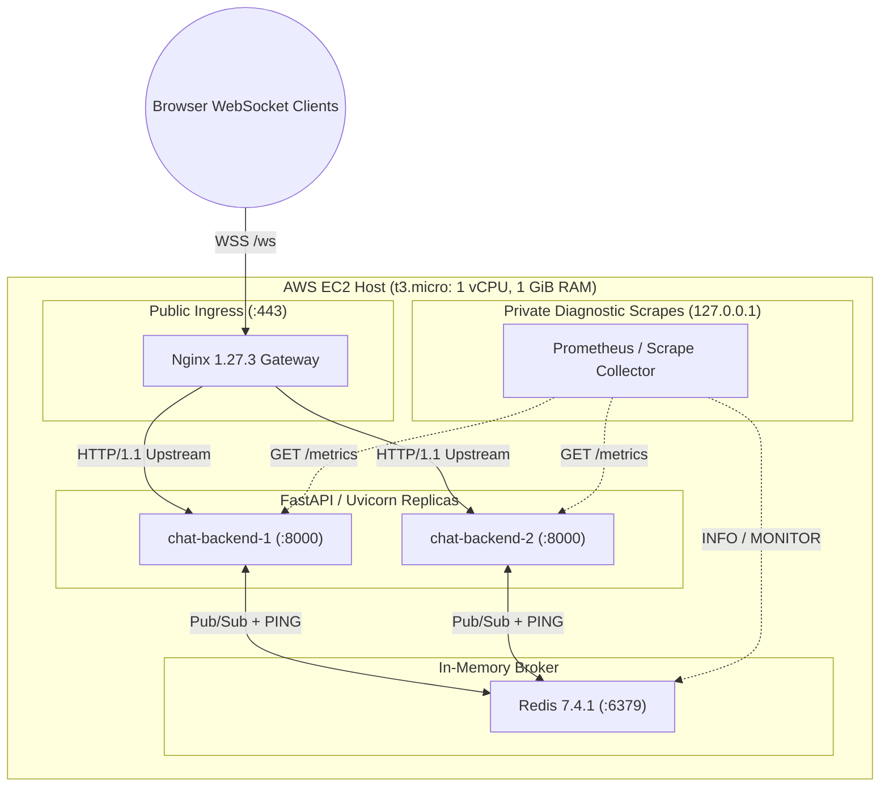
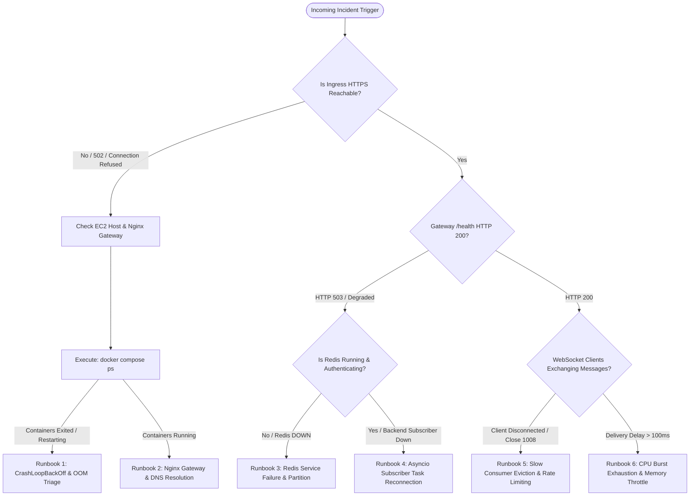

# Operations, Observability, and Incident Response Playbook

**Design Revision:** 4 (2026-10-25)  
**Document Status:** Production Operational Runbook & Telemetry Master  
**Target Environment:** AWS EC2 `t3.micro` (1 vCPU, 1 GiB RAM, Ubuntu 24.04 LTS Noble Numbat)  
**Parent Documentation:** [Architecture Specification](ARCHITECTURE.md) | [Deployment & Rollback](DEPLOYMENT.md) | [Configuration Master](CONFIGURATION.md) | [Security Specification](SECURITY.md)

---

## 1. Operational Overview & Health Topology

The real-time chat service operates as a distributed system on a single resource-constrained EC2 host (`t3.micro`). Maintaining service reliability requires real-time observability across four distinct layers:

1. **Host Infrastructure Layer:** Kernel CPU credit exhaustion, host available memory ($< 256\text{ MiB}$ alert threshold), and EBS disk utilization ($> 80\%$).
2. **Container Runtime Layer:** Docker daemon health, cgroup memory exhaustion ($> 80\%$ of container limit triggers OOM kill risk), and container restart frequency.
3. **Internal Application & Pub/Sub Mesh:** Redis ACL authentication, subscriber connection loop liveness, publisher latency histograms, and per-replica asyncio event loop lag.
4. **Client Ingress & Gateway Layer:** Nginx upstream active connections, WebSocket upgrade handshake durations, TLS certificate expiration ($< 14\text{ days}$ alert), and slow consumer queue drop rates.



---

## 2. Complete OpenMetrics / Prometheus Telemetry Catalog

Diagnostic metrics are exposed on `/metrics` directly by each FastAPI backend replica. The gateway blocks external public ingress to `/metrics`, making this interface exclusively available to internal scrapers or localhost diagnostic sessions.

### 2.1 Metric Definitions

| Metric Name | Type | Labels / Cardinality | Description & Operational Thresholds |
| :--- | :--- | :--- | :--- |
| `chat_connections_active` | Gauge | `replica="backend-1\|backend-2"` | Current active WebSocket sessions held by this replica. Sum across replicas must not exceed $100$ concurrent connections. |
| `chat_messages_published_total` | Counter | `result="ok\|timeout\|error"`, `replica` | Total client messages published to Redis Pub/Sub. Spike in `timeout` indicates Redis event loop starvation or network stall. |
| `chat_messages_rejected_total` | Counter | `reason="payload_too_large\|rate_limited\|invalid_json\|schema_violation"`, `replica` | Input sanitization drops. Rapid increase in `rate_limited` signals potential client-side flood or abuse. |
| `chat_system_events_dropped_total` | Counter | `reason="publish_budget\|queue_full"`, `replica` | Voluntary drops of best-effort `USER_JOIN` or `USER_LEAVE` events during transient traffic spikes to protect chat throughput. |
| `chat_deliveries_total` | Counter | `result="sent\|send_timeout\|queue_overflow"`, `replica` | Outbound WebSocket frame transmission outcomes. `queue_overflow` signals that a slow client exceeded the $128\text{ KiB}$ buffer. |
| `chat_outbound_queue_bytes` | Gauge | `replica` | Aggregate memory footprint of unconsumed outbound message queues. $> 64\text{ MiB}$ indicates massive slow consumer buildup. |
| `chat_redis_subscription_ready` | Gauge | `replica` | Boolean flag (`1.0` = healthy, `0.0` = unready/reconnecting). If `0.0`, the replica immediately drops from HTTP readiness checks. |
| `chat_redis_reconnects_total` | Counter | `replica` | Cumulative count of Redis Pub/Sub connection drops and reconnect attempts. Any continuous increase indicates Redis instability. |
| `chat_publish_duration_seconds` | Histogram | `replica`, Buckets: `[0.001, 0.005, 0.010, 0.025, 0.050, 0.100, 0.250, 0.500]` | Latency of Redis `PUBLISH` command. $p_{99} > 25\text{ ms}$ triggers backend performance warnings. |
| `chat_send_duration_seconds` | Histogram | `replica`, Buckets: `[0.001, 0.005, 0.010, 0.025, 0.050, 0.100, 0.250]` | Duration taken to push WebSocket frame to kernel TCP socket buffer. |
| `chat_event_loop_lag_seconds` | Gauge | `replica` | Latency between scheduled asyncio timer execution and actual execution. Values $> 50\text{ ms}$ indicate blocking sync code in loop. |

---

## 3. Prometheus Alerting Rules Configuration (`alerting_rules.yml`)

The following Alertmanager rules codify operational SLOs and trigger alerts based on critical failure thresholds.

```yaml
groups:
  - name: chat_application_alerts
    rules:
      - alert: ChatBackendDown
        expr: up{job="chat-backends"} == 0
        for: 15s
        labels:
          severity: critical
        annotations:
          summary: "Chat backend replica is unreachable"
          description: "Replica {{ $labels.instance }} has stopped responding to HTTP health probes for > 15s."

      - alert: RedisSubscriptionDown
        expr: chat_redis_subscription_ready == 0
        for: 10s
        labels:
          severity: critical
        annotations:
          summary: "Redis Pub/Sub subscription severed"
          description: "Replica {{ $labels.replica }} lost connection to Redis chat channel. Messages cannot be broadcast."

      - alert: HighEventLoopLag
        expr: chat_event_loop_lag_seconds > 0.050
        for: 30s
        labels:
          severity: warning
        annotations:
          summary: "Asyncio event loop lag elevated"
          description: "Replica {{ $labels.replica }} event loop lag is {{ $value }}s (> 50ms). Possible CPU starvation or synchronous blocking."

      - alert: SlowConsumerDropSpike
        expr: rate(chat_deliveries_total{result="queue_overflow"}[1m]) > 2
        for: 1m
        labels:
          severity: warning
        annotations:
          summary: "High rate of slow-consumer disconnects"
          description: "Outbound queue overflow rate is {{ $value }}/s on {{ $labels.replica }}. Clients may be on high-latency mobile networks."

      - alert: HostMemoryPressureCritical
        expr: node_memory_MemAvailable_bytes < (256 * 1024 * 1024)
        for: 1m
        labels:
          severity: critical
        annotations:
          summary: "Host available memory below 256 MiB"
          description: "Host available RAM is {{ $value | humanize1024 }}B. Imminent risk of Linux kernel OOM killer invocation."

      - alert: CertExpirationImpending
        expr: (ssl_certificate_expiry_timestamp_seconds - time()) < (14 * 86400)
        for: 1h
        labels:
          severity: warning
        annotations:
          summary: "TLS Certificate expiring soon"
          description: "Public TLS certificate for chat gateway expires in {{ $value | humanizeDuration }}."
```

---

## 4. Incident Triage Decision Flowchart

When an incident occurs, operators execute the following deterministic triage tree:



---

## 5. Concrete Diagnostic Terminal Commands

All operational commands must be executed on the target host from `/home/ubuntu/chat-app/current`. Secrets must **never** be passed as inline CLI flags.

### 5.1 Container & Resource Status Inspection

```bash
# 1. Inspect live container statuses, exit codes, and health probe states
docker compose -p chat-app -f docker-compose.prod.yml ps

# 2. View non-streaming container CPU, memory cgroup usage, and limit percentage
docker stats --no-stream --format "table {{.Name}}\t{{.CPUPerc}}\t{{.MemUsage}}\t{{.MemPerc}}\t{{.NetIO}}\t{{.BlockIO}}"

# 3. Check Linux host memory headroom (Available RAM must remain > 256 MiB)
free -m

# 4. Check root filesystem disk capacity and inode consumption
df -h /
df -i /

# 5. Inspect container restart history and OOM killer events in kernel ring buffer
dmesg -T | grep -i -E "oom[-_]killer|out of memory|killed process"
```

### 5.2 Direct Backend & Redis Diagnostics

```bash
# 1. Query Backend-1 readiness directly inside container network
docker exec chat-app-backend-1 curl -s http://127.0.0.1:8000/health/readiness | jq .

# 2. Query Backend-2 metrics to inspect event loop lag and connection count
docker exec chat-app-backend-2 curl -s http://127.0.0.1:8000/metrics | grep -E "chat_connections_active|chat_event_loop_lag_seconds|chat_redis_subscription_ready"

# 3. Check Redis memory allocation and active subscriber clients using protected secret
REDIS_PWD=$(sudo cat /home/ubuntu/chat-app/shared/secrets/redis_chat_backend.password)
docker exec chat-app-redis redis-cli --user chat_backend --pass "${REDIS_PWD}" INFO memory
docker exec chat-app-redis redis-cli --user chat_backend --pass "${REDIS_PWD}" PUBSUB NUMSUB chat_messages
```

---

## 6. Incident Response Runbooks

### 6.1 Runbook 1: Backend CrashLoopBackOff or Kernel OOM Kill

**Symptoms:** `docker compose ps` shows `backend-1` or `backend-2` in state `Restarting (137)`. `dmesg` reports `Out of memory: Killed process ... (python3)`.

1. **Verify Cgroup Limits:**
   Check `docker inspect chat-app-backend-1 | jq '.[0].HostConfig.Memory'` (must be $192\text{ MiB}$ or $201326592\text{ bytes}$).
2. **Inspect Slow Consumer Backpressure:**
   Inspect `chat_outbound_queue_bytes` from logs prior to crash. If memory climbed monotonically, clients with low bandwidth caused outbound buffer accumulation.
3. **Immediate Mitigation:**
   Restart the failed replica using Compose:
   ```bash
   docker compose -p chat-app -f docker-compose.prod.yml restart backend
   ```
4. **Log Collection:**
   Capture last 200 lines before termination:
   ```bash
   docker compose -p chat-app -f docker-compose.prod.yml logs --tail=200 backend > /tmp/oom-investigation.log
   ```

### 6.2 Runbook 2: Nginx Returns HTTP 502 Bad Gateway

**Symptoms:** Public curl `https://chat.example.com/health` returns `502 Bad Gateway`. Nginx error log reports `connect() failed (111: Connection refused) while connecting to upstream`.

1. **Check Backend Container IP & Dynamic DNS Resolution:**
   Inspect Nginx upstream DNS resolution:
   ```bash
   docker exec chat-app-gateway cat /etc/resolv.conf
   docker exec chat-app-gateway nslookup backend
   ```
2. **Validate Nginx Configuration Syntax:**
   Verify configuration with test command:
   ```bash
   docker exec chat-app-gateway nginx -t
   ```
3. **Check Backend Listening Ports:**
   ```bash
   docker exec chat-app-backend-1 ss -tulpn | grep 8000
   ```
4. **Reload Nginx Gateway:**
   ```bash
   docker exec chat-app-gateway nginx -s reload
   ```

### 6.3 Runbook 3: Redis Service Failure or Partition

**Symptoms:** `/health/readiness` returns HTTP `503 Service Unavailable`. Metrics report `chat_redis_subscription_ready 0`.

1. **Inspect Redis Container Health:**
   ```bash
   docker inspect --format='{{json .State.Health}}' chat-app-redis | jq .
   ```
2. **Test Redis Socket Responsiveness:**
   ```bash
   REDIS_PWD=$(sudo cat /home/ubuntu/chat-app/shared/secrets/redis_chat_backend.password)
   docker exec chat-app-redis redis-cli --user chat_backend --pass "${REDIS_PWD}" PING
   ```
3. **Recover Redis Container:**
   If Redis exited or is unresponsive:
   ```bash
   docker compose -p chat-app -f docker-compose.prod.yml restart redis
   ```
4. **Verify Application Self-Healing:**
   Watch backend logs to confirm exponential backoff reconnects to Redis:
   ```bash
   docker compose -p chat-app -f docker-compose.prod.yml logs -f --tail=50 backend | grep -i "redis"
   ```
   *Expected output:* `INFO: Redis Pub/Sub listener connected and subscribed to channel: chat_messages`.

---

## 7. Security & Secret Rotation Procedures

### 7.1 Redis ACL Credential Zero-Downtime Rotation

To rotate the `chat_backend` Redis password without taking down the chat application:

1. **Generate New Strong Secret:**
   ```bash
   NEW_SECRET=$(openssl rand -hex 32)
   ```
2. **Update Redis ACL to Accept Both Passwords:**
   Connect via `admin` user and append new hashed password to `chat_backend` ACL rule:
   ```bash
   ADMIN_PWD=$(sudo cat /home/ubuntu/chat-app/shared/secrets/redis_admin.password)
   docker exec chat-app-redis redis-cli -a "${ADMIN_PWD}" ACL SETUSER chat_backend >"${NEW_SECRET}"
   ```
3. **Update Protected Host Secret File:**
   ```bash
   echo "${NEW_SECRET}" | sudo tee /home/ubuntu/chat-app/shared/secrets/redis_chat_backend.password > /dev/null
   sudo chmod 0600 /home/ubuntu/chat-app/shared/secrets/redis_chat_backend.password
   ```
4. **Perform Rolling Backend Rejuvenation:**
   ```bash
   docker compose -p chat-app -f docker-compose.prod.yml up -d --no-deps --force-recreate backend
   ```
5. **Verify New Connections & Revoke Old Secret:**
   Once both backends are verified healthy on the new password, revoke old secret from Redis ACL:
   ```bash
   docker exec chat-app-redis redis-cli -a "${ADMIN_PWD}" ACL SETUSER chat_backend <"${OLD_SECRET}"
   ```

### 7.2 TLS Certificate Renewal via Certbot

When `ssl_certificate_expiry_timestamp_seconds` drops below 14 days:

```bash
# 1. Run Certbot renewal in webroot mode targeting shared Nginx challenge directory
sudo certbot certonly --webroot -w /home/ubuntu/chat-app/shared/acme-challenge -d chat.example.com --non-interactive

# 2. Copy renewed certificate to shared SSL directory
sudo cp /etc/letsencrypt/live/chat.example.com/fullchain.pem /home/ubuntu/chat-app/shared/ssl/fullchain.pem
sudo cp /etc/letsencrypt/live/chat.example.com/privkey.pem /home/ubuntu/chat-app/shared/ssl/privkey.pem
sudo chmod 0600 /home/ubuntu/chat-app/shared/ssl/*.pem

# 3. Reload Nginx without disconnecting active TCP/WebSocket connections
docker exec chat-app-gateway nginx -s reload

# 4. Verify live served certificate validity
curl -Iv https://chat.example.com 2>&1 | grep -i "expire date"
```

---

## 8. Complete Teardown Automation (`scripts/teardown.sh`)

For disposable demonstration environments or decommissioning, execute `scripts/teardown.sh` to cleanly stop containers, sanitize host files, and trigger Terraform resource destruction.

```bash
#!/usr/bin/env bash
# ==============================================================================
# Complete Decommissioning & Teardown Script (scripts/teardown.sh)
# Stops running containers, cleans up volumes, and invokes Terraform destroy.
# ==============================================================================
set -euo pipefail

DEPLOY_ROOT="/home/ubuntu/chat-app"
CURRENT_DIR="${DEPLOY_ROOT}/current"

echo "[TEARDOWN] Stopping all Docker Compose services and purging volumes..."
if [[ -d "${CURRENT_DIR}" ]]; then
    cd "${CURRENT_DIR}"
    docker compose -p chat-app -f docker-compose.prod.yml down -v --remove-orphans || true
fi

echo "[TEARDOWN] Pruning all unused Docker images and build caches..."
docker system prune -af --volumes || true

echo "[TEARDOWN] Sanitizing sensitive credentials from host filesystem..."
sudo rm -rf "${DEPLOY_ROOT}/shared/secrets"
sudo rm -rf "${DEPLOY_ROOT}/shared/ssl"

echo "[TEARDOWN] Local container teardown complete. Ready for Terraform destruction."
echo "Execute locally: terraform -chdir=terraform/environments/prod destroy -auto-approve"
exit 0
```

---
*End of Operations, Observability, and Incident Response Playbook.*

