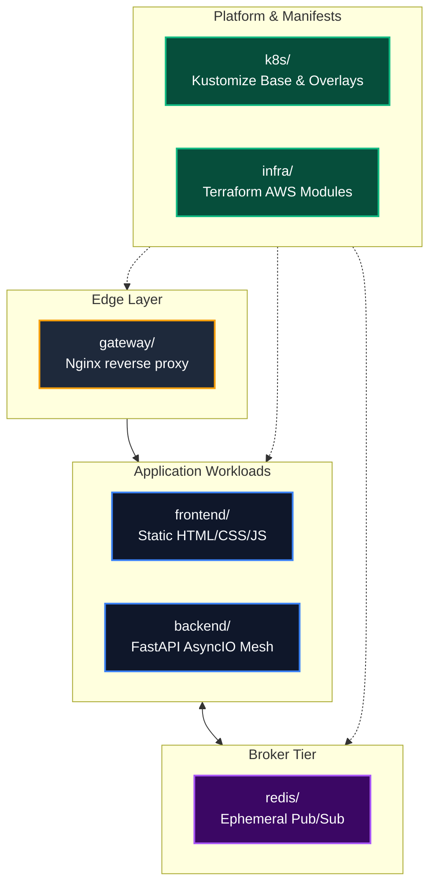

# Planned Project Structure & Repository Layout

> Design reference: the runnable implementation and measured results are recorded in [Implementation status](IMPLEMENTATION_STATUS.md). Use [Development](DEVELOPMENT.md), [Configuration](CONFIGURATION.md) and [Deployment](DEPLOYMENT.md) for current commands and defaults. The illustrative blueprints below are not the deployed source files.

**Design Revision 5 — 2026-10-26. Status: Architecture Layout Specification.** This document defines the directory hierarchy, file placement rules, modular boundaries, and Git governance for all components of Baatchit.

---

## 1. Master Repository Hierarchy

```text
Baatchit/
├── .github/                              # Continuous Integration & Delivery Workflows
│   ├── workflows/
│   │   ├── validate.yml                  # Linting, unit tests, property tests, schema checks
│   │   ├── release.yml                   # OCI build, SBOM generation, Trivy scan, Cosign sign
│   │   └── deploy.yml                    # Verified bundle deployment & automated verification
│   └── CODEOWNERS                        # Architectural review and ownership mapping
├── backend/                              # FastAPI AsyncIO Application Runtime
│   ├── app/
│   │   ├── __init__.py
│   │   ├── main.py                       # FastAPI lifespan, router mounting, signal handlers
│   │   ├── settings.py                   # Immutable Pydantic V2 settings loader
│   │   ├── protocol.py                   # Pydantic wire schemas, UUID/timestamp generation
│   │   ├── validation.py                 # Exact newline/ASCII trim, regex, code point counting; no NFC/NFKC
│   │   ├── sessions.py                   # Active session registry & delivery queue manager
│   │   ├── limits.py                     # Monotonic token-bucket rate limiters
│   │   ├── broker.py                     # Redis subscriber supervision & publisher pool
│   │   ├── health.py                     # Kubernetes readiness (/health) & liveness (/live)
│   │   └── telemetry.py                  # Prometheus metrics registry & JSON logging
│   ├── requirements.in                   # Direct high-level dependencies
│   ├── requirements.lock                 # Pinned, hashed production dependency lockfile
│   └── Dockerfile                        # Multi-stage rootless OCI container build
├── frontend/                             # Native Vanilla ES6 Browser Client
│   ├── index.html                        # Semantic HTML5 chat interface (No external CDNs)
│   ├── css/
│   │   └── style.css                     # Responsive CSS3 styles & dark mode themes
│   ├── js/
│   │   ├── app.js                        # App orchestrator, DOM event listener binding
│   │   ├── protocol.js                   # Client envelope parsing & outbound text encoding
│   │   ├── connection.js                 # WebSocket wrapper, retry loop with full jitter
│   │   ├── state.js                      # Single source of truth for UI state & draft retention
│   │   └── view.js                       # Sanitized DOM rendering via textContent
│   ├── nginx.conf                        # Unprivileged static file server configuration
│   └── Dockerfile                        # Static asset container build
├── gateway/                              # Public Edge Reverse Proxy
│   ├── nginx.conf                        # TLS termination, WSS proxy, security blockades
│   └── Dockerfile                        # Gateway container build
├── schemas/                              # Authoritative JSON Schemas
│   ├── events-v1.schema.json             # Schema validation for chat.v1 envelopes
│   └── release.schema.json               # Manifest verification schema for CI/CD
├── k8s/                                  # Kubernetes Declarative Manifests
│   ├── base/                             # Shared baseline configurations
│   │   ├── kustomization.yaml            # Base Kustomize manifest
│   │   ├── gateway/                      # Gateway Deployment, Service (LoadBalancer)
│   │   ├── frontend/                     # Frontend Deployment, Service (ClusterIP)
│   │   ├── backend/                      # Backend Deployment (2 replicas), Service (ClusterIP)
│   │   ├── redis/                        # Redis Deployment, Service (ClusterIP), ConfigMap
│   │   └── network-policies/             # Default-deny, inter-service ingress/egress rules
│   ├── overlays/                         # Environment-specific overlays
│   │   ├── local/                        # k3d overlay (localhost ports, dev certificates)
│   │   └── aws/                          # Production overlay (real hostnames, pinned digests)
│   └── platform/                         # Cluster bootstrap resources
│       ├── namespace.yaml                # baatchit namespace declaration
│       └── deployer-rbac.yaml            # Least-privilege deployer ServiceAccount & Role
├── infra/                                # Terraform Infrastructure as Code
│   ├── bootstrap-state/                  # Private versioned S3 bucket & locking initialization
│   └── workload/                         # AWS VPC, Subnet, Security Groups, EC2 instance
├── platform/                             # Orchestration Runtime Configurations
│   ├── k3s/                              # EC2 K3s installation scripts & config.yaml
│   └── k3d/                              # Local k3d cluster creation manifest
├── scripts/                              # Operational & Verification Runbooks
│   ├── verify-release.sh                 # Pre-flight OCI signature & digest validator
│   ├── deploy.sh                         # Staged rollout execution script
│   ├── rollback.sh                       # Emergency 10-minute automated rollback script
│   └── smoke-test.sh                     # Synthetic behavioral test suite
├── tests/                                # Multi-Tier Testing Suites
│   ├── unit/                             # Fast unit tests (validation, schemas, limits)
│   ├── property/                         # Hypothesis property-based fuzz tests
│   ├── contract/                         # Wire schema compliance verification
│   ├── integration/                      # Redis Pub/Sub & AsyncIO concurrency tests
│   ├── browser/                          # Headless Playwright end-to-end browser tests
│   ├── infrastructure/                   # Inspec / Terratest infrastructure validations
│   └── load/                             # k6 distributed load & latency benchmarks
├── docs/                                 # Architectural Specifications & Playbooks
│   ├── design/                           # System Design Handbook & Architecture Decisions
│   │   └── templates/                    # Standardized ADR and Change Proposal templates
│   └── images/                           # System architecture diagrams & infographics
├── README.md                             # Project overview & quickstart guide
├── CONTRIBUTING.md                       # Development guidelines & PR requirements
└── CHANGELOG.md                          # Version release history & audit trail
```

---

## 2. Component Responsibility & Boundary Invariants



* **Backend Module Isolation:** Business logic in `app/` is partitioned strictly: `limits.py` has zero network I/O; `validation.py` is pure computation; `broker.py` encapsulates Redis connectivity; `sessions.py` owns the socket registry.
* **Frontend Sandbox Isolation:** The browser client executes natively. No code in `frontend/` may import external npm packages, connect to third-party CDNs, or retain unsanitized user inputs.
* **Declarative Manifest Separation:** `k8s/base/` contains zero secrets and zero environment-specific hostnames. All environment differences reside in `k8s/overlays/`.

---

## 3. Git Governance & Sensitive Artifact Exclusions

To prevent credential leakage and repository bloat, the following items are strictly excluded from version control via `.gitignore`:

```gitignore
# Credentials, Secrets and Sensitive Keys
*.pem
*.key
*.crt
*.pfx
*.env
*.env.*
!.env.example
secrets/
kubeconfig
id_rsa*

# Terraform Local State and Caches
.terraform/
*.tfstate
*.tfstate.*
*.tfplan

# Python and Testing Artifacts
__pycache__/
*.py[cod]
*$py.class
.pytest_cache/
.coverage
htmlcov/
dist/
build/
*.egg-info/

# Operating System and IDE Files
.DS_Store
Thumbs.db
.idea/
.vscode/
*.swp
```
