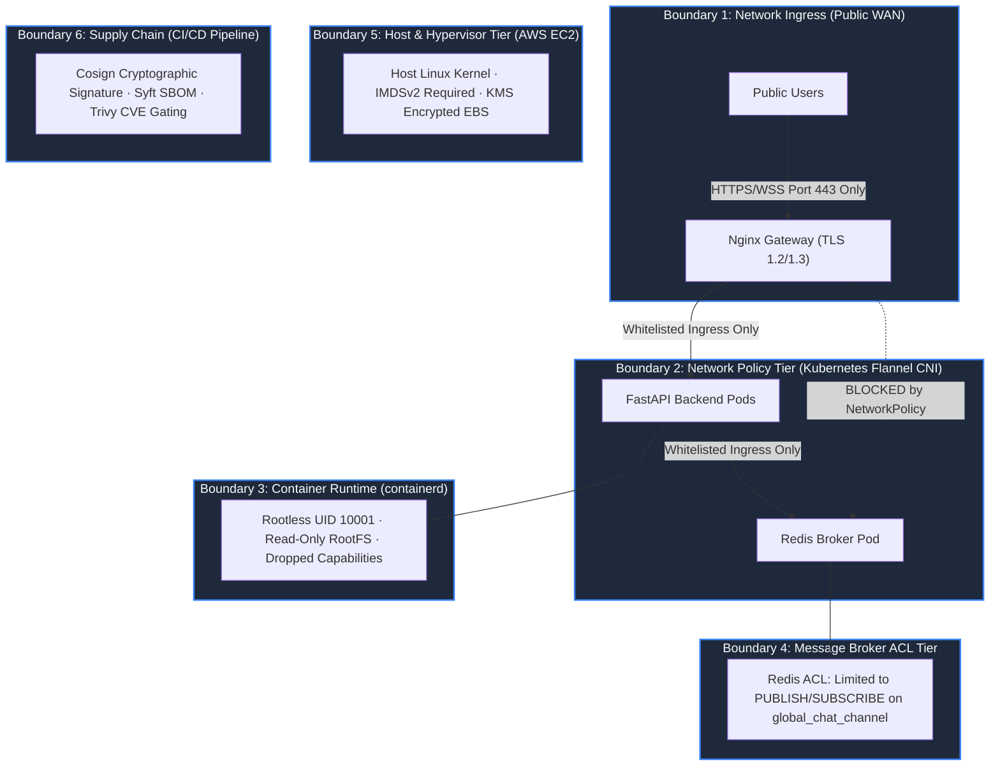
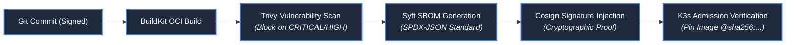

# System Security Architecture & Threat Modeling

**Design Revision 5 — 2026-10-26. Status: Production Security Specification.** This document defines the zero-trust security architecture, STRIDE threat models, container hardening standards, Redis ACL policies, and supply-chain integrity controls for Baatchit.

---

## 1. Zero-Trust Architecture & Boundary Defense

Baatchit implements defense-in-depth across six concentric security boundaries:



---

## 2. STRIDE System Threat Modeling

| STRIDE Category | Threat Vector & Attacker Goal | Targeted Component | Architecture Defense & Mitigation Mechanism | Residual Risk / Review Owner |
| :--- | :--- | :--- | :--- | :--- |
| **Spoofing** | Attacker impersonates legitimate user or injects arbitrary sender labels. | WebSocket Handshake | Ephemeral display names validated against regex `^[A-Za-z0-9_-]{1,32}$`; display names treated strictly as presentation labels; server generates immutable session UUIDs. | Anonymous app: names are non-authoritative. |
| **Tampering** | Man-in-the-middle alters in-flight chat messages or injects malicious payloads. | In-Flight Wire Frames | Mandatory TLS 1.2/1.3 termination at gateway; strict Pydantic JSON schema validation rejecting additional properties (`extra="forbid"`). | Compromised client machine out of scope. |
| **Repudiation** | Malicious sender denies publishing offensive text. | Broadcast Stream | Backend assigns authoritative `event_id` (UUIDv4), UTC timestamps (`sent_at`), and `container_id`. | Baseline maintains no permanent audit database. |
| **Information Disclosure** | Unauthenticated actor accesses internal telemetry or Redis messages. | Cluster Services | Gateway blocks `/metrics`, `/health`, and `/live` externally; Redis port 6379 unexposed on host; inter-pod NetworkPolicies block non-backend access. | Internal Pod compromise could inspect Redis bus. |
| **Denial of Service** | Flooding frames, memory exhaustion, or holding open thousands of idle sockets. | Backend Event Loop | Connection limit (64/pod); per-socket token bucket (5 burst, 1/s); per-replica bucket (30 burst, 10/s); double-accounting deques ($N \le 32$, $B \le 256\text{ KiB}$); close code `1013`. | Distributed volumetric DDoS against EC2 host. |
| **Elevation of Privilege**| Exploiting an ASGI/FastAPI vulnerability to escape container and access host. | Container Runtime | `runAsNonRoot: true` (UID 10001); `readOnlyRootFilesystem: true`; `allowPrivilegeEscalation: false`; all Linux capabilities dropped (`drop: ["ALL"]`); seccomp `RuntimeDefault`. | Zero-day kernel vulnerability in Linux kernel. |

---

## 3. Container Hardening & Pod Security Standards (PSS Restricted)

All application Pods in the `baatchit` namespace strictly enforce the Kubernetes **Restricted Pod Security Standard**:

```yaml
securityContext:
  runAsNonRoot: true
  runAsUser: 10001
  runAsGroup: 10001
  fsGroup: 10001
  seccompProfile:
    type: RuntimeDefault
containers:
- name: application
  securityContext:
    allowPrivilegeEscalation: false
    readOnlyRootFilesystem: true
    capabilities:
      drop:
      - ALL
```

* **No Privileged Workloads:** Zero containers run in privileged mode. Host namespaces (`hostPID`, `hostIPC`, `hostNetwork`) and host volume mounts (`hostPath`) are permanently forbidden.
* **Read-Only Root Filesystems:** Container root filesystems are mounted read-only. Ephemeral working directories (such as Nginx cache or `/tmp`) use memory-backed `emptyDir` volumes with strict `sizeLimit` caps ($16\text{ MiB}$).

---

## 4. Redis ACL Policy & Command Lockdown

The Redis broker operates in-memory with the default user disabled. Application connections authenticate using a dedicated user constrained by strict Command and Channel ACLs:

```text
# Redis 7 ACL Configuration
user default off
user baatchit on >${REDIS_PASSWORD} ~global_chat_channel +publish +subscribe +unsubscribe +ping -@all
```

* **Disabled Administrative Commands:** All administrative and dangerous commands (`FLUSHALL`, `FLUSHDB`, `CONFIG`, `KEYS`, `SHUTDOWN`, `DEBUG`, `EVAL`) are permanently blocked.
* **Exact Channel Gating:** Backends can only publish and subscribe to `global_chat_channel`. Key-space access is completely disabled.

---

## 5. HTTP Response Headers & Content Security Policy (CSP)

The Nginx gateway terminates TLS and injects strict security headers on all responses:

```nginx
# HTTP Security Response Headers
add_header Strict-Transport-Security "max-age=31536000; includeSubDomains" always;
add_header X-Content-Type-Options "nosniff" always;
add_header X-Frame-Options "DENY" always;
add_header Referrer-Policy "strict-origin-when-cross-origin" always;
add_header Permissions-Policy "geolocation=(), microphone=(), camera=()" always;

# Strict Content Security Policy (CSP)
add_header Content-Security-Policy "default-src 'self'; connect-src 'self' wss: ws:; style-src 'self'; script-src 'self'; img-src 'self' data:; frame-ancestors 'none'; base-uri 'self'; form-action 'self';" always;
```

---

## 6. Supply Chain Integrity & Automated Scanning

Release artifacts are verified through an immutable cryptographic chain:



* **Automated Image Signing:** Every OCI image is cryptographically signed using Cosign (`cosign sign --key cosign.key ghcr.io/...@sha256:...`).
* **Digest Pinning:** Kubernetes manifests in production overlays reject mutable tags (e.g., `:latest`). Workloads reference only validated `@sha256:...` digests.
