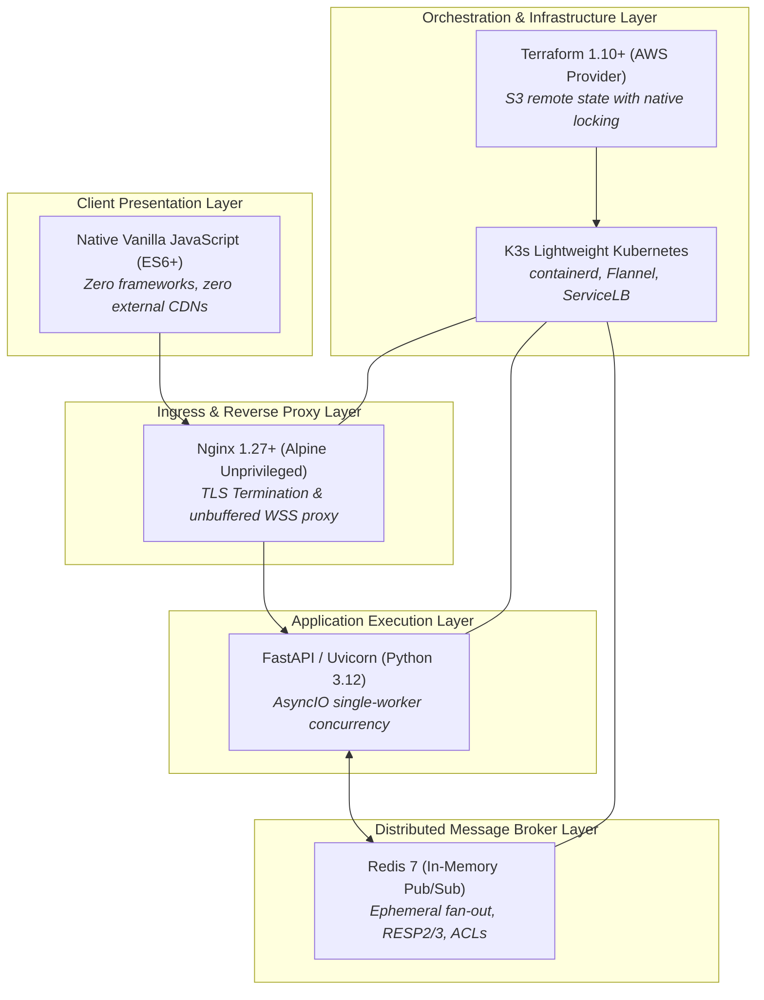
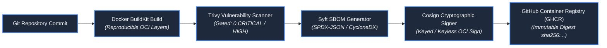

# Technology Choices & Ecosystem Evaluation

**Design Revision 5 — 2026-10-26. Status: Production Architecture Specification.** This document defines the technology selection rationale, ecosystem compatibility matrix, supply chain security tooling, and dependency boundaries for Baatchit.

---

## 1. Technology Selection Rationale & Evaluated Alternatives

Every technology in the Baatchit stack was selected based on strict criteria: operational simplicity on constrained resources (2 vCPU / 4 GiB), native async I/O performance, containerization footprint, and zero cloud vendor lock-in.

### Comprehensive Selection Analysis

| Layer | Selected Technology | Rejected Alternatives | Primary Selection Rationale & Trade-Offs |
| :--- | :--- | :--- | :--- |
| **Client Presentation** | **Native HTML5 / CSS3 / Vanilla ES6** | React, Vue, Svelte, Angular | Zero build-step complexity; zero node_modules dependencies; zero CDN outages; minimal bundle footprint ($< 25\text{ KiB}$ total); pure DOM manipulation via `textContent` eliminates XSS vectors. |
| **API & Application** | **Python 3.12 + FastAPI + Uvicorn** | Node.js / Express, Go / Gin, Rust / Axum | First-class AsyncIO concurrency; Pydantic V2 native C-speed data validation; automatic OpenAPI documentation; single-worker process model eliminates multi-thread contention on 2-vCPU nodes. |
| **Broker Engine** | **Redis 7 (In-Memory Pub/Sub)** | Apache Kafka, RabbitMQ, NATS | Extreme lightweight memory footprint ($< 35\text{ MiB}$ base RSS); sub-millisecond Pub/Sub dispatch; built-in ACLs; zero disk-persistence requirements for ephemeral chat. |
| **Ingress & Proxy** | **Nginx 1.27+ (`nginx-unprivileged`)** | Envoy, Traefik, Caddy | Battle-tested connection pooling; native WebSocket upgrade proxying; granular memory control; non-root execution by default; minimal memory footprint ($< 15\text{ MiB}$). |
| **Local Orchestration** | **k3d (K3s in Docker)** | Minikube, Kind, Docker Compose | Runs identical K3s Kubernetes manifests locally without cloud costs; supports ServiceLB simulation; exact parity with AWS production cluster. |
| **Cloud Orchestration** | **K3s (Single Node on EC2)** | AWS EKS, Docker Compose, Nomad | Eliminates $73/month EKS cluster control-plane charge; includes packaged Flannel, CoreDNS, and ServiceLB in a single $< 100\text{ MB}$ binary; fully compatible with standard Kubernetes API. |
| **Infrastructure as Code** | **Terraform 1.10+** | OpenTofu, AWS CloudFormation, Pulumi | Declarative HCL syntax; native S3 state locking via `use_lockfile = true` without requiring billable DynamoDB tables; reproducible cloud resource lifecycle. |
| **Supply Chain Security** | **Cosign 2.4+ & Syft & Trivy** | Notary, Docker Content Trust | Cryptographic image signing; automated Software Bill of Materials (SBOM) generation; container vulnerability gating before deployment. |

---

## 2. Formal Ecosystem Compatibility Matrix

All components must strictly adhere to the following pinned major/minor versions during implementation and build artifact generation:

| Component | Target Version | Supported Range | Critical Configuration & Compatibility Flags |
| :--- | :--- | :--- | :--- |
| **Python Runtime** | `3.12.7` | `3.12.x` | CPython base; `PYTHONUNBUFFERED=1`; `PYTHONDONTWRITEBYTECODE=1`. |
| **FastAPI** | `0.115.4` | `^0.115.0` | Relies on Starlette `^0.39.0` for WebSocket connection lifecycle. |
| **Pydantic** | `2.9.2` | `^2.9.0` | Pydantic Core with Rust validation engine; strict mode enabled. |
| **Uvicorn** | `0.32.0` | `^0.32.0` | Single worker per Pod (`--workers 1`); WebSocket protocol: `websockets` or `wsproto`. |
| **redis-py** | `5.2.0` | `^5.2.0` | AsyncIO client (`redis.asyncio`); connection pooling enabled. |
| **Nginx** | `1.27.2-alpine-slim` | `1.27.x-alpine` | Unprivileged non-root image (`UID 101`); `proxy_buffering off`. |
| **Redis Server** | `7.4.1-alpine` | `7.4.x-alpine` | In-memory only; RDB disabled; AOF disabled; ACL enabled. |
| **K3s Kubernetes** | `v1.31.2+k3s1` | `v1.31.x` | Embedded SQLite; Traefik disabled (`--disable traefik`); ServiceLB enabled. |
| **Terraform** | `1.10.0` | `>= 1.10.0` | AWS Provider `~> 5.75.0`; native S3 state locking enabled. |
| **Cosign** | `v2.4.1` | `^2.4.0` | OCI artifact signing with Cosign public key infrastructure. |

---

## 3. Supply Chain Security & Software Bill of Materials (SBOM)

To comply with enterprise security standards and SLSA Level 3 supply-chain integrity, all release builds enforce the following pipeline:

1. **Vulnerability Gating:** Images failing Trivy scans with unresolved `CRITICAL` or `HIGH` Common Vulnerabilities and Exposures (CVEs) fail the CI pipeline automatically.
2. **SBOM Generation:** Syft produces comprehensive SPDX-JSON and CycloneDX software bills of materials attached directly to the published container images.
3. **Digest Immutability:** Kubernetes manifests in production never reference mutable image tags (e.g., `:latest` or `:main`). All manifests pin exact `@sha256:...` digests.

---

## 4. Open Source Licensing & Compliance Verification

To prevent legal and licensing liabilities, all application dependencies are restricted to permissible permissive licenses:

| Layer | Permitted Licenses | Explicitly Forbidden Licenses |
| :--- | :--- | :--- |
| **Python Libraries** | MIT, Apache 2.0, BSD-2-Clause, BSD-3-Clause, PSF | GPL v2/v3, AGPL v3, SSPL, Commons Clause, Elastic License |
| **Container Base Images** | Alpine Linux (MIT / BSD / Apache / GPL for OS utilities) | Proprietary commercial bases, Non-commercial only |
| **JavaScript / Web** | Vanilla native code (No external libraries) | Any third-party NPM runtime dependencies |
| **Infrastructure Tools** | Mozilla Public License (Terraform MPL v2.0) | Proprietary cloud orchestration tools |
