# Technologies Used in the Chat Application

**Status:** Planned technology stack and production compatibility lock. See the [documentation index](../README.md).

**Design Revision 4 (2026-10-25):** Definitive production dependency locks, runtime engine selections, architectural trade-off analyses, and supply-chain integrity toolchains.

---

## Production Compatibility Lock (Revision 4 Baseline)

The table below specifies the verified, pinned production dependency baseline. These versions satisfy all architectural prerequisites (including ASGI denial responses, open-source dynamic Nginx upstream resolution, and Redis ACL support).

| Component / Library | Pinned Version / Digest | Runtime Role & Capability Justification |
| --- | --- | --- |
| **Python** | `3.11.10-slim-bookworm` | High-performance CPython runtime; native `asyncio` task groups, exception groups, and memory efficiency on single-worker containers. |
| **FastAPI** | `0.115.4` | Application routing, dependency injection, and Pydantic schema validation. |
| **Starlette** | `0.41.2` | Core ASGI engine; supports ASGI WebSocket denial response extension (`websocket.http.response.*`). |
| **Uvicorn** | `0.32.0` | Production ASGI web server; executes single-process event loop per container. |
| **websockets** | `13.1` | Native WebSocket protocol parser for Uvicorn; enforces frame limits, ping/pong heartbeats, and close frame negotiation. |
| **redis-py** | `5.2.0` | Asynchronous Redis client (`redis.asyncio`) with connection pooling and Pub/Sub iterator coroutines. |
| **hiredis** | `3.0.0` | C-accelerated Redis protocol parser; drastically minimizes Python event loop CPU lag during high message fan-out. |
| **Pydantic / Settings** | `2.9.2` / `2.6.0` | Strictly typed environment validation, code point string constraints, and immutable configuration objects. |
| **Nginx Ingress Gateway** | `nginx:1.27.3-alpine` | First open-source release officially supporting `resolver ... valid=5s` with `server ... resolve` in upstream shared-memory zones. |
| **Nginx Frontend Server** | `nginx:1.27.3-alpine` | High-concurrency static asset server delivering HTML, CSS, and JS with gzip and strict security headers. |
| **Redis Server** | `redis:7.4-alpine` | Ephemeral in-memory message bus; ACL command/channel sandboxing; persistence disabled. |
| **pytest / pytest-asyncio** | `8.3.3` / `0.24.0` | Asynchronous unit, component, and lifecycle integration testing harness. |
| **HTTPX** | `0.27.2` | Async HTTP client for test suite and synthetic health probe validation. |
| **Terraform Core** | `1.9.8` | Declarative infrastructure as code engine with native S3 state lockfile support (`use_lockfile = true`). |
| **Terraform AWS Provider** | `~> 5.73.0` | AWS resource management (VPC, Security Groups, EC2, EBS gp3). |
| **Trivy** | `0.56.2` | Vulnerability scanner for OCI container images and generator of CycloneDX SBOMs. |
| **Cosign (Sigstore)** | `2.4.1` | Container image signing and keyless provenance attestation via GitHub Actions OIDC tokens. |

---

## Architectural Technology Trade-Off Matrix

| Chosen Technology | Alternative Considered | Decision Rationale & Architectural Trade-Off |
| --- | --- | --- |
| **FastAPI + Uvicorn (Python 3.11)** | Go (`gorilla/websocket`) or Node.js (`ws`) | FastAPI provides declarative Pydantic schemas, native lifespan management, and clean integration with Python's async ecosystem. While Go has lower baseline memory, Python 3.11 with `hiredis` easily meets the 5 msg/s target while providing superior schema clarity and test fixtures. |
| **Redis Pub/Sub** | RabbitMQ / Apache Kafka / NATS | RabbitMQ/Kafka require substantial JVM/Erlang memory overhead ($>300\text{ MiB}$), which would exceed the $1\text{ GiB}$ host RAM envelope. Redis 7 requires $<30\text{ MiB}$ RSS, operates with sub-millisecond latency, and fits the ephemeral, at-most-once design contract perfectly. |
| **Nginx Ingress (v1.27.3+)** | Traefik / Envoy / Caddy | Envoy has higher memory footprints and complex EnvoyFilter YAMLs. Traefik requires Docker socket access (a critical security risk). Nginx is ultra-lightweight ($<15\text{ MiB}$), battle-tested, and v1.27.3+ resolves the historical limitation by supporting open-source dynamic upstream DNS resolution. |
| **Vanilla HTML/CSS/JS** | React / Vue / Next.js | Modern SPA frameworks introduce node build toolchains, client-side hydration delays, bundle weight ($>200\text{ KiB}$), and XSS vectors via virtual DOM bypasses. Vanilla JS delivers a $<20\text{ KiB}$ footprint, sub-10ms DOM render, zero supply-chain npm bloat, and strict Content Security Policy compliance. |
| **Terraform (HashiCorp)** | AWS CDK / CloudFormation / Pulumi | Terraform HCL is declarative, widely understood, operates without programming language runtimes, generates explicit reviewable execution plans (`terraform plan -out`), and ensures reproducible cloud-init bootstrap on AWS. |
| **Docker Compose v2** | Kubernetes / K3s / Nomad | Running Kubernetes or K3s on a single `t3.micro` instance consumes 400-600 MiB RAM just for control plane components. Compose v2 runs directly via the host Docker daemon with negligible overhead, matching the single-host learning and evaluation scope. |

---

## Multi-Stage Container Build Architecture

### Backend Multi-Stage Dockerfile Strategy
```
+-------------------------------------------------------------+
| Stage 1: Builder (python:3.11.10-slim-bookworm)             |
| - Installs build-essential, gcc, libhiredis-dev             |
| - Compiles Python wheels into /install/wheels               |
+-------------------------------------------------------------+
                              │ (Copies pre-compiled wheels only)
                              ▼
+-------------------------------------------------------------+
| Stage 2: Runtime (python:3.11.10-slim-bookworm)             |
| - Zero compiler tools, zero headers, zero git               |
| - Creates unprivileged user 'chatapp' (UID 10001)           |
| - Installs pre-built wheels via pip --no-index              |
| - Entrypoint: uvicorn app.main:app --host 0.0.0.0           |
+-------------------------------------------------------------+
```

### Security Benefits of the Multi-Stage Build:
1. **Attack Surface Minimization:** The runtime image contains no package managers, compilers, or build tools, preventing attacker utility execution upon potential remote code execution.
2. **Minimal Image Footprint:** Reduces image size from $>500\text{ MB}$ to $<140\text{ MB}$, accelerating CI/CD build times, network transfer, and host disk usage.
3. **Non-Root Execution:** Container processes execute under non-privileged system user `chatapp` (UID 10001, GID 10001), preventing container escape to host root.

---

## Supply Chain & Provenance Verification Toolchain

```mermaid
flowchart LR
    Git[Git Commit] --> CI[GitHub Actions Runner]
    CI --> Test[pytest & Container Integration Tests]
    Test --> Build[Docker Buildx: linux/amd64]
    Build --> Scan[Trivy Vulnerability Scan]
    Scan --> SBOM[CycloneDX SBOM Generation]
    SBOM --> Sign[Cosign Keyless Signature via OIDC]
    Sign --> Push[Docker Hub Registry: Pinned Digest]
    Push --> Manifest[release.json Manifest Generation]
```



1. **Artifact Digest Pinning:** All release configurations discard mutable tags (`latest`, `v1.0.0`) in favor of cryptographic image digests (`sha256:7f3b...`).
2. **Software Bill of Materials (SBOM):** Generated in CycloneDX JSON format for every release image, cataloging every OS library and Python package.
3. **Cosign Keyless Signing:** Uses Sigstore and GitHub Actions OpenID Connect (OIDC) identity to attach cryptographic signatures to published image digests without requiring long-lived private signing keys.

---

## Related Guides

[Requirements](REQUIREMENTS.md) | [Architecture](ARCHITECTURE.md) | [Configuration](CONFIGURATION.md) | [Security](SECURITY.md) | [CI/CD](CICD.md)

