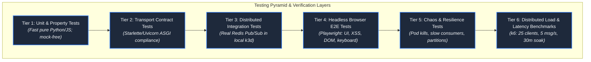

# Testing & Quality Assurance Plan

**Design Revision 5 — 2026-10-26. Status: Production Verification Specification.** This document provides the multi-tier testing framework, property-based fuzzing guidelines, Acceptance Criteria (AC-01 to AC-18) verification runbooks, and distributed k6 load testing specifications for Baatchit.

---

## 1. Multi-Tier Testing Architecture

Quality assurance is structured across six concentric testing tiers to guarantee that defects are caught at the earliest possible stage:



---

## 2. Acceptance Criteria (AC-01 to AC-18) Verification Runbook

Every functional requirement must be proven via reproducible automated verification commands:

| Criterion ID | Target Verification Scenario | Execution Command / Script | Expected Pass Output |
| :--- | :--- | :--- | :--- |
| **AC-01** | Baseline Topology Spin-Up | `kubectl get pods -n baatchit -l app.kubernetes.io/part-of=baatchit` | Exactly 5 application Pods in `Running` state (`1/1 Ready`). |
| **AC-02** | Cross-Replica Fan-Out | `pytest tests/e2e/test_cross_replica_fanout.py` | Client on Pod 1 receives message from Client on Pod 2 with counterpart `container_id`. |
| **AC-03** | Public Ingress TLS | `curl -vk https://${PUBLIC_IP}/ 2>&1 \| grep 'SSL connection using'` | Valid TLS 1.2/1.3 connection established. |
| **AC-04** | Subprotocol Negotiation | `wscat -c wss://${PUBLIC_IP}/ws/alice -s invalid.v1` | Handshake rejected with HTTP 400 or HTTP 403. |
| **AC-05** | Redis Dependency Recovery | `kubectl delete pod -n baatchit -l app=redis` | Backends transition to 503; recover to 200 within 15 seconds after restart. |
| **AC-06** | Rolling Deployment Drain | `kubectl rollout restart deployment/backend -n baatchit` | Connected sockets receive close code `1012` and reconnect without dropped messages. |
| **AC-07** | Strict Wire Validation | `pytest tests/unit/test_protocol_schemas.py` | Payloads with unexpected properties raise `ValidationError`. |
| **AC-08** | Immutable Digest Pinning | `kubectl get deployment backend -n baatchit -o jsonpath='{.spec.template.spec.containers[0].image}'` | Image pinned by `@sha256:...` digest. |
| **AC-09** | 10-Minute Rollback | `bash scripts/rollback.sh` | Cluster restores prior release bundle in $\le 10\text{ minutes}$. |
| **AC-10** | Slow Consumer Eviction | `python tests/chaos/flood_slow_consumer.py` | Slow client disconnected with close code `1013`; fast client unaffected. |
| **AC-11** | Clean Cloud Teardown | `terraform destroy -auto-approve` | Zero residual billable EC2 instances, EBS volumes, or Elastic IPs. |
| **AC-12** | Input Code Point Limits | `pytest tests/unit/test_text_normalization.py` | Messages $> 2,000$ code points or empty strings rejected. |
| **AC-13** | Rate Limit Enforcement | `python tests/chaos/burst_rate_limit.py` | Inbound bursts $> 5\text{ msg/s}$ throttled without closing socket. |
| **AC-14** | NetworkPolicy Isolation | `kubectl exec -n baatchit deploy/gateway -- nc -zvw1 redis 6379` | Direct TCP connection times out / fails (exit code 1). |
| **AC-15** | Supply Chain Verification | `cosign verify --key cosign.pub ${BACKEND_IMAGE}` | Verification successful, signature verified. |
| **AC-16** | Headroom Compliance | `ssh ec2-user@${NODE_IP} "free -m \| awk '/Mem:/ {print \$7}'"` | Free `MemAvailable` $\ge 512\text{ MiB}$ sustained. |
| **AC-17** | Private Telemetry Denied | `curl -I https://${PUBLIC_IP}/metrics` | Gateway returns HTTP 403 Forbidden. |
| **AC-18** | Heartbeat Nonce Probing | `pytest tests/integration/test_broker_watchdog.py` | Stale nonce $> 10\text{s}$ triggers readiness probe failure. |

---

## 3. Quantitative Non-Functional Requirements (NFR Matrix)

| NFR ID | Target Objective | Measurement Harness & Methodology | Acceptance Threshold |
| :--- | :--- | :--- | :--- |
| **NFR-01** | End-to-End Latency | k6 distributed WebSocket load generator (25 clients, 5 msg/s for 30m). | P95 latency $< 250\text{ ms}$; P99 latency $< 1,000\text{ ms}$. |
| **NFR-02** | Delivery Completeness | Automated receipt auditor comparing published vs received event IDs. | $\ge 99.9\%$ expected deliveries completed within $2.0\text{ seconds}$. |
| **NFR-03** | Data Integrity | SHA-256 payload checksum verification on all received frames. | $100\%$ byte integrity match across all received frames. |
| **NFR-04** | Client Memory Cap | Browser memory profiling during 1,000-message soak test. | Rendered DOM nodes $\le 500$; memory remains flat. |
| **NFR-05** | Handshake Latency | TCP + TLS + WebSocket upgrade round-trip latency. | P95 connection handshake completion $< 500\text{ ms}$. |
| **NFR-06** | Node Memory Headroom | Prometheus polling `node_memory_MemAvailable_bytes`. | Floor $\ge 512\text{ MiB}$ maintained at all times. |
| **NFR-07** | Pod Resource Boundaries | Kubernetes cgroups (`container_memory_working_set_bytes`). | Backend Pods stay under $256\text{ MiB}$; zero OOM kills. |
| **NFR-08** | Cloud Spend Ceiling | AWS Cost Explorer API / Billing telemetry. | Total gross accumulated charges $\le \$100.00$. |

---

## 4. Distributed k6 Load Testing Benchmark Script (`tests/load/k6_benchmark.js`)

```javascript
import ws from 'k6/ws';
import { check, sleep } from 'k6';
import { Trend, Counter } from 'k6/metrics';

const deliveryLatency = new Trend('chat_delivery_latency_ms');
const successfulDeliveries = new Counter('chat_deliveries_successful');

export const options = {
  scenarios: {
    steady_chat: {
      executor: 'constant-vus',
      vus: 25,
      duration: '30m',
    },
  },
  thresholds: {
    'chat_delivery_latency_ms': ['p(95)<250', 'p(99)<1000'],
  },
};

export default function () {
  const username = `k6_client_${__VU}`;
  const url = `wss://chat.example.com/ws/${username}`;
  const params = { subprotocols: ['chat.v1'] };

  const res = ws.connect(url, params, function (socket) {
    socket.on('open', () => {
      // Periodic message generation: 5 aggregate msg/s = 1 msg every 5s per VU
      socket.setInterval(() => {
        const payload = JSON.stringify({
          text: `Benchmark message from VU ${__VU} at ${Date.now()}`.padEnd(512, 'X'),
        });
        socket.send(payload);
      }, 5000);
    });

    socket.on('message', (data) => {
      const event = JSON.parse(data);
      if (event.type === 'chat') {
        const sentTime = new Date(event.sent_at).getTime();
        const latency = Date.now() - sentTime;
        deliveryLatency.add(latency);
        successfulDeliveries.add(1);
      }
    });

    socket.on('close', () => {});
    socket.on('error', (e) => console.error(e));
  });

  check(res, { 'status is 101': (r) => r && r.status === 101 });
}
```
