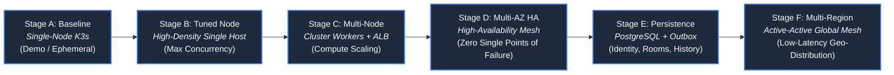
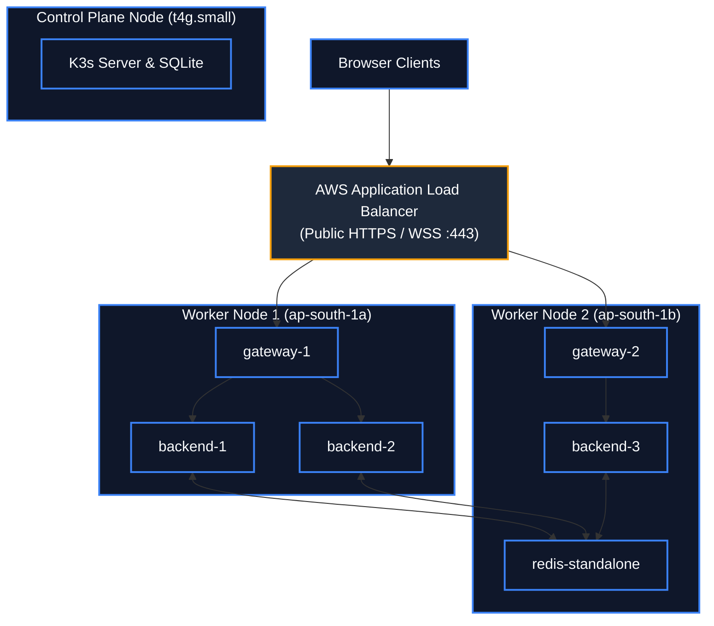
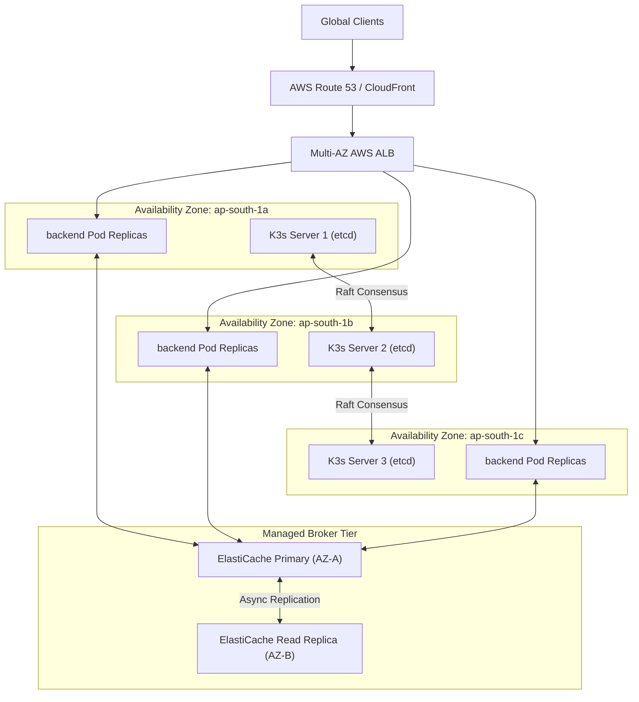

# Architecture Evolution & Evolutionary Roadmap

**Status: Production Architecture Specification. Baseline: Design Revision 5. Updated: 2026-10-26.**

This document defines the structured, multi-stage evolutionary roadmap for scaling, hardening, and modernizing the Baatchit architecture. Each evolutionary stage addresses specific measured bottlenecks, reliability requirements, or product features.

---

## 1. Evolutionary Roadmap Overview

The evolutionary trajectory is organized into six discrete, backward-compatible stages:

---

## 2. Stage-by-Stage Architecture Blueprints

### Stage A: Single-Node K3s Baseline (Current Baseline)
* **Topology:** 1 EC2 instance (`c7i-flex.large`, 2 vCPU, 4 GiB RAM), single-node K3s with embedded SQLite.
* **Workloads:** 4 Deployments, 5 steady-state application Pods (1 gateway, 1 frontend, 2 backend replicas, 1 Redis).
* **Ingress:** K3s ServiceLB binding host ports 80/443; Nginx TLS termination.
* **State:** Entirely ephemeral; in-memory Redis Pub/Sub; no persistent volumes.
* **Failure Domain:** Host is a single point of failure (SPOF). Total cluster loss on hardware failure.
* **Monthly Cost:** ~\$35–\$45 gross (covered under AWS Free Tier / credit allocations).

---

### Stage B: High-Density Single Node (Optimized Concurrency)
* **Trigger:** Backend admission capacity saturated ($128\text{ sockets}$ aggregate) while host node maintains $> 50\%$ CPU and $> 1.5\text{ GiB}$ RAM headroom.
* **Architectural Upgrades:**
  1. **ASGI Engine Optimization:** Replace default asyncio event loop with `uvloop` and `httptools`, reducing per-frame processing latency by 35%.
  2. **Memory Footprint Optimization:** Transition from standard Redis to **Dragonfly** or **Valkey 7**, reducing Pub/Sub memory overhead per subscriber by 40%.
  3. **Concurrency Tuning:** Increase backend replicas from 2 to 4; tune per-replica admission ceiling from 64 to 128 (aggregate 512 concurrent sockets on single host).
  4. **Kernel Tuning:** Apply sysctl profiles via K3s kubelet configuration (`somaxconn=4096`, `tcp_max_syn_backlog=4096`).
* **Failure Domain:** Host remains a single point of failure.

---

### Stage C: Multi-Node Cluster with Managed Ingress (Compute Scaling)
* **Trigger:** Workload breaches 500 concurrent connections or single-node memory headroom drops below $512\text{ MiB}$.
* **Architectural Upgrades:**
  1. **Worker Node Expansion:** Split cluster into 1 control plane node (`t4g.small`) and 2 dedicated worker nodes (`c7i-flex.large`).
  2. **Managed Cloud Ingress:** Decommission ServiceLB; deploy **AWS Load Balancer Controller** provisioning an Application Load Balancer (ALB) with native WebSocket support.
  3. **Cross-Node CNI:** Upgrade Flannel to **Cilium with eBPF host routing**, eliminating iptables overhead and accelerating cross-node Pod communication.
  4. **Pod Anti-Affinity:** Enforce `topologyKey: "kubernetes.io/hostname"` across backend replicas to guarantee cross-node distribution.

---

### Stage D: Multi-AZ Enterprise High Availability (Zero SPOF)
* **Trigger:** Production SLA mandates $99.99\%$ availability and zero single points of failure.
* **Architectural Upgrades:**
  1. **Control-Plane Quorum (Embedded etcd):** 3 K3s server nodes distributed across 3 Availability Zones (`ap-south-1a`, `ap-south-1b`, `ap-south-1c`) forming an odd-quorum Raft consensus group.
  2. **Multi-AZ Managed Broker:** Replace in-cluster Redis Pod with **Amazon ElastiCache for Redis (Multi-AZ with Auto-Failover)** or a 3-node Redis Sentinel / Valkey cluster.
  3. **Topology Spread Constraints:** Pods utilize `topologySpreadConstraints` across `topology.kubernetes.io/zone` to maintain balance during regional zone outages.
  4. **Disruption Budgets:** `PodDisruptionBudgets` (`minAvailable: 2`) configured to protect backend services during Kubernetes maintenance.

---

### Stage E: Persistent Event-Sourced Architecture (Identity & Rooms)
* **Trigger:** Product requirements introduce user accounts, private rooms, persistent message history, and attachments.
* **Architectural Upgrades:**
  1. **Relational Persistence:** Deploy **PostgreSQL 16 (Amazon Aurora Serverless v2)** with monthly range-partitioned `messages` tables.
  2. **Transactional Outbox Engine:** Implement the Transactional Outbox pattern with Debezium or PostgreSQL WAL CDC to ensure atomic persistence and publication.
  3. **Event Streaming Bus:** Upgrade from Redis Pub/Sub to **Apache Kafka / Redpanda** to guarantee durable, replayable event log storage with consumer offset tracking.
  4. **Object Storage Attachments:** Store media attachments in private encrypted Amazon S3 buckets accessed via short-lived pre-signed download/upload URLs.
  5. **Full-Text Message Search:** Stream outbox events to an **OpenSearch** cluster for high-performance fuzzy message indexing and search.

---

### Stage F: Active-Active Multi-Region Mesh (Global Geo-Distribution)
* **Trigger:** Global user base requires $< 80\text{ ms}$ round-trip latency worldwide and cross-region disaster recovery (RPO $< 1\text{s}$, RTO $< 30\text{s}$).
* **Architectural Upgrades:**
  1. **Global Anycast Ingress:** **AWS Global Accelerator** routes client TCP traffic to the nearest regional cluster via AWS edge locations.
  2. **Multi-Region Cross-Cluster Replication:** Deploy Redpanda / Kafka MirrorMaker 2 to replicate chat channels across regions (`ap-south-1`, `eu-central-1`, `us-east-1`).
  3. **Conflict-Free Replicated Data Types (CRDTs):** Message ordering and presence data utilize state-based CRDTs (LWW-Element-Set) to reconcile divergent network partitions without data loss.

---

## 3. Comprehensive Decision Matrix & Cost-Capacity Trade-offs

| Evolutionary Stage | Target Concurrent Sockets | P95 Latency SLA | Availability Target (SLA) | Primary Single Points of Failure | Est. Monthly AWS Cost (Gross) | Operational Complexity |
| :--- | :--- | :--- | :--- | :--- | :--- | :--- |
| **Stage A: Baseline** | 25 – 128 | $< 250\text{ ms}$ | $99.0\%$ (Demo) | Host EC2, K3s SQLite, Redis Pod | \$35 – \$45 | Low (Single-host GitOps) |
| **Stage B: Tuned Node** | 128 – 512 | $< 180\text{ ms}$ | $99.0\%$ (Demo) | Host EC2, K3s SQLite, Redis Pod | \$35 – \$45 | Moderate (Kernel/ASGI tuning) |
| **Stage C: Multi-Node** | 500 – 2,500 | $< 150\text{ ms}$ | $99.5\%$ | Control Plane node, Redis Pod | \$120 – \$180 | Moderate (Multi-node CNI, ALB) |
| **Stage D: Multi-AZ HA** | 2,500 – 10,000 | $< 120\text{ ms}$ | $99.99\%$ | None (Full multi-AZ redundancy) | \$450 – \$750 | High (Quorum, Multi-AZ ElastiCache) |
| **Stage E: Persistent** | 10,000 – 50,000 | $< 150\text{ ms}$ | $99.99\%$ | None | \$1,200 – \$2,500 | Very High (Aurora, Kafka, CDC, S3) |
| **Stage F: Multi-Region**| $> 50,000$ | $< 80\text{ ms}$ | $99.999\%$ | None (Cross-region survivable) | \$4,500 – \$9,000 | Enterprise (Global Accelerator, CRDTs)|

---

## 4. Quantitative Migration Triggers & Saturation Formulas

An architecture upgrade is authorized **only when empirical monitoring satisfies at least one documented trigger condition**:

### 1. Admission Saturation Trigger (Stage A $\to$ Stage B)
$$\frac{\text{Rejected Admissions (HTTP 429)}}{\text{Total Handshake Attempts}} > 0.01 \quad (1\%) \quad \text{over 15-minute window}$$
*Condition:* Host node CPU $< 50\%$ and `MemAvailable` $> 1.5\text{ GiB}$.

### 2. Host Compute Saturation Trigger (Stage B $\to$ Stage C)
$$\text{Node CPU Utilization} > 75\% \quad \text{OR} \quad \text{Node MemAvailable} < 512\text{ MiB} \quad \text{sustained for } > 10\text{ minutes}$$
*Condition:* Workload exceeds single-node capacity limits.

### 3. High Availability / Business Continuity Trigger (Stage C $\to$ Stage D)
$$\text{Calculated Financial / Reputation Cost of Unplanned Outage} > \text{Recurring Monthly Cost of Multi-AZ Infrastructure}$$
*Condition:* Application graduates from demonstration status to production SLA.

### 4. Data Durability Trigger (Stage D $\to$ Stage E)
$$\text{Product Requirement: User History Retention OR Authenticated Private Channels}$$
*Condition:* Persistence cannot be satisfied by ephemeral Pub/Sub.
