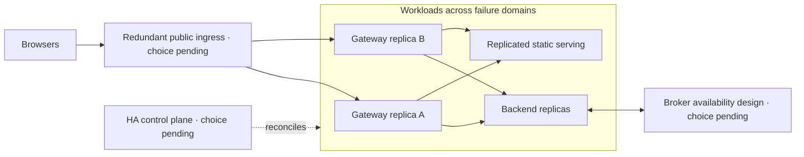

# Architecture Evolution and Future HLD

**Status: design documentation only. Baseline: design revision 5. Updated: 2026-10-26.**

Stages below are alternatives and milestones for future proposals, not promises of capacity or an instruction to provision resources. Select upgrades from measured constraints and product requirements; a higher stage is not automatically better.

## Staged roadmap

| Stage | Trigger | Proposed change | Acceptance gate / cost effect |
| --- | --- | --- | --- |
| A — Selected baseline | Learning/demo requirements | One K3s node, two backend Pods, ephemeral global room | Complete existing AC/NFR tests; time-limited AWS estimate. |
| B — Tune and scale within node | Backend bottleneck with spare node capacity | Tune bounded concurrency/limits or increase backend replicas | Re-measure latency, skew, broker fan-out and rollout peaks; same host failure domain. |
| C — Add worker capacity | Validated node capacity insufficient | Additional workers and explicit placement/ingress design | Cross-node policy/routing/drain tests; more compute, storage and transfer. |
| D — End-to-end HA | Required outage tolerance cannot be met | Redundant control plane, ingress, workloads and broker design | Prove node/zone failure behavior and restore objectives; separate ongoing budget. |
| E — Durable product features | Identity, private rooms or replay required | Authentication, authorization, durable store and versioned protocol | Privacy, consistency, replay, migration and backup tests; new service costs. |
| F — Multi-region | Explicit geographic latency or disaster-recovery need | Regional routing, data ownership/replication and failover policy | Defined conflict handling, RPO/RTO and regional failure drills; substantial complexity. |

Stages D and E can be independent. Durable storage does not by itself improve ingress availability; extra workers do not make a singleton control plane highly available.

## Stage B: controlled backend growth

Check whether existing Pods are CPU-bound, memory-bound, admission-bound or unevenly loaded. Adding Pods serves new connections but does not rebalance existing WebSockets. Test connection skew and deliberate drain instead of assuming uniform distribution.

Every backend consumes the global room stream; extra replicas increase broker subscriber work. Per-replica publication budgets also change the aggregate theoretical budget. Revisit global abuse constraints and Redis ACL/probe behavior when changing replica count.

## Stage C: workers and ingress

Adding worker nodes expands scheduling capacity but leaves the single K3s server as a control-plane failure point. Define node placement, private node communication, security groups, certificate names, ServiceLB placement and the actual public entry path.

A diagram showing two workers is insufficient: clients need a reachable entry path after the advertised node fails. Evaluate ingress options, health checks, DNS/failover behavior and their cost. Re-test NetworkPolicy/SNAT across nodes and verify that rolling updates can schedule.

## Stage D: conceptual HA target

This is a target shape, not an AWS resource plan. It omits no cost obligation: the chosen ingress, nodes, broker, storage and operational tooling all need estimates.

For self-managed K3s with embedded etcd, the official HA topology uses three or more server nodes and an odd quorum arrangement. Migrating from the baseline SQLite server needs a version-specific datastore conversion/restore plan. Adding only agent nodes does not create control-plane HA. [K3s HA guidance](https://docs.k3s.io/datastore/ha-embedded).

Alternatively evaluate a managed control plane such as EKS as a separate operational/cost decision. It still requires workload, ingress, broker and failure-domain planning. Do not treat it as an automatic free-tier upgrade.

Use topology spreading or anti-affinity only when the intended nodes/failure domains exist. Define disruption budgets compatible with replica count, available capacity and maintenance; they do not prevent every involuntary outage. Broker redundancy needs client failover testing, and cannot turn Pub/Sub into durable replay.

## Autoscaling design, when justified

Kubernetes HPA adjusts workload replicas using observed metrics; resource utilization calculations depend on resource requests, and custom/external metrics require their supporting APIs. HPA does not add nodes by itself. [Kubernetes HPA documentation](https://kubernetes.io/docs/concepts/workloads/autoscaling/horizontal-pod-autoscale/).

For this application, evaluate active connections, admission rejection, event-loop pressure and CPU together. CPU alone may miss many idle long-lived sockets. Define minimum/maximum replicas, a validated target, stabilization windows and behavior when metrics are unavailable.

Test scale-down with long-lived sockets: bound drain, avoid retry storms and protect remaining capacity. Any node autoscaler is a separate component with its own permissions, quotas, costs and teardown behavior.

## Stages E and F

Identity/history require [data and protocol design](DATA_AND_PROTOCOL.md), not merely attaching a database. Multi-region needs room/data ownership, ordering and conflict rules, failover routing, replication lag and a response to partial partitions. Avoid promising global ordering or exactly-once delivery without an explicit protocol and evidence.

## Proposal gate

Before selecting a stage, complete the [change proposal](templates/CHANGE_PROPOSAL.md), record a decision, update HLD/LLD, quote cost and run the [migration playbook](MIGRATION_PLAYBOOK.md). The baseline remains unchanged until the decision and affected contracts are accepted.
