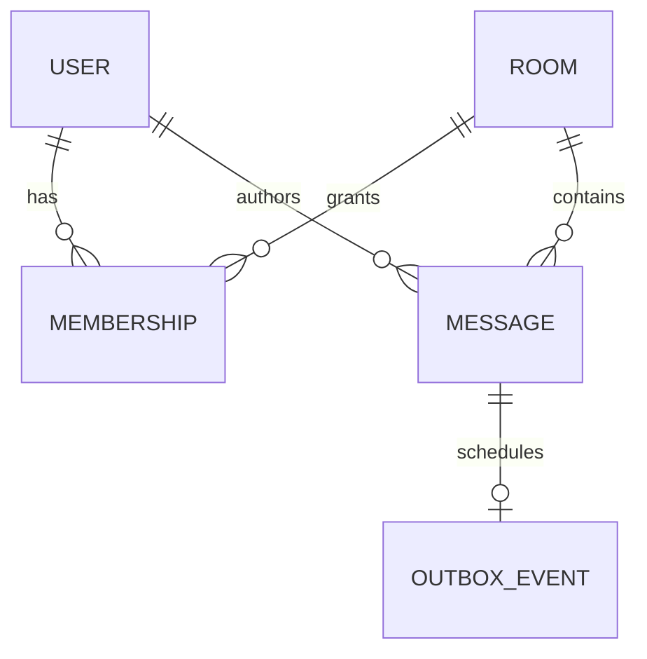

# Data and Protocol Design

**Status: design documentation only. Baseline: design revision 5. Updated: 2026-10-26.**

## Baseline state model

There is no application database in the selected baseline. Redis distributes live messages; it is not an authoritative history store. Redis Pub/Sub has at-most-once delivery and cannot replay messages missed by a disconnected subscriber. [Redis delivery semantics](https://redis.io/docs/latest/develop/pubsub/).

| Data | Owner | Retention / confidentiality |
| --- | --- | --- |
| Draft and rendered events | Browser tab | At most 500 displayed entries; draft survives reconnect in tab state. |
| Connection UUID and display name | Backend session | Ephemeral; name is not an authenticated identity. |
| Queues, rate buckets and admission count | Backend process | Bounded and released on cleanup. |
| Public event | Broker and local queues during delivery | No durable history or recovery guarantee. |
| Redis URI / ACL and TLS keys | Restricted Kubernetes Secrets | Separate rotation/backup policy; never frontend data. |
| Desired Kubernetes state | K3s datastore | Platform recovery concern; not a chat-message store. |
| Terraform state | Protected S3 backend | Sensitive infrastructure metadata; independent lifecycle. |

## External protocol summary

The browser connects at `/ws/{username}` using `chat.v1`, then sends plain text. The backend sends JSON events:

| Event | Required fields | Delivery scope |
| --- | --- | --- |
| session | schema_version, type, connection_id, container_id, user, sent_at | Direct to the new socket, before broadcasts. |
| chat / system | schema_version, event_id, sent_at, type, user, text, container_id, time | Redis fan-out to active subscribers and local clients. |

Use [API specification](../API_SPECIFICATION.md) as the schema source. Do not independently extend these tables into a second JSON Schema.

Event UUIDs identify events; they are not sequence numbers or evidence of successful delivery. Timestamps are display/correlation data, not a global ordering guarantee across publishers. Join/leave messages are advisory and cannot be treated as a reliable presence database.

## Compatibility rules

The current schema rejects additional properties. Adding a sender ID, room ID, acknowledgment or history cursor is therefore not automatically backward-compatible. Propose an explicit protocol version and negotiate support; test old/new clients and servers together before changing the default.

Do not change client messages from plain text to JSON under the same unmodified contract. For a future acknowledged-send protocol, distinguish client message IDs, server event IDs, durable acceptance and recipient delivery. None are interchangeable.

## Future persistence model — proposal only

If product requirements demand authenticated rooms and history, evaluate these conceptual entities before selecting a database:

| Entity | Candidate keys and constraints | Questions to resolve |
| --- | --- | --- |
| User | Stable user_id; unique external subject scoped to identity issuer | Authentication provider, deactivation and privacy requirements. |
| Room | room_id; ownership and visibility | Public/private membership and moderation policy. |
| Membership | Unique room_id + user_id | Roles, revocation and authorization of every action. |
| Message | message_id, room_id, sender_id, created_at; optional per-room sequence | Retention, edits/deletion, indexing and ordering guarantees. |
| OutboxEvent | event_id linked to message, delivery state | Retry bounds, duplicate handling and backlog recovery. |

This model is not part of the current implementation plan. A relational database and transactional outbox are options to evaluate, not selected infrastructure.

For durable acceptance, define the transaction boundary between stored message and publication intent. A database write followed by an unrelated broker publish can fail halfway; design recovery rather than assuming the pair is atomic. Retries require an idempotency key scoped to authenticated sender/operation, uniqueness enforcement and bounded retention.

## History and replay contract to design

Define authorized cursor pagination, ordering scope, replay/live handoff, duplicate detection, expired cursors and maximum catch-up work. A reconnecting client must not receive another user's private room history. Set storage retention, deletion behavior, backup retention and restore tests before launch.

Never backfill “history” by assuming every old Pub/Sub event was stored. The current app has no durable dataset to migrate; persistence begins at an explicitly defined cutover.

## Security and testing impact

Identity and rooms add authorization tests, membership-revocation behavior and abuse controls. Persistence adds schema migration, retention, idempotency, backup/restore and data-access tests. Every schema change must include rollback compatibility and a protocol-version decision in the [migration playbook](MIGRATION_PLAYBOOK.md).
