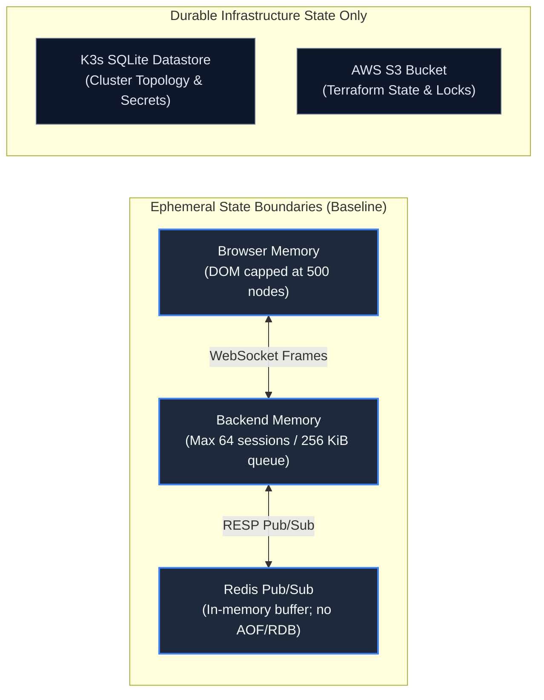
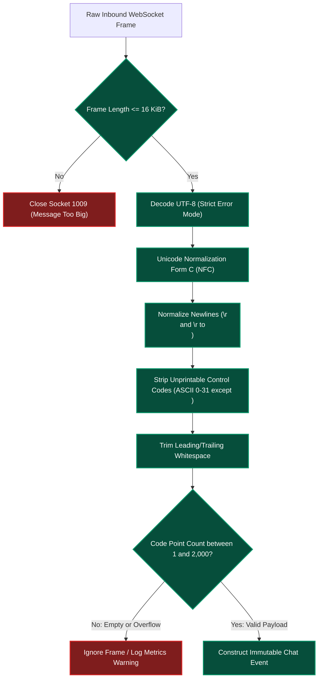
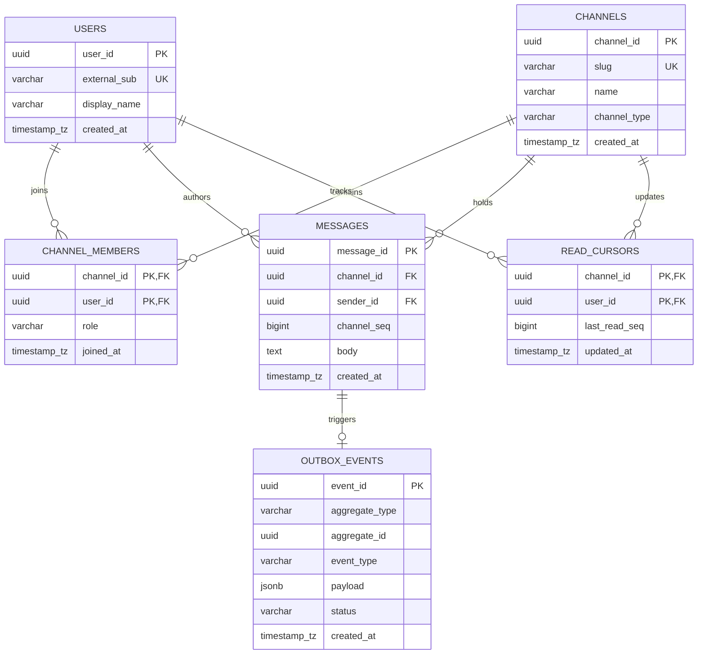
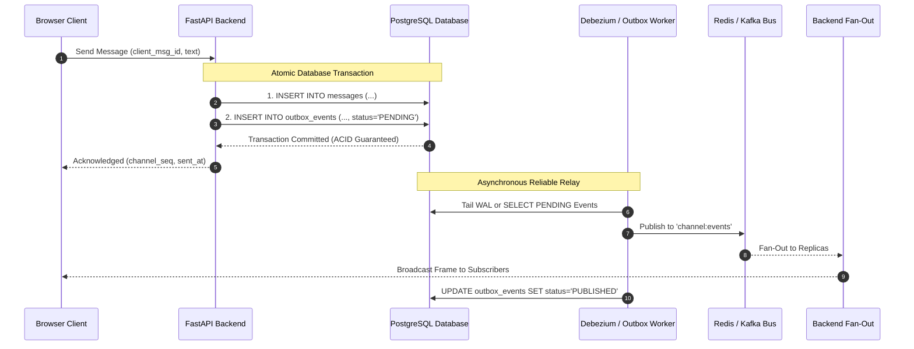

# Data and Protocol Design

**Status: Production Architecture Specification. Baseline: Design Revision 5. Updated: 2026-10-26.**

This document specifies the wire protocol serialization contracts, input normalization rules, broker internal communications, and future relational persistence models for Baatchit.

---

## 1. Baseline Ephemeral State Model

The baseline architecture (Design Revision 5) is completely in-memory and stateless across application restarts. There is no relational or document database. Redis operates purely as an ephemeral message distribution bus via Pub/Sub.



### State Ownership & Retention Matrix

| State Entity | Authoritative Owner | Storage Medium | Retention Policy | Confidentiality & Encryption |
| :--- | :--- | :--- | :--- | :--- |
| **Unsent Drafts** | Browser Tab | JavaScript heap | Lost on tab closure; survives reconnects. | Client-side memory only. |
| **Rendered History** | Browser Tab | DOM nodes | Capped at 500 entries (FIFO eviction). | Client-side memory only. |
| **Session Slot & Deque** | Backend Process | Python heap | Evicted on socket termination or Pod shutdown. | Process-isolated memory. |
| **Broadcast Events** | Redis Broker | Redis in-memory buffer | Instantaneous; no replay after consumer disconnect. | Protected by Redis ACL & password. |
| **TLS Certificates** | K3s Datastore | Kubernetes Secret | Managed via cert-manager or static deployment. | Encrypted at rest via K3s secrets encryption. |
| **Terraform State** | AWS S3 | S3 Bucket + DynamoDB | Retained across infrastructure lifecycle. | Server-side AES-256; restricted IAM policy. |

---

## 2. Wire Protocol Specification

### 2.1 Inbound Client-to-Server Transport
The browser establishes a WebSocket connection to:
```text
WSS /ws/{username} HTTP/1.1
Sec-WebSocket-Protocol: chat.v1
```

Once upgraded, **the client transmits raw UTF-8 text frames**. The client does not wrap messages in JSON:
```text
Hello, world! This is a real-time message.
```

### 2.2 Outbound Server-to-Client Envelopes
All outbound messages dispatched by the backend are strictly serialized UTF-8 JSON envelopes adhering to the `chat.v1` schema. The schema explicitly forbids extraneous properties (`extra="forbid"`).

#### 1. Unicast `session` Envelope
Dispatched directly to the newly connected client over the private socket. Never broadcast to neighbor clients or the Redis bus.

```json
{
  "schema_version": 1,
  "type": "session",
  "connection_id": "7b8d4f20-9a2c-4e1b-b4a1-0f8c3e2d1a5b",
  "container_id": "backend-7f8d6c4b5-x2z9q",
  "user": "alice_99",
  "sent_at": "2026-10-26T21:15:30.125Z"
}
```

#### 2. Broadcast `chat` Envelope
Dispatched to all connected clients across all backend replicas via Redis Pub/Sub when a user publishes text.

```json
{
  "schema_version": 1,
  "type": "chat",
  "event_id": "c1f2e3d4-b5a6-4c7d-8e9f-0a1b2c3d4e5f",
  "sent_at": "2026-10-26T21:15:32.450Z",
  "user": "alice_99",
  "text": "Hello, world! This is a real-time message.",
  "container_id": "backend-7f8d6c4b5-x2z9q",
  "time": "21:15:32"
}
```

#### 3. Broadcast `system` Envelope
Dispatched when an advisory event occurs (e.g., user join or user departure).

```json
{
  "schema_version": 1,
  "type": "system",
  "event_id": "d9e8f7a6-b5c4-4d3e-2f1a-0b9c8d7e6f5a",
  "sent_at": "2026-10-26T21:15:30.200Z",
  "user": "system",
  "text": "alice_99 joined the chat",
  "container_id": "backend-7f8d6c4b5-x2z9q",
  "time": "21:15:30"
}
```

---

## 3. Strict Input Normalization & Sanitization Rules

To eliminate Cross-Site Scripting (XSS), Unicode spoofing, and buffer-overflow vectors, incoming frames undergo a deterministic transformation pipeline:



### Normalization Invariants
1. **Unicode NFC Normalization:** All text is canonicalized using `unicodedata.normalize('NFC', text)`. This guarantees consistent byte representations for multi-byte characters and combined diacritics.
2. **Code Point Accounting:** Limits are enforced on **Unicode code points** ($\text{len}(text)$ in Python 3), not UTF-8 byte lengths. A 2,000-character message consisting entirely of 4-byte emojis ($8,000\text{ bytes}$) is valid, whereas a 2,001-character ASCII string is rejected.
3. **Control Code Stripping:** Control characters in ranges `[\x00-\x09]`, `[\x0b-\x1f]`, and `\x7f` are strictly stripped. Line feeds (`\n` / `\x0a`) are preserved up to a maximum of 20 consecutive newlines to prevent DOM layout denial-of-service.
4. **XSS Neutralization:** Client-side rendering exclusively assigns received strings to the `textContent` property of DOM elements. The use of `innerHTML`, `outerHTML`, or `eval()` is strictly prohibited.

---

## 4. Redis Pub/Sub Wire Protocol & Configuration

Backend replicas interface with Redis 7 via RESP2 over TCP port `6379`.

### 4.1 Channel Architecture
* **Single Global Bus:** Channel name `global_chat_channel`.
* **Payload Serialization:** Compact UTF-8 JSON encoding (separators `(',', ':')`, no formatting spaces).
* **Delivery Semantics:** At-most-once delivery. If a backend replica is disconnected during publication, messages published during the outage are not buffered by Redis and are permanently missed.

### 4.2 Redis Buffer & ACL Sizing
To prevent slow backend subscribers from triggering memory exhaustion on the Redis broker, Redis is configured with explicit client output buffer limits:

```text
client-output-buffer-limit pubsub 32mb 8mb 60
```
* **Hard Limit:** $32\text{ MiB}$. If a subscriber's buffer exceeds $32\text{ MiB}$, Redis disconnects the client immediately.
* **Soft Limit:** $8\text{ MiB}$ for 60 consecutive seconds.

### 4.3 Redis ACL Configuration
```text
user baatchit on >${REDIS_PASSWORD} ~global_chat_channel +publish +subscribe +unsubscribe +ping -@all
```
The application user is restricted exclusively to Pub/Sub operations on `global_chat_channel` and `PING`. All administrative commands (`FLUSHALL`, `CONFIG`, `KEYS`, `SHUTDOWN`) are permanently disabled.

---

## 5. Future Persistent Data Architecture (Stage E Evolution)

When product requirements demand authenticated identity, multi-room partitioning, and durable message history, the system evolves to an event-sourced relational architecture powered by **PostgreSQL 16**.

### 5.1 Relational Entity-Relationship Diagram



### 5.2 Production PostgreSQL 16 DDL Specification

```sql
-- Enable cryptographic extensions for UUIDv7 generation
CREATE EXTENSION IF NOT EXISTS "pgcrypto";

-- Users Table
CREATE TABLE users (
    user_id UUID PRIMARY KEY DEFAULT gen_random_uuid(),
    external_sub VARCHAR(255) NOT NULL UNIQUE,
    display_name VARCHAR(32) NOT NULL,
    created_at TIMESTAMPTZ NOT NULL DEFAULT CURRENT_TIMESTAMP,
    is_active BOOLEAN NOT NULL DEFAULT TRUE
);

-- Channels / Rooms Table
CREATE TABLE channels (
    channel_id UUID PRIMARY KEY DEFAULT gen_random_uuid(),
    slug VARCHAR(64) NOT NULL UNIQUE,
    name VARCHAR(128) NOT NULL,
    channel_type VARCHAR(16) NOT NULL DEFAULT 'public',
    created_at TIMESTAMPTZ NOT NULL DEFAULT CURRENT_TIMESTAMP
);

-- Partitioned Messages Table (Monthly Range Partitioning)
CREATE TABLE messages (
    message_id UUID NOT NULL,
    channel_id UUID NOT NULL REFERENCES channels(channel_id) ON DELETE CASCADE,
    sender_id UUID NOT NULL REFERENCES users(user_id),
    client_msg_id UUID NOT NULL,
    channel_seq BIGINT NOT NULL,
    body TEXT NOT NULL,
    created_at TIMESTAMPTZ NOT NULL DEFAULT CURRENT_TIMESTAMP,
    CONSTRAINT pk_messages PRIMARY KEY (channel_id, channel_seq, created_at)
) PARTITION BY RANGE (created_at);

-- Initial Partitions
CREATE TABLE messages_2026_q4 PARTITION OF messages
    FOR VALUES FROM ('2026-10-01 00:00:00+00') TO ('2027-01-01 00:00:00+00');

-- Indexes for Accelerated Cursor Pagination
CREATE INDEX idx_messages_channel_seq ON messages (channel_id, channel_seq DESC);
CREATE UNIQUE INDEX idx_messages_idempotency ON messages (channel_id, sender_id, client_msg_id);

-- Transactional Outbox Table for Guaranteed Broker Delivery
CREATE TABLE outbox_events (
    event_id UUID PRIMARY KEY DEFAULT gen_random_uuid(),
    channel_id UUID NOT NULL,
    event_type VARCHAR(32) NOT NULL,
    payload JSONB NOT NULL,
    status VARCHAR(16) NOT NULL DEFAULT 'PENDING',
    retry_count INT NOT NULL DEFAULT 0,
    created_at TIMESTAMPTZ NOT NULL DEFAULT CURRENT_TIMESTAMP
);
CREATE INDEX idx_outbox_pending ON outbox_events (status, created_at) WHERE status = 'PENDING';
```

---

## 6. Transactional Outbox Pattern & At-Least-Once Delivery

In Stage E, message persistence and broker fan-out are decoupled via the **Transactional Outbox Pattern** to prevent split-brain dual-write failures:



### Deduplication Invariants
* **Client Idempotency Key:** Clients generate a unique `client_msg_id` (UUIDv4) for every draft submission.
* **Unique Database Constraint:** `idx_messages_idempotency` ensures that network retries by the client cannot produce duplicate messages in the database.
* **Cursor-Based History Pagination:** Reconnecting clients query `/api/v1/channels/{id}/history?before_seq={seq}&limit=50` to backfill messages missed during network interruptions without gaps.
