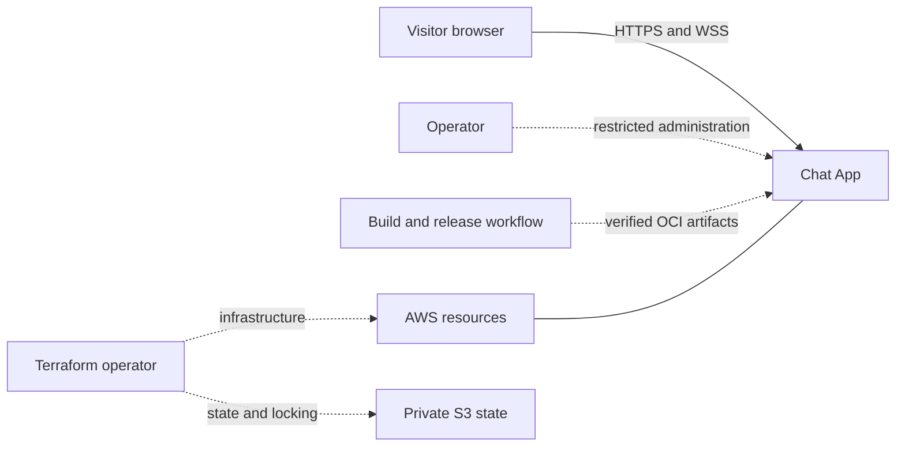
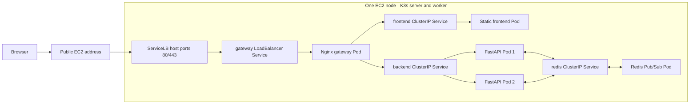

# High-Level Design

**Status: design documentation only. Baseline: design revision 5. Updated: 2026-10-26.**

## Purpose and scope

Provide an anonymous, single-room browser chat demonstrating distributed WebSocket fan-out, bounded resource usage and repeatable Kubernetes delivery. Display names are presentation labels. The baseline has no accounts, durable messages, private rooms, attachments, read receipts or end-to-end encryption.

Primary users are chat visitors; operators deploy, diagnose and tear down the environment. Developers build and test outside the AWS node.

## System context

S3 holds infrastructure state, not chat history. The browser has no direct Redis, Kubernetes API or AWS credential access.

## Application and deployment view

There are four Deployments and five steady-state application Pods, plus platform Pods. K3s uses containerd on AWS; k3d hosts the local test cluster in Docker. Exact resources, ports, probes and security settings are owned by [Kubernetes](../KUBERNETES.md). The [AWS diagram](../images/aws-k3s-architecture.png) shows the network boundary.

## Component responsibilities

| Component | Owns | Does not own |
| --- | --- | --- |
| Browser | Draft, connection state, safe display, bounded local history | Authoritative identity, server delivery acknowledgment or replay. |
| Gateway | TLS, static/WebSocket routing, forwarding-header policy | Session state or Redis access. |
| Frontend server | Versioned static assets | Backend credentials or user data storage. |
| Backend Pod | Its sockets, queues, budgets, event creation, broker connections | Another Pod's sockets or a global identity registry. |
| Redis | Live event distribution across subscribed backends | Durable message history or browser acknowledgments. |
| K3s | Scheduling, reconciliation, endpoint readiness and platform state | Application delivery guarantees. |

## Main design decisions

The browser sends plain text; the accepting backend builds the authoritative event. All delivery, including sender echo, passes through Redis so local and cross-Pod paths behave consistently. A single writer per socket isolates slow receivers through bounded queues.

An open socket stays with its backend. On loss it reconnects with a new session; existing sockets are not moved when another Pod starts. Redis loss invalidates dependency readiness and may lose messages.

Only the gateway is public. Namespace policies isolate Redis from gateway/frontend; operators use restricted access. Detailed health and metrics remain private. See [security](../SECURITY.md).

## Quality targets and limits

The initial acceptance experiment uses 25 clients, aggregate 5 messages/s, 512-byte payloads, 2-minute warmup and 30-minute steady run. Targets are p95 <250 ms, p99 <1000 ms and at least 99.9% expected deliveries within 2 seconds under healthy conditions. These are unverified targets; [requirements](../REQUIREMENTS.md) controls their exact interpretation.

Single-node K3s, singleton gateway and singleton Redis remain failure points. Two backend replicas do not provide host availability. The proposed 4-GiB node must be measured with platform overhead. Rollout may interrupt service; recovery means verified functionality, not merely Ready Pods.

## Growth boundary

More connections, lower outage tolerance and durable history are different requirements. They need different changes: capacity tuning, failure-domain redesign or new data/protocol semantics. Use [capacity planning](CAPACITY_PLANNING.md) to identify the bottleneck and [architecture evolution](ARCHITECTURE_EVOLUTION.md) to choose the next design. None of the future stages is part of the current AWS credit commitment.
