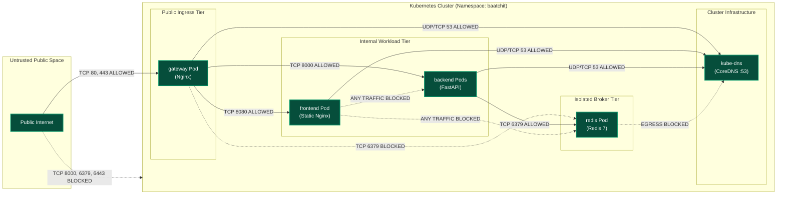
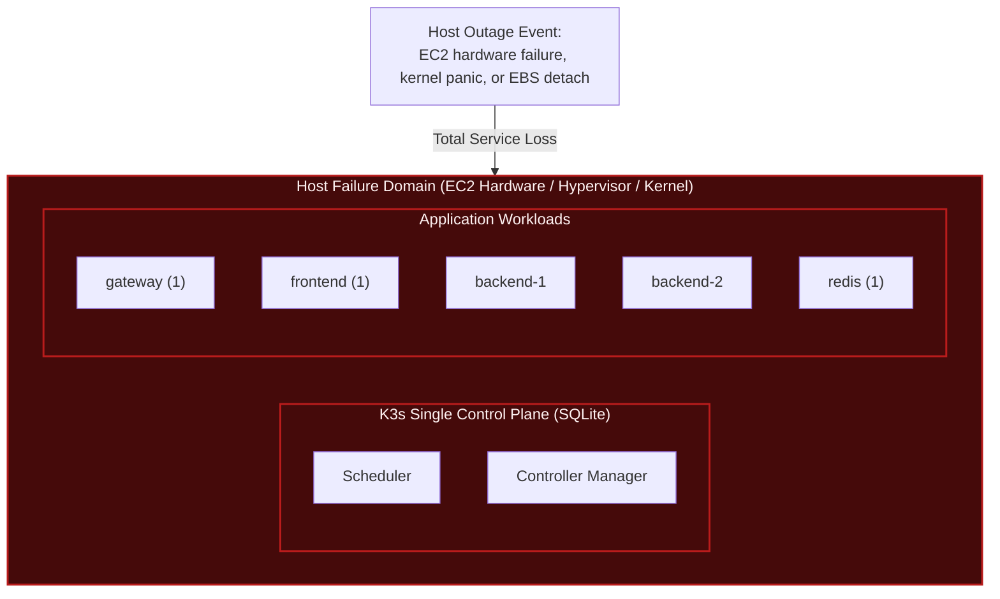

# High-Level Design (HLD)

**Status: Production Architecture Specification. Baseline: Design Revision 5. Updated: 2026-10-26.**

The High-Level Design (HLD) specifies the macro-architecture, system topology, networking models, trust boundaries, and component responsibilities for the Baatchit platform.

---

## 1. System Purpose & Architectural Drivers

Baatchit is an enterprise-grade demonstration of real-time distributed messaging deployed onto an immutable Kubernetes substrate. It provides an ephemeral, anonymous, single-room chat environment engineered to demonstrate:

* **Horizontally Scalable WebSocket Fan-Out:** Decoupled ingress and broadcast distribution across independent application replicas using an authenticated message broker.
* **Deterministic Backpressure & Resource Isolation:** Strict cgroup boundaries, monotonic token-bucket throttling, and bounded queue accounting to prevent resource starvation.
* **Zero-Trust Network Topologies:** Namespace-scoped, default-deny packet filtering enforcing least-privilege inter-service connectivity.
* **Repeatable GitOps & Infrastructure as Code:** Fully automated deployment using Terraform and Kustomize across local Docker (k3d) and public cloud (AWS K3s on EC2).

### Architectural Non-Goals
The baseline explicitly excludes persistent message storage, database migrations, user account authentication, private multi-tenant rooms, file attachments, push notifications, and end-to-end encryption. These capabilities are deferred to future evolutionary milestones (see [Architecture Evolution](ARCHITECTURE_EVOLUTION.md)).

---

## 2. C4 Architecture Models

### 2.1 C4 Level 1: System Context Diagram
The System Context illustrates the boundaries between human actors, external deployment automation, cloud infrastructure, and the core Baatchit system.

```mermaid
flowchart TD
    subgraph Users["Human Actors"]
        Visitor["Chat Visitor<br/><i>[Web Browser]</i><br/>Accesses anonymous chat over HTTPS/WSS"]
        Operator["DevOps Operator<br/><i>[Terminal / Bastion]</i><br/>Administers K3s cluster via restricted SSH/kubectl"]
    end

    subgraph Automation["Continuous Delivery & IaC"]
        CI["GitHub Actions CI/CD<br/><i>[OCI Pipeline]</i><br/>Builds, tests, and signs immutable images"]
        TF["Terraform Engine<br/><i>[IaC Operator]</i><br/>Provisions AWS VPC, EC2, EBS, Security Groups"]
    end

    subgraph Storage["Cloud Infrastructure Services"]
        S3["AWS S3 Bucket<br/><i>[Encrypted / Versioned]</i><br/>Stores Terraform state & lockfile (NOT chat data)"]
        EC2["AWS EC2 Node<br/><i>[ap-south-1 Mumbai]</i><br/>2-vCPU / 4-GiB candidate running K3s"]
    end

    subgraph Baatchit["Baatchit Platform Boundary"]
        App["Baatchit System<br/><i>[Kubernetes K3s Cluster]</i><br/>Reverse proxy, static frontend, backend mesh, Redis Pub/Sub"]
    end

    Visitor -->|HTTPS / WSS (Port 443)| App
    Operator -.->|Restricted SSH (Port 22) / kubectl (Port 6443)| EC2
    CI -.->|Deploys verified OCI manifests| App
    TF -->|Declares VPC / Node resources| EC2
    TF -.->|State locking & storage| S3
    EC2 --- App

    classDef actor fill:#1e293b,stroke:#3b82f6,stroke-width:2px,color:#f8fafc;
    classDef infra fill:#0f172a,stroke:#64748b,stroke-width:1px,color:#e2e8f0;
    classDef system fill:#1e3a5f,stroke:#2563eb,stroke-width:2px,color:#ffffff;
    class Visitor,Operator,CI,TF actor;
    class S3,EC2 infra;
    class App system;
```

---

### 2.2 C4 Level 2: Container & Deployment Topology Diagram
The Container Topology describes the runtime pods, services, network ports, and traffic paths executing inside the single-node K3s deployment.

```mermaid
flowchart TB
    subgraph External["External Network Environment"]
        Client["Browser Client"]
        DNS["Public DNS / Route 53"]
    end

    subgraph Node["Single EC2 Node (2 vCPU / 4 GiB · 20 GiB gp3 Encrypted)"]
        subgraph IngressLayer["Host Ingress & ServiceLB Layer"]
            Host80["Host Port TCP :80<br/>(HTTP)"]
            Host443["Host Port TCP :443<br/>(HTTPS / WSS)"]
            SLB["K3s ServiceLB DaemonSet<br/><i>[Host Port Forwarder]</i>"]
        end

        subgraph K8sNamespace["Kubernetes Namespace: baatchit"]
            GW_SVC["gateway Service<br/><i>[Type: LoadBalancer]</i><br/>TCP 80, 443"]

            subgraph GW_POD["gateway Deployment (1 Replica)"]
                Nginx["Nginx Reverse Proxy<br/><i>TLS Termination & Header Sanitization</i><br/>Port 8080 (HTTP) · Port 8443 (HTTPS)"]
            end

            FE_SVC["frontend Service<br/><i>[Type: ClusterIP]</i><br/>TCP 80"]
            subgraph FE_POD["frontend Deployment (1 Replica)"]
                FE["Static Asset Server<br/><i>Nginx unprivileged (HTML/CSS/JS)</i><br/>Port 8080"]
            end

            BE_SVC["backend Service<br/><i>[Type: ClusterIP]</i><br/>TCP 8000"]
            subgraph BE_MESH["backend Deployment (2 Replicas)"]
                BE1["FastAPI Backend Pod 1<br/><i>Uvicorn Single-Worker (asyncio)</i><br/>Port 8000"]
                BE2["FastAPI Backend Pod 2<br/><i>Uvicorn Single-Worker (asyncio)</i><br/>Port 8000"]
            end

            REDIS_SVC["redis Service<br/><i>[Type: ClusterIP]</i><br/>TCP 6379"]
            subgraph REDIS_POD["redis Deployment (1 Replica)"]
                Redis["Redis Broker Pod<br/><i>Pub/Sub Engine (ACL-Protected)</i><br/>Port 6379 (Ephemeral in-memory)"]
            end
        end

        subgraph K3sPlatform["K3s Platform Substrate"]
            Flannel["Flannel CNI<br/>(VXLAN 10.42.0.0/16)"]
            CoreDNS["CoreDNS Server<br/>(kube-dns :53)"]
            NetPol["K3s NetworkPolicy Engine"]
        end
    end

    Client -->|HTTPS / WSS :443| Host443
    Client -.->|HTTP :80 Redirect| Host80
    Host80 --> SLB
    Host443 --> SLB
    SLB --> GW_SVC
    GW_SVC --> Nginx

    Nginx -->|GET / (Static Content)| FE_SVC
    FE_SVC --> FE

    Nginx -->|Upgrade /ws/* (WSS)| BE_SVC
    BE_SVC -->|Round-Robin / Session Sticky| BE1
    BE_SVC -->|Round-Robin / Session Sticky| BE2

    BE1 <-->|RESP Pub/Sub TCP :6379| REDIS_SVC
    BE2 <-->|RESP Pub/Sub TCP :6379| REDIS_SVC
    REDIS_SVC <--> Redis

    classDef client fill:#334155,stroke:#94a3b8,stroke-width:1px,color:#f8fafc;
    classDef ingress fill:#1e293b,stroke:#f59e0b,stroke-width:2px,color:#ffffff;
    classDef pod fill:#0f172a,stroke:#3b82f6,stroke-width:2px,color:#f8fafc;
    classDef broker fill:#3b0764,stroke:#a855f7,stroke-width:2px,color:#ffffff;
    class Client,DNS client;
    class Host80,Host443,SLB,GW_SVC ingress;
    class Nginx,FE,BE1,BE2 pod;
    class Redis broker;
```

---

## 3. Component Responsibilities & Boundary Invariants

| Component | Architecture & State Invariant | What It OWNS | What It DOES NOT OWN |
| :--- | :--- | :--- | :--- |
| **Browser Client** | Single-page ES6 native runtime; ephemeral memory; maximum 500 rendered DOM messages. | UI draft retention, monotonic retry timer calculation, sanitized DOM rendering via `textContent`, connection state indicators. | Message delivery guarantees, authoritative user identity, server-side message ordering. |
| **Gateway (Nginx)** | Stateless reverse proxy; TLS termination (`ECDHE-ECDSA-AES128-GCM-SHA256`); unbuffered WebSocket proxying. | Public port binding (`:80`, `:443`), TLS termination, static vs WebSocket route dispatch, `X-Forwarded-*` sanitization, origin validation. | Application session state, user admission tokens, Redis credentials, business logic. |
| **Frontend Server** | Unprivileged static HTTP server (`nginx-unprivileged:alpine`); immutable static assets. | Serving static bundle (`index.html`, `app.js`, `style.css`), HTTP cache headers (`Cache-Control: public, max-age=3600`). | API routes, WebSocket handling, secrets, backend health evaluation. |
| **Backend Replicas (FastAPI)** | AsyncIO event-loop runtime; single Uvicorn ASGI worker per Pod; connection-local memory state. | WebSocket handshake validation, token-bucket admission, session UUID assignment, outbound queue backpressure, Redis publication & subscription. | Global user registry, cross-Pod socket state, durable message persistence, multi-room routing. |
| **Event Broker (Redis)** | In-memory ephemeral Redis 7 engine; ACL authenticated; no RDB/AOF disk persistence enabled. | Instantaneous Pub/Sub fan-out across subscribed backend replicas via channel `global_chat_channel`. | Message history storage, unacknowledged message replay, socket connection tracking. |
| **Kubernetes Substrate (K3s)** | Lightweight single-binary container orchestrator with embedded SQLite datastore. | Pod scheduling, container lifecycle reconciliation, Service DNS resolution, ServiceLB port forwarding, NetworkPolicy enforcement. | Application-level delivery acknowledgments, WebSocket message serialization. |

---

## 4. Kubernetes Ingress & Networking Mechanics

### 4.1 ServiceLB Host-Port Forwarding vs Cloud Load Balancers
In standard AWS Kubernetes deployments, a `Service` of type `LoadBalancer` provisions an AWS Network Load Balancer (NLB) or Application Load Balancer (ALB), incurring hourly control-plane charges (~$18–$25/month). 

To satisfy strict budget constraints ($100 lifetime demonstration budget), Baatchit utilizes K3s **ServiceLB** (formerly Klipper LB):
1. ServiceLB deploys a lightweight DaemonSet pod (`svclb-gateway`) that binds directly to the host's physical network interface on ports `80` and `443`.
2. Inbound TCP SYN packets entering the host on `:80` or `:443` are routed via iptables rules directly to the `gateway` Service cluster IP (`10.43.x.x`).
3. The gateway Pod terminates TLS using TLS certificates provisioned via Kubernetes Secrets (`tls-secret`).
4. **Source IP Preservation:** Traffic routed through ServiceLB undergoes source NAT (SNAT) by default unless `externalTrafficPolicy: Local` is configured on the `gateway` Service. The Nginx gateway extracts the client IP from the `X-Forwarded-For` header populated by upstream proxies or direct socket peers.

### 4.2 WebSocket Upgrade Handshake Mechanics
WebSocket connections are established through an HTTP/1.1 Upgrade exchange traversing the gateway to the backend:

```http
GET /ws/alice HTTP/1.1
Host: chat.example.com
Upgrade: websocket
Connection: Upgrade
Sec-WebSocket-Key: dGhlIHNhbXBsZSBub25jZQ==
Sec-WebSocket-Version: 13
Sec-WebSocket-Protocol: chat.v1
Origin: https://chat.example.com
```

Nginx proxy configuration enforces:
```nginx
location /ws/ {
    proxy_pass http://backend_cluster;
    proxy_http_version 1.1;
    proxy_set_header Upgrade $http_upgrade;
    proxy_set_header Connection "Upgrade";
    proxy_set_header Host $host;
    proxy_set_header X-Real-IP $remote_addr;
    proxy_set_header X-Forwarded-For $proxy_add_x_forwarded_for;
    proxy_set_header X-Forwarded-Proto $scheme;
    proxy_read_timeout 3600s;
    proxy_send_timeout 3600s;
    proxy_buffering off;
}
```

---

## 5. End-to-End Latency Budget & Hop-by-Hop Breakdown

To satisfy **NFR-01** (p95 latency $< 250\text{ ms}$, p99 $< 1000\text{ ms}$ under baseline load of 25 clients, 5 msg/s), latency is budgeted across individual physical and logical processing hops:

```mermaid
gantt
    title Hop-by-Hop Delivery Latency Budget (p95 Target: 130 ms Total)
    dateFormat X
    axisFormat %s ms
    section Inbound Path
    Client TLS & Network Travel      :0, 45
    Host ServiceLB & Nginx Proxy     :45, 52
    FastAPI Ingress & Validation     :52, 60
    section Broker Fan-Out
    Redis TCP Socket & PUBLISH       :60, 68
    Redis Engine Fan-Out Processing  :68, 72
    Redis SUBSCRIBE Delivery to BEs  :72, 80
    section Outbound Path
    AsyncIO Queue Dispatch & Enqueue :80, 85
    Writer Task Socket Frame Write   :85, 95
    Nginx Egress Forwarding          :95, 102
    Network Egress to Browser Client :102, 130
```



| Processing Stage | Physical Execution Environment | P50 Budget | P95 Budget | P99 Limit | Failure Modes & Mitigations |
| :--- | :--- | :--- | :--- | :--- | :--- |
| **1. Browser Egress & Ingress Network** | Public WAN to EC2 Internet Gateway | 25 ms | 45 ms | 150 ms | Packet loss, WAN jitter. Mitigation: TCP BBR congestion control on host. |
| **2. Gateway Routing (Nginx)** | Host network to Pod via veth / Flannel | 2 ms | 7 ms | 15 ms | CPU throttling. Mitigation: Explicit CPU request (50m) and unbuffered proxying. |
| **3. Backend Admission & Ingestion** | Uvicorn ASGI request parse & Pydantic | 3 ms | 8 ms | 20 ms | Event loop lag. Mitigation: Single worker per container, no blocking sync I/O. |
| **4. Redis Publish & Broker Dispatch** | Loopback TCP via ClusterIP to Redis | 2 ms | 8 ms | 15 ms | Broker queue lag. Mitigation: In-memory ephemeral operation; zero disk persistence. |
| **5. Broker Ingestion to Replicas** | Redis subscriber callback execution | 3 ms | 8 ms | 20 ms | Output buffer saturation. Mitigation: `client-output-buffer-limit pubsub 32mb 8mb 60`. |
| **6. AsyncIO Local Queue Enqueue** | Memory copy to session delivery deques | 1 ms | 5 ms | 15 ms | Queue lock contention. Mitigation: Lock-free deque insertion with atomic length check. |
| **7. WebSocket Frame Transmission** | Single-writer task socket flush | 4 ms | 10 ms | 35 ms | Slow network consumer. Mitigation: 2.0s send timeout with eviction close code `1013`. |
| **8. Gateway Egress to Browser** | Flannel overlay to WAN egress | 20 ms | 39 ms | 125 ms | Client TCP receive window exhaustion. Mitigation: Bounded queue drop policy. |
| **Total Cumulative Latency** | **End-to-End Delivery** | **60 ms** | **130 ms** | **395 ms** | **Well within NFR-01 thresholds (p95 < 250ms, p99 < 1000ms)** |

---

## 6. Network Segmentation & Zero-Trust Security Architecture

Security boundaries are strictly enforced at the network transport layer via Kubernetes `NetworkPolicies`. The default policy denies all non-whitelisted ingress and egress:



### STRIDE System Threat Modeling

| Threat Category | Target Component | Threat Vector & Impact | Architecture Defense & Mitigation |
| :--- | :--- | :--- | :--- |
| **Spoofing** | WebSocket Endpoint | Adversary spoofs client identity or impersonates admin. | Ephemeral sessions; username validated against strict regex; display names non-authoritative; no elevated admin roles on chat bus. |
| **Tampering** | In-Flight Wire Events | Man-in-the-middle modifies event payload or injects malformed frames. | Mandatory TLS 1.2/1.3 termination at gateway; strict Pydantic schema validation rejecting additional properties. |
| **Repudiation** | Broadcast Events | Sender denies publishing abusive content. | Server assigns immutable `event_id` (UUIDv4), `container_id`, and `sent_at` timestamp. Accepted boundary: anonymous app maintains no persistent audit trail. |
| **Information Disclosure** | Internal Telemetry & Redis | Unauthenticated actor reads `/metrics` or Redis Pub/Sub traffic. | Gateway denies public access to `/metrics` and `/live`; Redis requires password/ACL from Secret file mount; Redis port unmapped to host. |
| **Denial of Service** | Backend Event Loop | Attacker floods 16 KiB frames or holds open 10,000 idle sockets. | Connection limit (64/pod); per-socket token bucket (5 burst, 1/s); per-replica bucket (30 burst, 10/s); gateway request body limits. |
| **Elevation of Privilege** | Container Escape | Attacker exploits FastAPI vulnerability to compromise host node. | Rootless container execution (`runAsNonRoot: true`, UID 10001); `readOnlyRootFilesystem: true`; all Linux capabilities dropped (`drop: ["ALL"]`). |

---

## 7. High Availability & Failure Domain Analysis

### 7.1 Single-Node Failure Boundary
The baseline deployment operates on a single AWS EC2 instance. While the application runs two backend Pod replicas to prove multi-instance fan-out, **the physical host represents a single point of failure (SPOF)**.



### 7.2 Component Failure Modes & Recovery Matrices

| Failure Scenario | Immediate System Impact | Automated Recovery Mechanism | MTTR Target | Data Loss Boundary |
| :--- | :--- | :--- | :--- | :--- |
| **Backend Pod Crash** | Clients connected to that Pod disconnect. | Kubernetes restarts Pod via Deployment controller. Survived Pod continues serving. Gateway routes reconnections. | $< 10\text{ seconds}$ | In-flight unacknowledged frames discarded; client retries. |
| **Gateway Pod Crash** | All active WebSockets severed; HTTP unavailable. | Kubernetes restarts gateway Pod. Clients enter backoff retry loop. | $< 8\text{ seconds}$ | Active socket connections dropped; reconnects re-establish state. |
| **Redis Pod Crash** | Backends detect broker failure; transition to `DEGRADED`. | Readiness probes fail (503). ServiceLB stops routing new traffic. Backends close sockets with `1011`. Redis restarts; backends reconnect. | $< 15\text{ seconds}$ | Ephemeral in-flight broadcast messages lost. No durable data exists. |
| **Node Termination** | Complete cluster outage. | Terraform re-provisioning or EC2 Auto-Recovery. K3s bootstrap from cloud-init. | $< 5\text{ minutes}$ | Total ephemeral session loss. Infrastructure state restored from S3. |

For multi-node, multi-AZ High Availability architectures that eliminate these SPOFs, refer to [Architecture Evolution](ARCHITECTURE_EVOLUTION.md).
