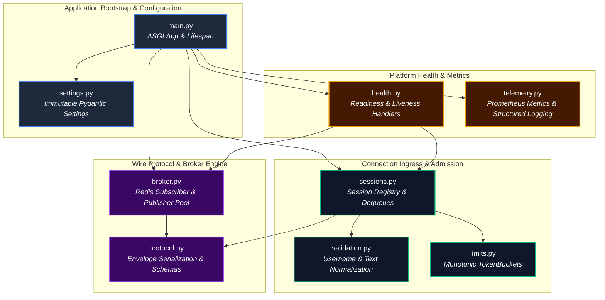
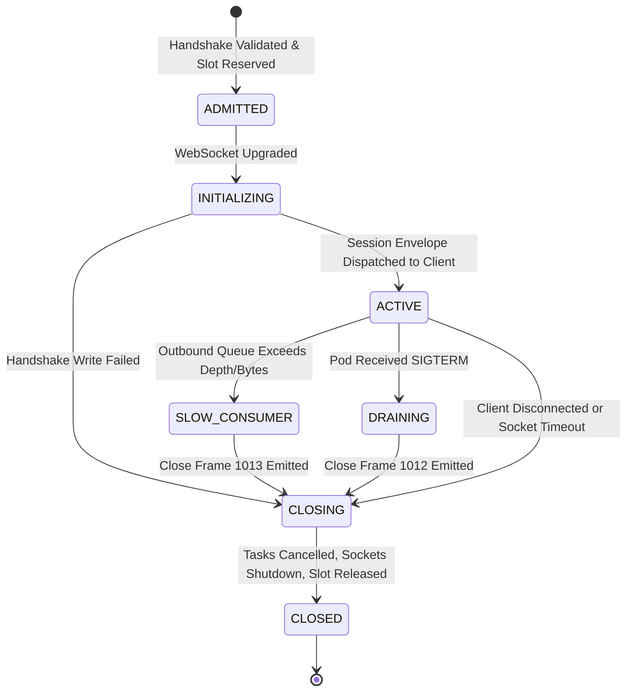
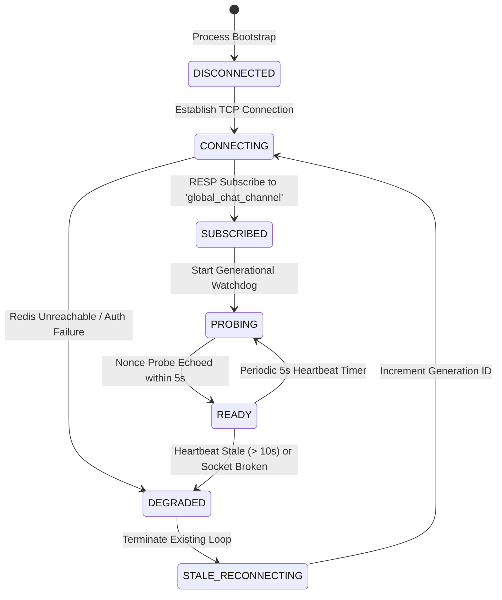
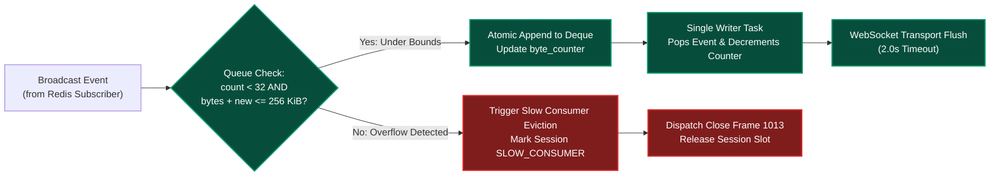
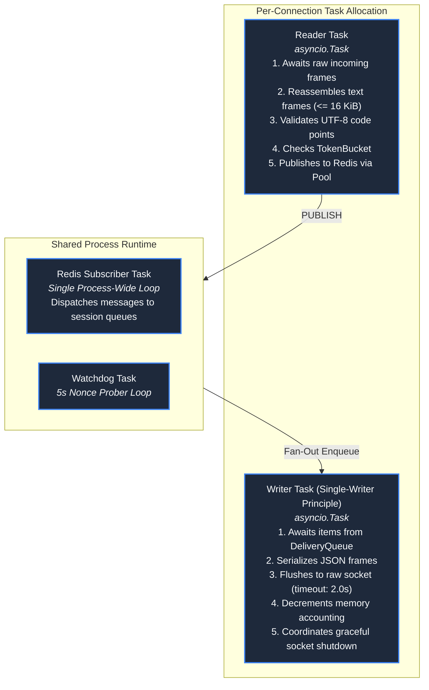
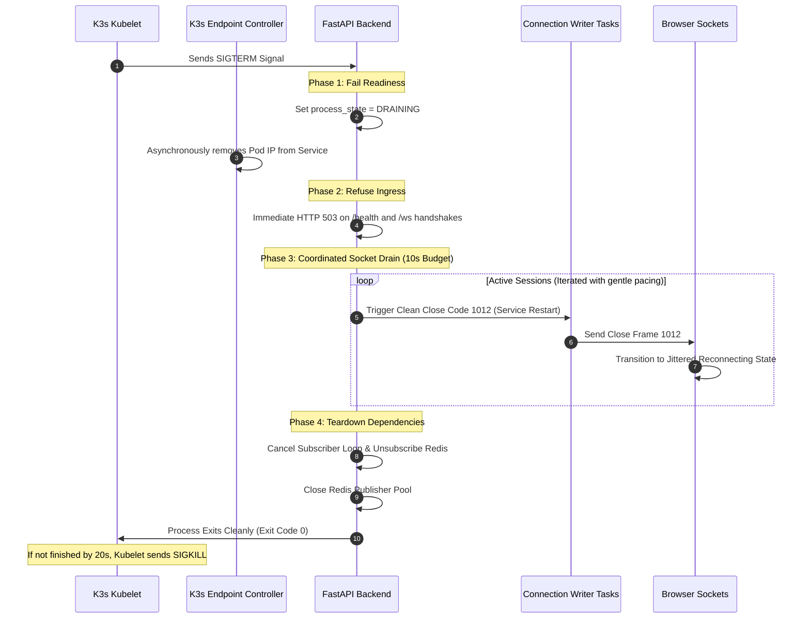

# Low-Level Design (LLD)

**Status: Production Architecture Specification. Baseline: Design Revision 5. Updated: 2026-10-26.**

The Low-Level Design (LLD) specifies internal component architectures, concurrency models, state machines, algorithmic invariants, and data structures for the backend ASGI runtime and browser client.

---

## 1. Backend Module Architecture & Conceptual Contracts

The backend service is engineered in Python 3.12 using FastAPI and AsyncIO. To guarantee testability and eliminate hidden global state, all dependencies (clocks, ID providers, event brokers) are explicitly injected during application startup.



### Module Responsibilities & Boundary Invariants

| Module | Primary Responsibility | Critical Invariant & State Ownership |
| :--- | :--- | :--- |
| `main.py` | FastAPI lifespan manager, signal handlers, router mounting. | Exactly one process lifespan per Pod; wires dependencies cleanly; shuts down event loops cleanly. |
| `settings.py` | Pydantic V2 immutable configuration loader. | Resolves configuration from environment or Secret files (`REDIS_URL_FILE`); forbids logging secrets. |
| `validation.py` | Code point validation, unicode normalization (NFC), regex checks. | Pure, deterministic functional operations; zero I/O or state modification. |
| `protocol.py` | Pydantic schemas, UUID generation, RFC 3339 timestamps. | Server assigns all `event_id`, `container_id`, and `sent_at` values; never reflects raw client fields directly. |
| `sessions.py` | Admission control, active session registry, connection writer tasks. | Maintains active session mapping; ensures atomic slot reservations; coordinates connection cleanup. |
| `limits.py` | Monotonic token-bucket rate limiters. | Uses `time.monotonic()`; thread-safe and task-safe atomic token decrements. |
| `broker.py` | Redis connection management, subscriber supervision, publisher pool. | Dedicated background subscriber task; bounded connection pool for publishing; generational heartbeat probes. |
| `health.py` | Kubernetes readiness and liveness endpoints. | Readiness requires active Redis subscription and fresh probe nonce; liveness requires responsive event loop. |
| `telemetry.py` | Prometheus metrics collection and structured JSON logging. | Low-cardinality metric labels; zero message payloads, usernames, or secrets in logs. |

---

## 2. Formal Internal State Machines

### 2.1 Connection Session State Machine
Every WebSocket accepted by a backend replica transitions through a deterministic, strictly serialized lifecycle:



#### State Definitions & Transition Invariants
1. **`ADMITTED`:** The client handshake request satisfies origin validation, regex syntax, and capacity headroom. An admission slot is atomically reserved in the local process registry (`current_active_sessions < 64`).
2. **`INITIALIZING`:** The WebSocket protocol is upgraded (`HTTP 101 Switching Protocols`). The dedicated writer task is spawned. The session is **not yet registered** in the broadcast registry and cannot receive broadcast events.
3. **`ACTIVE`:** The writer task successfully dispatches the unicast `session` envelope across the wire. The session is registered in the broadcast delivery set. An advisory `system` join event is dispatched to Redis Pub/Sub.
4. **`SLOW_CONSUMER`:** The session's delivery queue breaches either 32 pending events or 262,144 bytes ($256\text{ KiB}$), or a frame write exceeds the 2.0-second timeout.
5. **`DRAINING`:** The host process receives `SIGTERM`. Active sessions stop receiving new inbound messages and receive close frame `1012` (Service Restart).
6. **`CLOSING`:** Outbound frame writing terminates. Close frame is flushed to the network. Delivery queues are purged, and pending byte accounting is decremented.
7. **`CLOSED`:** Terminal state. Associated asyncio tasks are cancelled and awaited. The admission slot is returned to the process pool.

---

### 2.2 Broker Connection & Heartbeat Probing State Machine
The backend maintains an active supervisory loop over its Redis Pub/Sub connection to ensure subscriber liveliness:



* **Generational Nonce Heartbeat:** Every 5 seconds, the publisher emits an internal heartbeat message containing a random UUID and the current connection generation ID: `probe:<generation_id>:<uuid>`.
* **Readiness Evaluation:** The `/health` endpoint evaluates the difference between current time and the last successfully echoed nonce:
  $$\Delta t_{\text{probe}} = t_{\text{now}} - t_{\text{last\_echo}}$$
  If $\Delta t_{\text{probe}} > 10.0\text{ seconds}$, the backend transitions immediately to `DEGRADED`, returning HTTP 503 to Kubernetes readiness probes and triggering endpoint removal from ServiceLB.

---

## 3. Mathematical Concurrency & Rate Limiting Models

### 3.1 Monotonic Token Bucket Formalism
Rate limiting is implemented using an in-memory Token Bucket algorithm utilizing Python's `time.monotonic()` clock to prevent clock skew vulnerabilities.

Let:
* $C$ = Bucket burst capacity (maximum tokens).
* $r$ = Refill rate (tokens per second).
* $T(t)$ = Available tokens at timestamp $t$.
* $t_{\text{last}}$ = Timestamp of last token consumption.

The token balance at time $t$ is defined as:
$$T(t) = \min\left(C, T(t_{\text{last}}) + (t - t_{\text{last}}) \times r\right)$$

A request requiring $k$ tokens ($k=1$ for normal chat frames) at time $t$ is admitted if and only if:
$$T(t) \ge k$$
Upon admission, the bucket state updates atomically:
$$T(t_{\text{new}}) = T(t) - k, \quad t_{\text{last}} = t$$

```python
import time
from dataclasses import dataclass

@dataclass(slots=True)
class TokenBucket:
    capacity: float
    refill_rate: float
    tokens: float
    last_update: float

    def consume(self, tokens_requested: float = 1.0) -> bool:
        now = time.monotonic()
        elapsed = now - self.last_update
        self.tokens = min(self.capacity, self.tokens + elapsed * self.refill_rate)
        self.last_update = now
        
        if self.tokens >= tokens_requested:
            self.tokens -= tokens_requested
            return True
        return False
```

### Rate Limiting Hierarchy
1. **Per-Socket Inbound Limiter:** $C = 5.0$, $r = 1.0\text{ tokens/sec}$. Enforces client-level message throttling. Excess frames are rejected without closing the socket.
2. **Per-Replica Outbound Publisher Limiter:** $C = 30.0$, $r = 10.0\text{ tokens/sec}$. Protects the shared Redis bus from aggregate flooding caused by multiple active sockets on a single replica.

---

## 4. Double-Accounting Delivery Queue Mechanics

To isolate slow consumers and guarantee that memory remains bounded under adverse network conditions, each session owns a private `DeliveryQueue`. 

The queue enforces a strict **double-accounting invariant**:
$$\text{len}(Q) \le 32 \quad \text{AND} \quad \sum_{e \in Q} \text{len}(e.\text{payload\_bytes}) \le 262,144 \text{ bytes } (256\text{ KiB})$$



```python
from collections import deque
from dataclasses import dataclass

@dataclass(slots=True)
class DeliveryQueue:
    max_items: int = 32
    max_bytes: int = 262_144
    items: deque = deque()
    current_bytes: int = 0
    closed: bool = False

    def try_enqueue(self, payload: bytes) -> bool:
        if self.closed:
            return False
        payload_size = len(payload)
        if len(self.items) >= self.max_items or (self.current_bytes + payload_size) > self.max_bytes:
            return False  # Queue saturated
        
        self.items.append(payload)
        self.current_bytes += payload_size
        return True

    def pop_left(self) -> bytes | None:
        if not self.items:
            return None
        payload = self.items.popleft()
        self.current_bytes -= len(payload)
        return payload
```

---

## 5. Connection Task Topology & Asynchronous Execution Model

For each active WebSocket connection, the backend allocates **exactly two cooperative AsyncIO tasks**:



### Invariant Rules
1. **Zero Concurrent Socket Writes:** The `Reader Task` is strictly forbidden from writing frames (even control frames) directly to the WebSocket transport. All outbound communications traverse the `Writer Task`.
2. **Unblocking Fan-Out:** The `Redis Subscriber Task` iterates across active session references and invokes `try_enqueue()`. It never awaits I/O or network flushes. If a session queue is full, the subscriber marks the session as degraded and continues to neighbor sessions without delay.

---

## 6. Graceful Shutdown & Kubernetes Lifecycle Timeline

When Kubernetes initiates a Pod termination (e.g., during a rolling deployment), the backend coordinates a multi-stage graceful drain:



---

## 7. Browser Client Architecture & Resilient State Machine

The React frontend uses Vite for bundling and preserves framework-independent connection, protocol and state modules:

| Module | Responsibilities & Design Invariants |
| :--- | :--- |
| `src/main.jsx` and `src/App.jsx` | React root, semantic UI components and controlled forms. |
| `src/useChat.js` | Store subscription via `useSyncExternalStore`, actions, socket/timer cleanup and reconnect lifecycle. |
| `protocol.js` | Strict envelope parser; validates incoming JSON schemas; constructs outgoing text frames. |
| `connection.js` | Manages raw `WebSocket` instance; encapsulates retry timers, heartbeats, and generation IDs. |
| `state.js` | Single source of truth for UI state: active session, drafts, displayed messages (capped at 500). |
| `src/components/MessageList.jsx` | Escaped React text children, stable event keys and pre-update scroll snapshots for bounded-history eviction. |

### Exponential Backoff with Full Jitter
To prevent thundering herd storms against surviving backend replicas during a rolling restart or node recovery, `connection.js` executes exponential backoff with full jitter:

$$t_{\text{sleep}} = \text{random}\left(0, \, \min\left(T_{\text{max}}, \, T_{\text{base}} \times 2^{\text{attempt}}\right)\right)$$
Where:
* $T_{\text{base}} = 0.5\text{ seconds}$
* $T_{\text{max}} = 15.0\text{ seconds}$
* $\text{attempt} \in [0, 10]$

If reconnect attempts exceed 10 successive failures, the client transitions to a terminal `PAUSED` state, preserving the user's uncommitted message draft and requiring an explicit user click on a "Reconnect" button.
