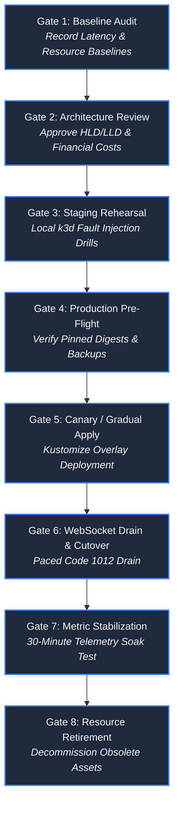
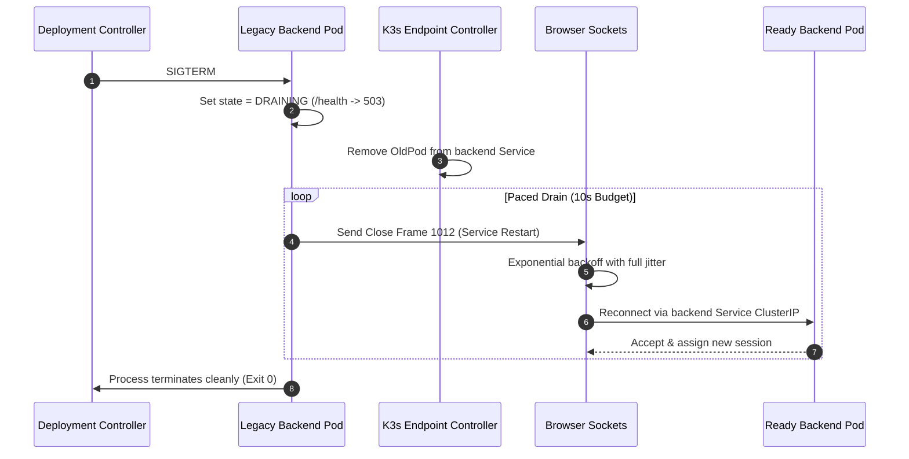

# Architecture Migration & Operational Rollout Playbook

**Status: Production Architecture Specification. Baseline: Design Revision 5. Updated: 2026-10-26.**

This playbook defines the formal engineering protocols, operational gates, Prometheus anomaly triggers, and rollback procedures required to execute architectural migrations, infrastructure updates, and version cutovers for Baatchit.

---

## 1. The 8-Gate Operational Migration Lifecycle

All architectural transitions—including scaling backend replicas, upgrading the Redis broker, migrating Kubernetes clusters, or introducing schema versions—must advance sequentially through eight strict operational gates:



### Detailed Gate Verification Requirements

| Gate | Primary Work & Actionable Tasks | Mandatory Pass Criteria | Stop / Abort Condition |
| :--- | :--- | :--- | :--- |
| **1. Baseline Audit** | Capture 30-minute steady-state telemetry: p95/p99 latency, connection count, CPU/RSS, and Redis output buffer levels. | Complete telemetry snapshot saved to migration record. | Inability to establish steady-state baseline. |
| **2. Architecture Review** | Complete [Change Proposal](templates/CHANGE_PROPOSAL.md) and [ADR](templates/ADR.md). Verify capacity models and AWS cost impact. | Unanimous approval from Technical Lead and Platform Owner. | Unresolved security vulnerability or budget breach ($>\$100$). |
| **3. Staging Rehearsal** | Rehearse complete rollout in local `k3d` cluster. Inject broker faults, slow consumers, and rapid Pod terminations. | Zero unhandled exceptions; graceful client reconnection verified. | Socket lock contention, memory leaks, or cascade crashes. |
| **4. Production Pre-Flight** | Verify immutable OCI container signatures (Cosign), check Kubernetes Secret file mounts, ensure host node free memory $\ge 1.0\text{ GiB}$. | Pre-flight verification script exits code 0. | Unsigned image digest, missing secret, or host memory pressure. |
| **5. Canary / Gradual Apply** | Apply candidate Kubernetes manifests via Kustomize: `kubectl apply -k k8s/overlays/aws/`. | Candidate Pods enter `Running` state and pass initial startup probe. | CrashLoopBackOff, probe failure, or admission rejection. |
| **6. WebSocket Drain & Cutover** | Terminate old backend replicas. Old Pods send close code `1012` over a 10s window. Clients reconnect to new Pods. | $100\%$ of active clients re-establish sessions within 15 seconds. | Thundering herd saturates CPU ($>90\%$) or client disconnect rate $>5\%$. |
| **7. Metric Stabilization** | Monitor cluster for 30 minutes under active traffic. Verify p95 latency $< 250\text{ ms}$ and zero OOM events. | All AC/NFR criteria satisfied across soak window. | Any Prometheus abort trigger breached (see Section 2). |
| **8. Resource Retirement** | Clean up superseded container images (`crictl rmi --prune`), rotate temporary bootstrap credentials, close migration ticket. | Zero residual orphaned resources; updated infrastructure inventory. | Active dependencies still referencing legacy endpoints. |

---

## 2. Automated Prometheus Abort Triggers & PromQL Rules

During Gates 5, 6, and 7, automated deployment monitors evaluate live metrics every 15 seconds. If any of the following PromQL expressions evaluate to `true` for longer than 60 seconds, **the migration is automatically aborted and the rollback procedure is triggered immediately**:

### 1. HTTP Ingress Error Spike (Gateway 5xx Rate)
```promql
sum(rate(nginx_ingress_controller_requests{status=~"5.."}[2m])) 
/ 
sum(rate(nginx_ingress_controller_requests[2m])) > 0.01
```
*Trigger Threshold:* $> 1.0\%$ 5xx server errors over a 2-minute rolling window.

### 2. Abnormal WebSocket Disconnect Spike
```promql
sum(rate(websocket_closures_total{code!~"1000|1012"}[2m])) > 5.0
```
*Trigger Threshold:* $> 5.0$ unexpected socket drops/second (excluding normal user closes `1000` and rolling restart handoffs `1012`).

### 3. P95 Delivery Latency Degradation
```promql
histogram_quantile(0.95, sum(rate(chat_message_delivery_latency_seconds_bucket[5m])) by (le)) > 0.250
```
*Trigger Threshold:* P95 end-to-end broadcast delivery latency exceeds $250\text{ ms}$.

### 4. Node Memory Starvation Alert
```promql
node_memory_MemAvailable_bytes < 536870912
```
*Trigger Threshold:* Host node `MemAvailable` drops below $512\text{ MiB}$ (breaching NFR-06).

### 5. Redis Output Buffer Saturation
```promql
redis_connected_client_highest_output_buffer_bytes > 16777216
```
*Trigger Threshold:* Any subscriber's output buffer breaches $16\text{ MiB}$ ($50\%$ of hard cap).

---

## 3. WebSocket Zero-Downtime Rollout Strategy

Unlike stateless HTTP APIs where new requests are immediately routed to new pods via round-robin, **active WebSocket connections remain anchored to their initial backend replica for the duration of the session**.

### Controlled Drain Protocol
1. **Initiate Termination:** Deployment controller dispatches `SIGTERM` to the legacy backend Pod.
2. **Immediate Ingress Delisting:** The backend's readiness handler `/health` immediately returns HTTP 503. The K3s Endpoint Controller removes the terminating Pod's IP from the `backend` ClusterIP Service.
3. **Paced Disconnect Handoff:** The backend does not terminate all sockets simultaneously. Across a **10-second drain budget**, it dispatches WebSocket close frame `1012` (Service Restart) in paced batches (e.g., 6 sockets per second).
4. **Client-Side Jittered Reconnect:** Clients intercepting close code `1012` apply exponential backoff with full jitter ($t_{\text{sleep}} = \text{random}(0.5, 15.0\text{s})$), preventing a synchronized thundering herd against surviving replicas.
5. **Session Re-establishment:** Reconnecting clients resolve the `backend` Service ClusterIP, which directs traffic exclusively to newly spun-up, ready replicas.



---

## 4. Deterministic Rollback Procedure

If an abort trigger fires or behavioral verification fails during rollout, execute the automated rollback runbook:

```bash
#!/usr/bin/env bash
set -euo pipefail

echo "[ROLLBACK] Abort trigger activated. Initiating emergency rollback..."

# 1. Capture current cluster diagnostic snapshot
DIAG_DIR="/tmp/k8s-rollback-$(date +%Y%m%d%H%M%S)"
mkdir -p "${DIAG_DIR}"
kubectl get pods,services,endpoints -n baatchit -o wide > "${DIAG_DIR}/cluster-state.txt"
kubectl logs -n baatchit -l app=backend --tail=500 > "${DIAG_DIR}/backend-logs.txt"
echo "[ROLLBACK] Diagnostic snapshot saved to ${DIAG_DIR}"

# 2. Re-apply verified prior release bundle
echo "[ROLLBACK] Re-applying prior stable release bundle: release-manifest-previous.yaml..."
kubectl apply -f /opt/baatchit/releases/release-manifest-previous.yaml

# 3. Block until prior workloads are completely Ready (Timeout: 180s)
echo "[ROLLBACK] Awaiting rollout completion..."
kubectl rollout status deployment/backend -n baatchit --timeout=180s
kubectl rollout status deployment/gateway -n baatchit --timeout=180s

# 4. Perform synthetic behavioral verification
echo "[ROLLBACK] Executing post-rollback smoke check..."
curl -kfsS https://localhost/health > /dev/null
echo "[ROLLBACK] Rollback successfully completed and verified."
```

### Post-Mortem Incident Template
Following an aborted migration or emergency rollback, the operational team must file an incident review containing:
1. **Incident Summary:** Date, affected commit digest, and rollout operator.
2. **Abort Trigger Fired:** Exact PromQL metric, threshold, and duration.
3. **User Impact:** Number of dropped connections, duration of service degradation.
4. **Root Cause Analysis (RCA):** Deep dive into the software, network, or configuration flaw.
5. **Corrective Actions:** Code fixes, updated test cases, and revisions to capacity limits before re-attempting rollout.
