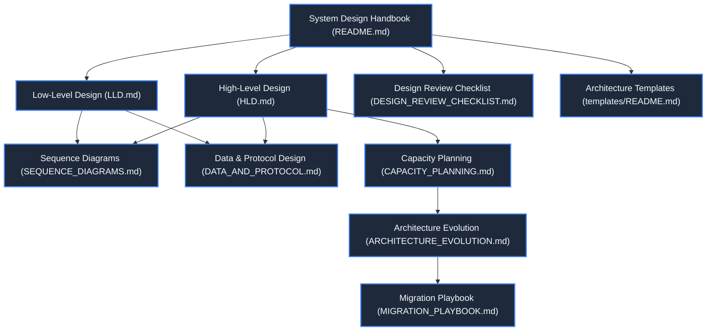
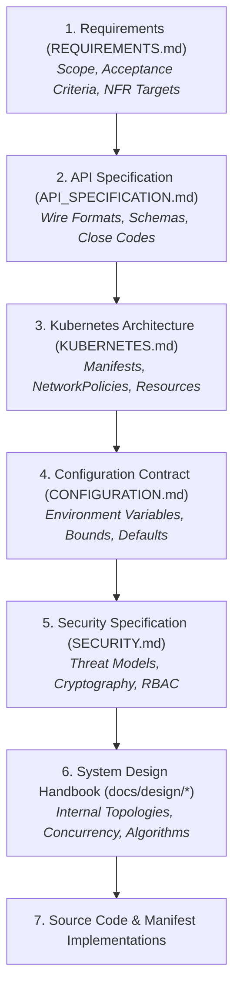

# System Design Handbook

**Status: Production Architecture Specification. Baseline: Design Revision 5. Updated: 2026-10-26.**

Welcome to the **Chat App System Design Handbook**. This repository of technical specifications, component contracts, operational playbooks, and capacity models serves as the primary engineering authority for designing, building, validating, and evolving the Chat App platform.

The architectural baseline reflects **Design Revision 5**: a distributed, event-driven, single-room real-time messaging system deployed on a unified **Kubernetes (K3s)** control plane (targeting local development via **k3d** and production demonstration on an **AWS EC2 2-vCPU / 4-GiB** candidate node in `ap-south-1`).

---

## 1. Core Architectural Tenets

All design specifications within this directory adhere to five non-negotiable architectural invariants:

1. **The Single-Writer Principle:** Each active WebSocket connection is owned by exactly one asynchronous writer task within a single backend replica. Concurrent writes to a raw transport socket are prohibited, preventing frame interleaving and race-induced transport corruption.
2. **Backpressure-Driven Ingress & Isolation:** Outbound delivery queues are strictly bounded in both item count ($N \le 32$) and byte volume ($B \le 256\text{ KiB}$). A slow receiver or stalled network consumer is deterministically isolated and disconnected via WebSocket close code `1013` (Try Again Later), preventing buffer bloat from impacting neighbor sessions.
3. **Symmetric Distributed Fan-Out:** Backend replicas maintain no direct peer-to-peer communication. All message distribution—including sender echos—traverses an authenticated Redis Pub/Sub bus (`global_chat_channel`). Local and cross-replica message delivery paths are functionally indistinguishable.
4. **Deterministic Session Initialization:** New connections execute an atomic two-phase handshake: admission reservation $\to$ transport upgrade $\to$ unicast `session` envelope dispatch $\to$ broadcast registration $\to$ advisory `system` join publication. Clients cannot receive broadcasts before possessing their session UUID.
5. **Zero-Trust Defense-in-Depth:** Public traffic terminates exclusively at the Nginx reverse-proxy gateway (`:80`, `:443`). Internal backend workloads (`:8000`) and the Redis event broker (`:6379`) are isolated via default-deny Kubernetes `NetworkPolicies`, non-root execution contexts, dropped Linux capabilities, and read-only root filesystems.

---

## 2. Document Navigation Map

The design handbook is organized into specialized, interconnected engineering documents. Review them in the following designated sequence:

| Document | Primary Focus & Engineering Scope | Critical Sections |
| :--- | :--- | :--- |
| **[High-Level Design (HLD)](HLD.md)** | System topology, C4 models, Kubernetes ingress routing, trust boundaries, end-to-end latency budget, and failure domains. | C4 Models, ServiceLB vs Ingress, End-to-End Latency Budget, STRIDE Threat Model. |
| **[Low-Level Design (LLD)](LLD.md)** | Process concurrency models, asyncio task ownership, state machines, token-bucket algorithms, queue mechanics, and browser architecture. | Session State Machine, TokenBucket Formalism, Double-Accounting Deque, Graceful Drain Timeline. |
| **[Sequence Diagrams](SEQUENCE_DIAGRAMS.md)** | Complete chronological execution flows across all actors with exact HTTP/WS headers, payloads, and close codes. | Handshake, Fan-Out, Slow Consumer Eviction, Rolling Deployment Drain, Stalled Subscriber Nonce Recovery. |
| **[Data & Protocol Design](DATA_AND_PROTOCOL.md)** | Wire protocol contracts, UTF-8 normalization rules, Pydantic/JSON schemas, Redis Pub/Sub internals, and future persistent storage models. | Wire Schemas, Normalization Rules, Redis Buffer Bounds, Stage-E PostgreSQL DDL & Outbox Pattern. |
| **[Capacity Planning](CAPACITY_PLANNING.md)** | Rigorous mathematical workload formulations, memory/CPU allocation equations, kernel sysctl parameters, and scaling triggers. | Formal Capacity Equation, Kernel Sockets Model, Multi-Tier Sizing Tables (25 to 10k), Cloud Cost Modeling. |
| **[Architecture Evolution](ARCHITECTURE_EVOLUTION.md)** | Staged evolutionary roadmap from single-node K3s to multi-AZ HA, managed brokers, and active-active multi-region deployments. | Stages A through F, Distributed Consensus Analysis, Redis Cluster vs Dragonfly, Cloud Cost Projections. |
| **[Migration Playbook](MIGRATION_PLAYBOOK.md)** | Production-grade operational runbook for rolling upgrades, WebSocket connection draining, schema transitions, and rollback gates. | 8-Gate Process, Dual-Run Strategies, PromQL Anomaly Triggers, Abort Thresholds, Post-Mortem Template. |
| **[Design Review Checklist](DESIGN_REVIEW_CHECKLIST.md)** | Verification matrices, acceptance criteria traceability, verification commands, and operational governance gates. | Traceability Matrix (AC-01 to AC-18, NFR-01 to NFR-08), Automated Verification Scripts, Sign-Off Gate. |
| **[Template Guide](templates/README.md)** | Instructions for drafting Architecture Decision Records (ADRs) and Change Proposals using standardized engineering formats. | Document Selection Matrix, Identifier Allocation, Governance Rules. |

---

## 3. Global System Invariants & Operational Bounds

The following operational bounds are binding across all specifications, manifests, and source code implementations:

| Domain | Parameter | Specification Default | Authoritative Source |
| :--- | :--- | :--- | :--- |
| **Network & Ingress** | Public Listening Ports | TCP `80` (HTTP redirect), TCP `443` (HTTPS/WSS) | [KUBERNETES.md](../KUBERNETES.md) |
| | Transport Protocols | HTTP/1.1, HTTP/2, WebSocket (`chat.v1` mandatory) | [API_SPECIFICATION.md](../API_SPECIFICATION.md) |
| | Proxy Ingress Buffer | `proxy_buffering off;` (unbuffered streaming) | [HLD.md](HLD.md) |
| | Gateway Timeouts | `proxy_read_timeout 3600s; proxy_send_timeout 3600s;` | [CONFIGURATION.md](../CONFIGURATION.md) |
| **Admission & Quotas** | Max Concurrent Sockets | 64 per backend replica (128 aggregate across 2 Pods) | [REQUIREMENTS.md](../REQUIREMENTS.md) |
| | Username Constraints | 1 to 32 code points, regex `^[a-zA-Z0-9_\-]{1,32}$` | [API_SPECIFICATION.md](../API_SPECIFICATION.md) |
| | Frame Size Ceiling | 16 KiB maximum reassembled WebSocket frame | [REQUIREMENTS.md](../REQUIREMENTS.md) |
| | Message Length Ceiling | 1 to 2,000 UTF-8 code points (whitespace-trimmed) | [API_SPECIFICATION.md](../API_SPECIFICATION.md) |
| **Rate Limiting** | Socket Token Bucket | Capacity: 5 tokens; Refill: 1 token/sec (Monotonic) | [LLD.md](LLD.md) |
| | Replica Publication Bucket | Capacity: 30 tokens; Refill: 10 tokens/sec | [LLD.md](LLD.md) |
| **Queue Mechanics** | Outbound Queue Depth | Maximum 32 events per session | [LLD.md](LLD.md) |
| | Outbound Queue Bytes | Maximum 262,144 bytes ($256\text{ KiB}$) per session | [LLD.md](LLD.md) |
| | Outbound Socket Timeout | 2.0 seconds send timeout before forced termination | [LLD.md](LLD.md) |
| **Lifecycle & Probes** | Backend Readiness Probe | Path `/health`, interval 2s, timeout 1s, failure 1 | [KUBERNETES.md](../KUBERNETES.md) |
| | Backend Liveness Probe | Path `/live`, interval 10s, timeout 1s, failure 3 | [KUBERNETES.md](../KUBERNETES.md) |
| | Termination Grace Period | 20s total Pod grace period; 10s application drain | [KUBERNETES.md](../KUBERNETES.md) |
| | Eviction Close Codes | Normal: `1000`; Drain: `1012`; Slow Consumer: `1013` | [API_SPECIFICATION.md](../API_SPECIFICATION.md) |
| **Node Resources** | Target Host Node | 2 vCPU / 4 GiB candidate instance (`c7i-flex.large`) | [KUBERNETES.md](../KUBERNETES.md) |
| | App Resource Requests | CPU: 275m aggregate; Memory: 368 MiB aggregate | [KUBERNETES.md](../KUBERNETES.md) |
| | App Resource Limits | CPU: 1100m aggregate; Memory: 752 MiB aggregate | [KUBERNETES.md](../KUBERNETES.md) |
| | Node Headroom Floor | $\ge 512\text{ MiB}$ free `MemAvailable` under steady load | [REQUIREMENTS.md](../REQUIREMENTS.md) |

---

## 4. Architectural Authority & Governance

This handbook operates within an explicit hierarchy of technical authority. When discrepancies arise, precedence is resolved according to the following matrix:

* **Contract Modifications:** If an evolution proposal requires altering a higher-level contract (e.g., adding authenticated user IDs to the wire format), the authoritative specification (e.g., `API_SPECIFICATION.md`) and its automated test suites must be updated simultaneously within the same pull request.
* **No Unilateral Drift:** Implementations must strictly conform to these specifications. No undocumented environment variable, hidden fallback mode, or unmetered buffer may exist in code without an accompanying architecture update.

---

## 5. Engineering Workflow for System Modifications

To propose, review, and execute an architectural alteration:

1. **Quantify the Constraint:** Record concrete benchmark metrics or product requirements demonstrating the limitation of the existing baseline (e.g., event-loop starvation at 100 concurrent connections).
2. **Draft a Change Proposal:** Copy [templates/CHANGE_PROPOSAL.md](templates/CHANGE_PROPOSAL.md) to `docs/design/PROPOSAL-<id>-<slug>.md` and detail the technical trade-offs, capacity impact, cost estimates, and rollback procedures.
3. **Draft an Architecture Decision Record (ADR):** For permanent design choices, copy [templates/ADR.md](templates/ADR.md) to `docs/design/ADR-<id>-<slug>.md`.
4. **Conduct Multi-Disciplinary Review:** Execute the verification gates defined in the [Design Review Checklist](DESIGN_REVIEW_CHECKLIST.md).
5. **Implement and Validate:** Deploy changes to local k3d environments first, followed by staging and AWS verification. Capture empirical telemetry artifacts and update the status from `Accepted` to `Verified`.
