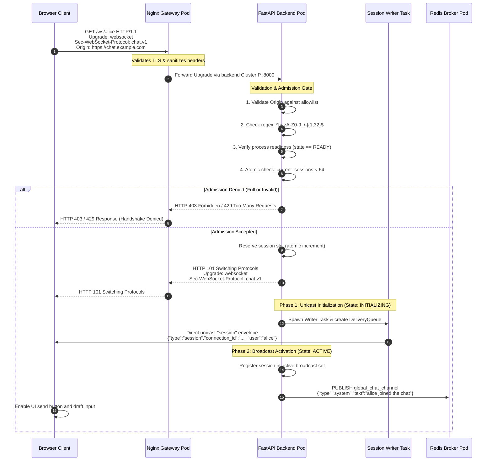
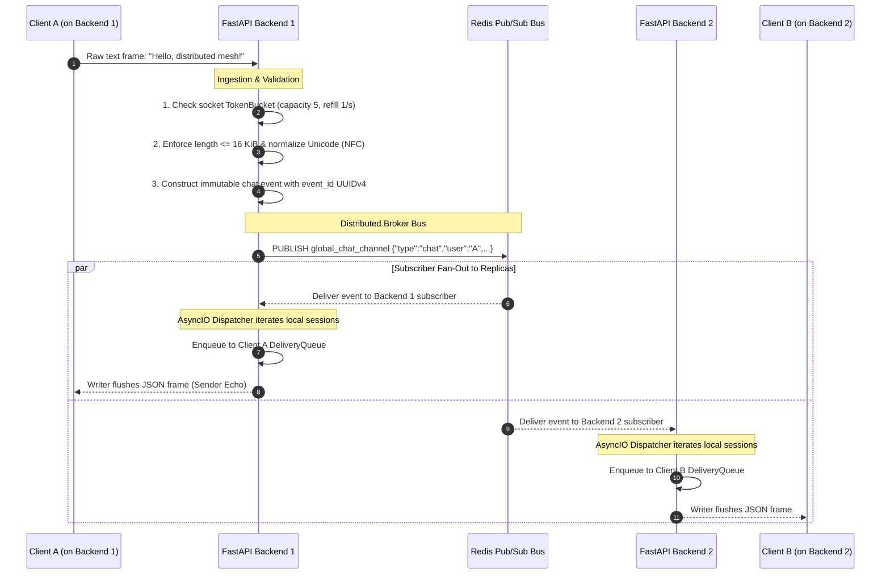
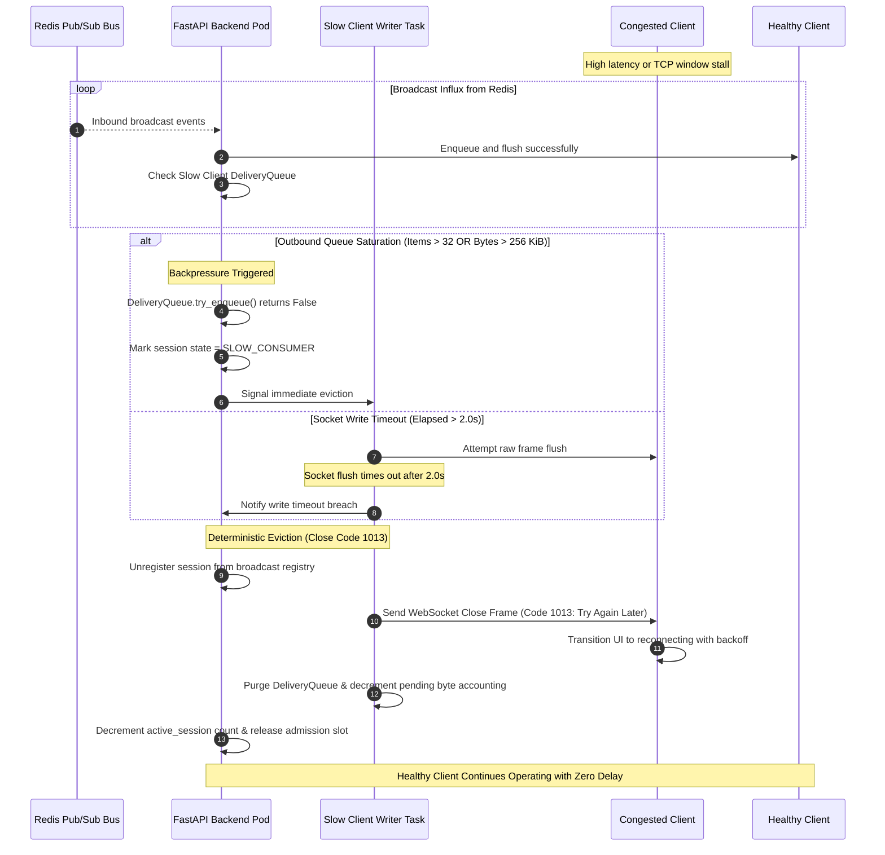
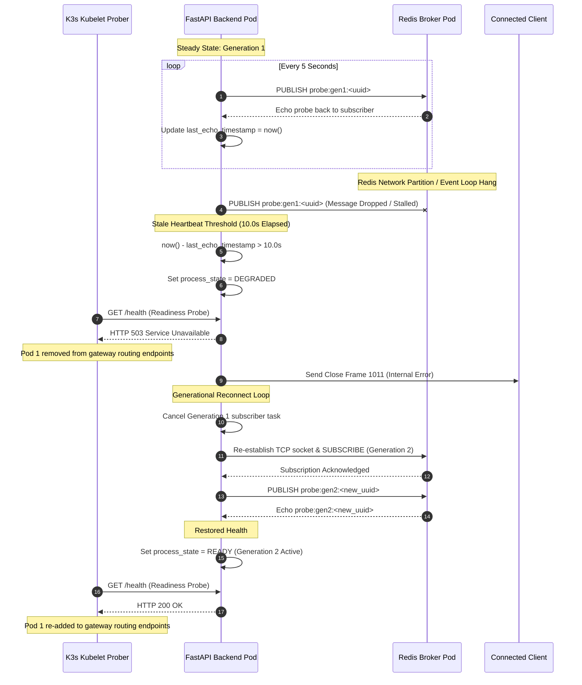
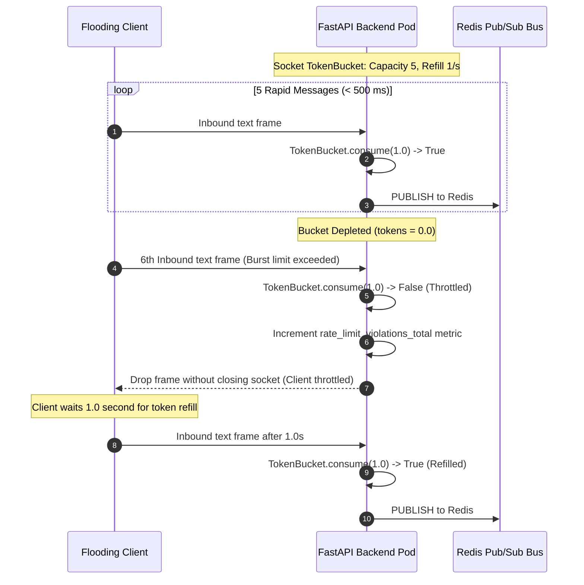
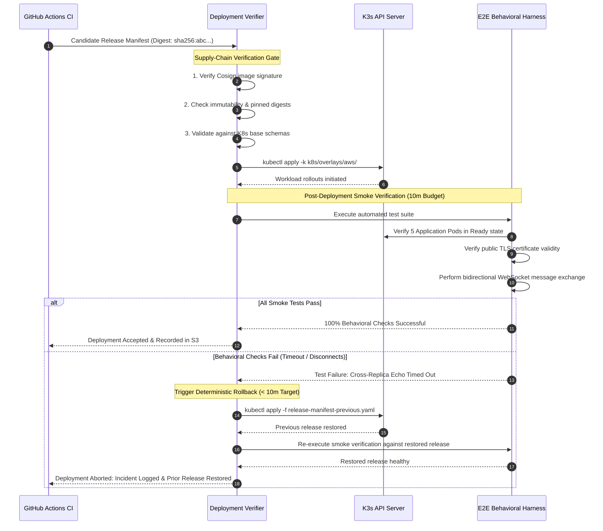

# System Sequence Diagrams

**Status: Production Architecture Specification. Baseline: Design Revision 5. Updated: 2026-10-26.**

This document provides definitive, end-to-end execution sequence diagrams for all critical connection, messaging, failure recovery, eviction, and release workflows in Chat App.

---

## 1. Connection Admission & Handshake Sequence

Demonstrates connection establishment, origin/username validation, atomic slot reservation, private `session` envelope dispatch, broadcast activation, and advisory `system` join publication.



---

## 2. Distributed Cross-Replica Message Fan-Out Sequence

Demonstrates message ingestion, token bucket charge, envelope serialization, Redis publication, and symmetric fan-out across independent backend replicas.



---

## 3. Slow Consumer Detection & Bounded Queue Eviction Sequence

Demonstrates backpressure enforcement, queue saturation detection, socket write timeout, and deterministic client eviction via close code `1013` (Try Again Later) without impacting neighbor sessions.



---

## 4. Rolling Deployment & Graceful Drain Sequence

Demonstrates Kubernetes zero-downtime rolling deployment, readiness probe failure, asynchronous endpoint removal, and client handoff via close code `1012` (Service Restart).

```mermaid
sequenceDiagram
    autonumber
    participant K8s as K3s Kubelet
    participant SLB as ServiceLB / Gateway
    participant BE1 as Backend Pod 1 (Terminating)
    participant C as Connected Client
    participant BE2 as Backend Pod 2 (Surviving)

    K8s->>BE1: SIGTERM Signal Dispatched
    Note over BE1: 1. Set process_state = DRAINING
    BE1->>BE1: Fail readiness (/health returns HTTP 503)
    
    par Endpoint De-registration
        K8s->>SLB: Asynchronously remove Pod 1 IP from Service endpoints
        SLB->>SLB: Stop routing new HTTP/WS handshakes to Pod 1
    and Coordinated Drain Window (10s Budget)
        Note over BE1: 2. Send Close Code 1012 to Active Sockets
        BE1->>C: Close Frame 1012 (Service Restart)
        C->>C: Calculate exponential backoff with full jitter (0.5s - 15s)
        BE1->>BE1: Await task cancellations & purge memory queues
        BE1->>BE1: Unsubscribe Redis & close connection pool
    end

    BE1-->>K8s: Process exits cleanly (Exit Code 0 within 20s grace)
    
    Note over C,BE2: Reconnection to Surviving / New Replica
    C->>SLB: New WebSocket Upgrade Request
    SLB->>BE2: Forward handshake to healthy Backend Pod 2
    BE2->>BE2: Validate & reserve admission slot
    BE2-->>C: HTTP 101 Switching Protocols + Session Envelope
    C->>C: Session restored; unsent drafts preserved
```

---

## 5. Redis Heartbeat Stalling & Degraded Recovery Sequence

Demonstrates watchdog probe monitoring, stale nonce detection, readiness degradation, and automatic generational reconnect.



---

## 6. Rate Limit Throttling Sequence

Demonstrates token bucket depletion under inbound spam and client throttling.



---

## 7. Verified CI/CD Deployment & Automated Rollback Sequence

Demonstrates supply-chain verification, immutable OCI deployment, end-to-end smoke testing, and deterministic rollback to the prior release bundle.


