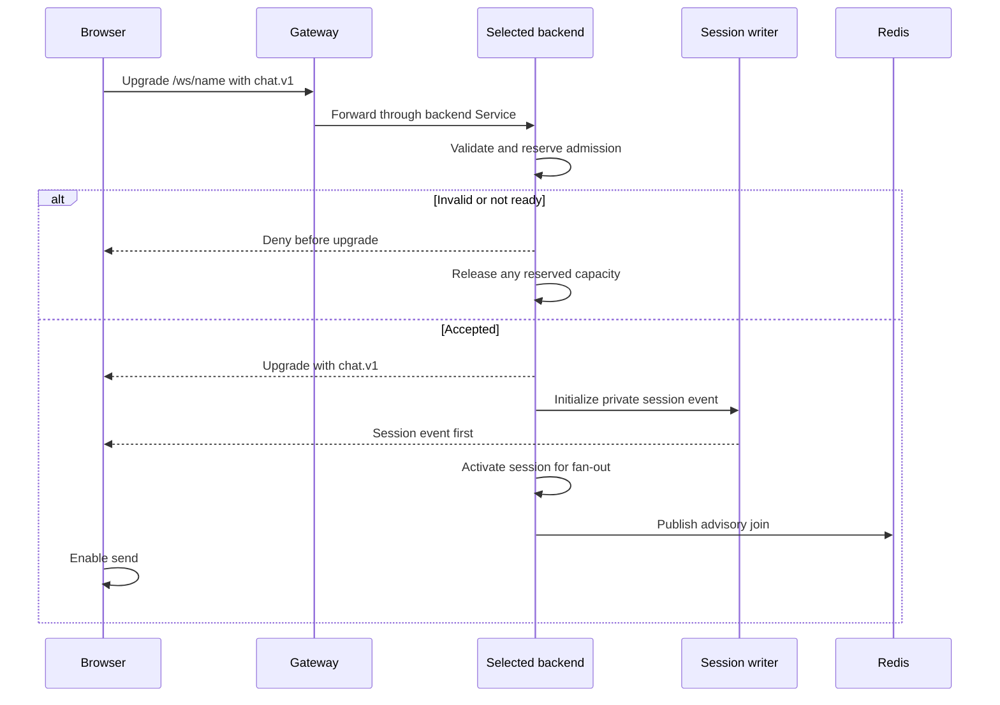
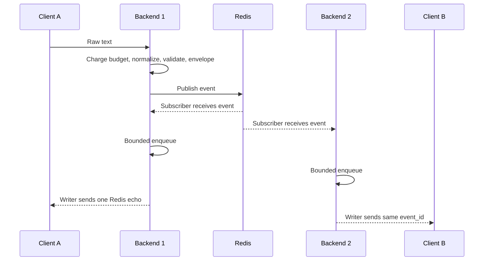
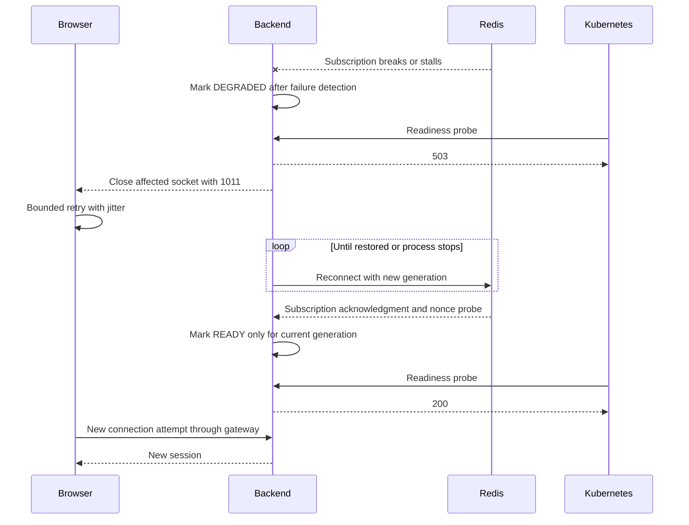
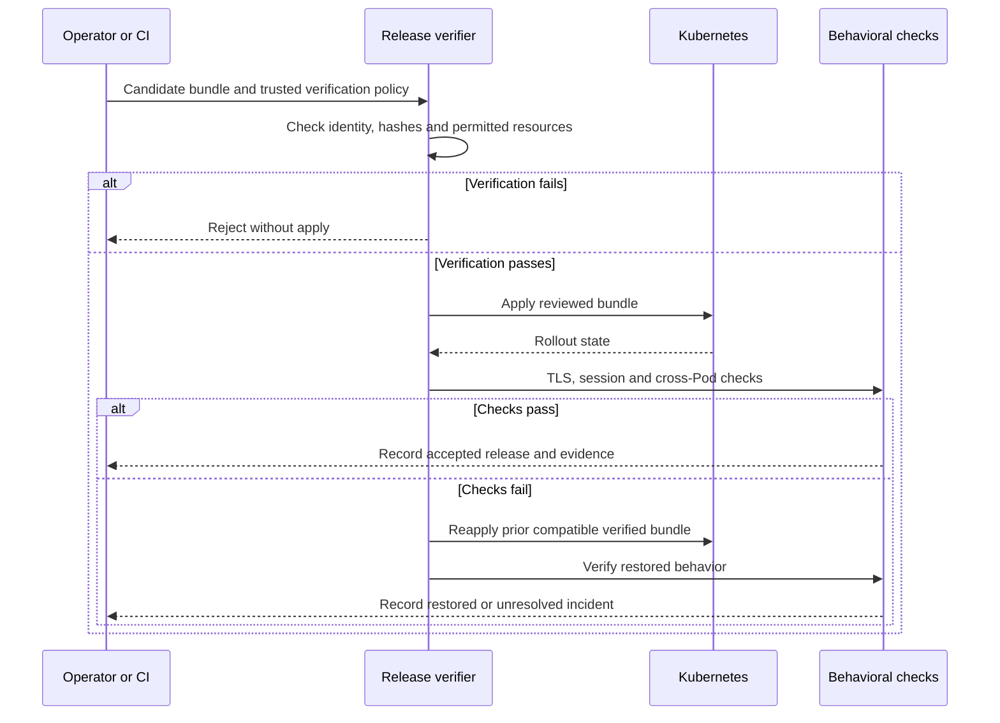

# Sequence Diagrams

**Status: design documentation only. Baseline: design revision 5. Updated: 2026-10-26.**

These diagrams express intended behavior. Exact wire fields and close codes remain in [API](../API_SPECIFICATION.md); task ownership is in [LLD](LLD.md).

## Connect and initialize

The diagram abbreviates return traffic through the gateway. An initializing session is not yet a broadcast recipient.

## Cross-replica message delivery

No direct local echo is added before Redis fan-out. This shows healthy behavior, not exactly-once delivery during faults.

## Dependency loss and recovery

There is no historical replay after recovery. Browser retries may pause after exhaustion; a paused user needs manual retry.

## Controlled deployment and restoration

Applying multiple Kubernetes resources is not atomic. The journal and live state must be reconciled after interruption; a failed restoration stays an incident.
