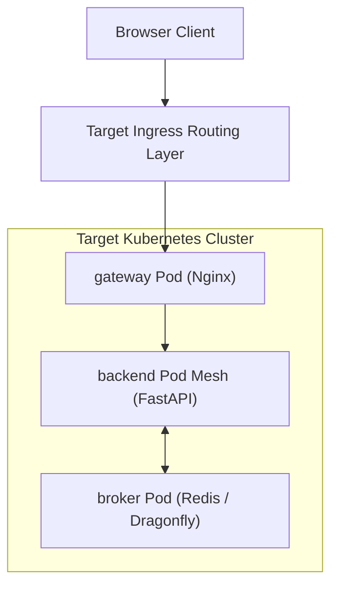

# Architecture Change Proposal (RFC) Template

**Template Pack Revision 3 · 2026-10-26. Status: Unfilled Engineering Proposal.**

Use this proposal template to make an architectural alteration, infrastructure overhaul, or capacity expansion concrete enough to review, simulate, deploy, monitor, and reverse. Read the [Template Guide](README.md) before drafting. Replace all bracketed markers with facts, mathematical models, or open items with assigned owners.

---

## 1. Proposal Identity & Executive Summary

| Field | Value to Complete |
| :--- | :--- |
| **Proposal Identifier & Title** | `PROPOSAL-<number>-<short-slug>` (e.g., `PROPOSAL-04-k3s-servicelb-gateway`) |
| **Design Status** | `DRAFT` / `IN_REVIEW` / `LAST_CALL` / `ACCEPTED` / `REJECTED` / `SUPERSEDED` |
| **Delivery Status** | `NOT_STARTED` / `IN_PROGRESS` / `IMPLEMENTED` / `VERIFIED` / `RETIRED` |
| **Author(s) & Discipline** | [Name(s) and engineering discipline] |
| **Assigned Reviewers** | Technical Lead: `[Name]` · Security: `[Name]` · Infrastructure: `[Name]` |
| **Submission / Review Dates** | Created: `YYYY-MM-DD` · Review Due: `YYYY-MM-DD` · Decision Due: `YYYY-MM-DD` |
| **Baseline Architecture Revision** | Design Revision 5 (Kubernetes Baseline: local k3d + single-node AWS K3s) |
| **Target Milestone & Environment** | Local k3d / AWS EC2 Mumbai `ap-south-1` / Production |
| **Change Classification** | `CAPACITY` / `TOPOLOGY` / `PROTOCOL` / `SECURITY` / `OPERATIONAL` (select all affected) |
| **Primary Decision Requested** | [One concise sentence defining the exact architectural choice to settle] |

### Executive Summary
> **Problem Statement:** Because [measured bottleneck, outage observation, or product requirement],
> **Proposed Solution:** We propose [concrete architectural, manifest, or code change] for [workload/environment].
> **Target Outcome:** Success is verified when [quantitative metrics and acceptance criteria met].
> **Primary Trade-off:** The accepted drawback or residual operational complexity is [cost, complexity, SPOF].
> **Fallback Safety:** If abort triggers fire, the system deterministically reverts via [automated rollback runbook].

---

## 2. Problem Statement, Baseline Architecture & Empirical Evidence

### 2.1 The Observed Bottleneck or Architectural Driver
Describe the concrete failure mode, resource saturation, or new product requirement necessitating this change. Distinguish observed empirical data from projected future needs.

### 2.2 Baseline Evidence & Telemetry Snapshot
| Evidence ID | Observation or Telemetry Metric | Environment & Date | Artifact / Data Source | Confidence Level |
| :--- | :--- | :--- | :--- | :--- |
| **EV-01** | E.g., Backend event loop lag breaches 100 ms under 128 clients. | AWS EC2 (c7i-flex.large) · `YYYY-MM-DD` | Prometheus histogram logs | `FACT` (Measured) |
| **EV-02** | E.g., Host node free memory drops to 380 MiB during image pulls. | Local k3d · `YYYY-MM-DD` | `free -m` command output | `FACT` (Measured) |
| **EV-03** | E.g., Single-worker Uvicorn saturates 100% of single vCPU core. | Benchmark harness · `YYYY-MM-DD` | k6 test execution report | `FACT` (Measured) |

---

## 3. Scope, Preserved Invariants & Explicit Non-Goals

| Architectural Domain | Current Baseline Contract | Proposed Alteration | Invariant Status |
| :--- | :--- | :--- | :--- |
| **Product Behavior** | Anonymous, single-room ephemeral chat. | [Unchanged or Proposed Change] | `PRESERVED` / `MODIFIED` |
| **Wire Protocol** | Strict `chat.v1` JSON envelopes; plain text client frames. | [Unchanged or Proposed Change] | `PRESERVED` / `MODIFIED` |
| **Concurrency Model** | Single-writer task per socket; bounded queues. | [Unchanged or Proposed Change] | `PRESERVED` / `MODIFIED` |
| **Network Boundaries** | Default-deny NetworkPolicies; internal Redis isolated. | [Unchanged or Proposed Change] | `PRESERVED` / `MODIFIED` |
| **Infrastructure Sizing** | 2-vCPU / 4-GiB single EC2 node; $512\text{ MiB}$ free headroom. | [Unchanged or Proposed Change] | `PRESERVED` / `MODIFIED` |

### Explicit Non-Goals
* [E.g., Non-Goal 1: This proposal does NOT implement multi-region active-active database replication.]
* [E.g., Non-Goal 2: This proposal does NOT introduce persistent user accounts or password authentication.]

---

## 4. Success Criteria & Quantitative Guardrails

| Criterion ID | Metric / Performance Behavior | Current Baseline | Proposed Target | Measurement Methodology & Window |
| :--- | :--- | :--- | :--- | :--- |
| **SC-01** | P95 End-to-End Delivery Latency | 210 ms (Measured) | $< 150\text{ ms}$ | k6 load test: 25 clients, 5 msg/s for 30m. |
| **SC-02** | Concurrent Socket Capacity | 128 connections | 512 connections | Sustained load test without socket drops. |
| **SC-03** | Node Memory Headroom | 650 MiB free | $\ge 512\text{ MiB}$ free | Prometheus `node_memory_MemAvailable_bytes`. |
| **SC-04** | Rollback Execution Time | 8 minutes | $< 10\text{ minutes}$ | Automated execution of `deploy/rollback.sh`. |

---

## 5. Assumptions, Upstream Dependencies & Critical Path

| Item ID | Assumption or External Dependency | Impact on Architecture | Validation Methodology & Owner | Fallback if Invalidated |
| :--- | :--- | :--- | :--- | :--- |
| **DEP-01** | AWS Free Tier eligibility for `c7i-flex.large`. | Determines monthly billing ($0 vs $34). | Billing Owner / Check AWS Console | Fall back to `t4g.medium` (Arm). |
| **DEP-02** | K3s ServiceLB compatibility with Flannel CNI. | Required for host-port packet routing. | Platform Owner / Run in k3d | Bind host ports directly to Nginx. |
| **DEP-03** | Let's Encrypt automated TLS certificate issuance. | Required for valid public HTTPS/WSS. | Security Owner / Test cert-manager | Use self-signed cert for local tests. |

---

## 6. High-Level Design (HLD) Impact: Topologies & Trust Boundaries

### 6.1 Target Topology Diagram


### 6.2 Component Responsibility Diff
| Component | Baseline Responsibility | Proposed Responsibility | State Ownership Changes |
| :--- | :--- | :--- | :--- |
| **Gateway** | Nginx reverse proxy + TLS termination. | [Unchanged or describe additions] | Stateless; no changes. |
| **Backend** | 2 replicas running FastAPI/Uvicorn. | [E.g., 4 replicas running uvloop] | AsyncIO memory state per Pod. |
| **Broker** | Singleton Redis 7 Pub/Sub. | [E.g., Dragonfly in-memory engine] | Ephemeral; zero disk writes. |

---

## 7. Low-Level Design (LLD) Impact: Interfaces & Async Concurrency

### 7.1 Changed or Added Module Interfaces
Describe new Python or JavaScript classes, async tasks, and conceptual contracts:

```python
# Conceptual Interface Diff
class ProposedBrokerAdapter(Protocol):
    async def publish_event(self, channel: str, payload: bytes) -> bool:
        """Publishes serialized event with strict 1.0s timeout."""
        ...

    async def subscribe_stream(self, channel: str) -> AsyncIterator[bytes]:
        """Supervised subscriber yielding broadcast events."""
        ...
```

### 7.2 Concurrency & Task Topology Impact
* **Task Ownership:** [Who spawns, supervises, and cancels new tasks?]
* **Queue Invariants:** [Verify preservation of $N \le 32$ items and $B \le 256\text{ KiB}$ bounds.]
* **Cancellation Safety:** [Verify clean exception handling on `asyncio.CancelledError`.]

---

## 8. Data & Wire Protocol Compatibility Matrix

| Client / Server Interaction | Old Client (v1.0) | Proposed Client (v1.1) | Compatibility Behavior & Fallback |
| :--- | :--- | :--- | :--- |
| **Old Server (v1.0)** | `COMPATIBLE` | `COMPATIBLE` | Client preserves strict schema fields. |
| **Proposed Server (v1.1)** | `COMPATIBLE` | `COMPATIBLE` | Envelopes preserve `chat.v1` JSON structure. |
| **Cross-Version Fan-Out** | Both clients receive identical broadcast events across the shared Redis bus without errors. |

---

## 9. Formal Capacity Model, Resource Equations & Sizing Impact

### 9.1 Sizing Calculations (Applying [Capacity Planning](../CAPACITY_PLANNING.md))
$$\Delta M_{\text{node}} = \Delta M_{\text{workloads}} + \Delta M_{\text{queues}} + \Delta M_{\text{kernel}}$$

* **Memory Request / Limit Delta:**
  * Gateway: Request: `50m / 32Mi` $\to$ `[New Value]` · Limit: `250m / 64Mi` $\to$ `[New Value]`
  * Backend (each): Request: `100m / 128Mi` $\to$ `[New Value]` · Limit: `500m / 256Mi` $\to$ `[New Value]`
  * Redis: Request: `50m / 64Mi` $\to$ `[New Value]` · Limit: `250m / 128Mi` $\to$ `[New Value]`
* **Projected Steady-State Free Memory:** `[Calculated free MemAvailable]` $\ge 512\text{ MiB}$.

---

## 10. Failure Mode & Effects Analysis (FMEA)

| Failure Scenario | Detection Mechanism | Immediate User Impact | Automated Recovery Action | Target MTTR |
| :--- | :--- | :--- | :--- | :--- |
| **Broker Process Crash** | Watchdog nonce timeout $> 10\text{s}$. | Brief message delivery pause. | Pod restarted by K8s; backends reconnect. | $< 15\text{s}$ |
| **Backend OOM Eviction** | Kubelet cgroup OOM alert. | Sockets on that Pod disconnect. | Clients reconnect with full jitter to surviving Pod. | $< 10\text{s}$ |
| **Network Partition** | TCP keepalive timeout (300s). | Sockets terminate. | Clients back off and reconnect. | $< 30\text{s}$ |

---

## 11. Security, Zero-Trust & STRIDE Threat Review

* **Least Privilege:** [Do new workloads require elevated permissions or host namespaces?]
* **Network Isolation:** [Are new ports exposed via NetworkPolicies?]
* **Secret Handling:** [Are new credentials stored exclusively in Kubernetes Secret volumes?]
* **STRIDE Diff:** [Detail any new attack vectors and their corresponding controls.]

---

## 12. Financial Budgeting, AWS Free Tier Ledger & Teardown

| Cloud Resource | Proposed Sizing / Quantity | Unit Rate (ap-south-1) | Monthly Cost | Credit Offset Status |
| :--- | :--- | :--- | :--- | :--- |
| **EC2 Compute** | 1x `c7i-flex.large` (720 hrs) | $0.0476 / hr | $34.27 | Eligible Free Tier / Credit |
| **EBS Storage** | 20 GiB gp3 SSD | $0.096 / GB-mo | $1.92 | Credit Offset |
| **Public IPv4** | 1 In-Use IPv4 (720 hrs) | $0.005 / hr | $3.60 | Credit Offset |
| **Total Gross Spend** | — | — | **$39.79** | **Fully within $100 Budget** |

---

## 13. Observability, Telemetry & Anomaly Trigger Rules

Specify the Prometheus metrics and PromQL alerts monitoring this change:

```promql
# Alert: High Handshake Denial Rate
sum(rate(websocket_handshake_rejections_total[2m])) 
/ 
sum(rate(websocket_handshake_attempts_total[2m])) > 0.05
```

---

## 14. Evaluated Alternatives & Comparative Trade-offs

| Architectural Option | Pros | Cons | Financial Impact | Outcome |
| :--- | :--- | :--- | :--- | :--- |
| **Candidate A: [Selected]** | [Primary advantage] | [Primary trade-off] | $[Gross Cost] | **SELECTED** |
| **Candidate B: [Alternative]** | [Advantage] | [Fatal flaw] | $[Gross Cost] | REJECTED |
| **Candidate C: [Status Quo]** | Zero implementation risk. | Bottleneck persists. | $0.00 | REJECTED |

---

## 15. The 8-Gate Implementation & Staged Rollout Plan

Execute rollout in strict accordance with the [Migration Playbook](../MIGRATION_PLAYBOOK.md):
* **Gate 1 (Baseline):** Capture baseline telemetry.
* **Gate 2 (Design Approval):** Complete this RFC and gain sign-offs.
* **Gate 3 (Rehearsal):** Run full test suite in local `k3d`.
* **Gate 4 (Pre-Flight):** Verify Cosign image signatures and secrets.
* **Gate 5 (Apply):** `kubectl apply -k k8s/overlays/aws/`.
* **Gate 6 (Drain):** Paced `1012` close frame drain across 10 seconds.
* **Gate 7 (Soak):** 30-minute metric stabilization observation.
* **Gate 8 (Retire):** Decommission legacy images and temporary secrets.

---

## 16. Abort Triggers, Rollback Runbook & Forward Repair

### 16.1 Automated Rollback Conditions
If any of the following occur during Gates 5–7, abort immediately:
1. P95 latency $> 250\text{ ms}$ for $> 60\text{ seconds}$.
2. Error rate (5xx or unhandled exceptions) $> 1\%$.
3. Node free memory $< 512\text{ MiB}$.

### 16.2 Executable Rollback Command
```bash
kubectl apply -f /opt/baatchit/releases/release-manifest-previous.yaml
kubectl rollout status deployment/backend -n baatchit --timeout=180s
```

---

## 17. Empirical Verification & Acceptance Evidence Contract

| Test ID | Traceable AC / NFR | Test Scenario & Command | Expected Outcome | Verification Status |
| :--- | :--- | :--- | :--- | :--- |
| **V-01** | AC-01 (Topology) | `kubectl get pods -n baatchit` | 5 Pods `1/1 Ready` | `PENDING` |
| **V-02** | AC-02 (Messaging) | `pytest tests/e2e/test_fanout.py` | Cross-pod echo $< 250\text{ ms}$ | `PENDING` |
| **V-03** | NFR-06 (Headroom) | Prometheus memory exporter | Free RAM $\ge 512\text{ MiB}$ | `PENDING` |

---

## 18. Governance Sign-Off & Post-Migration Audit

* **Technical Lead Approval:** `APPROVED` / `REJECTED` — [Name] (`YYYY-MM-DD`)
* **Security Sign-Off:** `APPROVED` / `REJECTED` — [Name] (`YYYY-MM-DD`)
* **Infrastructure Sign-Off:** `APPROVED` / `REJECTED` — [Name] (`YYYY-MM-DD`)

### Post-Migration Audit Notes:
* *Rollout Completed At:* `YYYY-MM-DD HH:MM UTC`
* *Actual P95 Latency Observed:* `XX ms`
* *Actual Steady-State Free RAM:* `XXX MiB`
* *Residual Unresolved Items:* `[None or list actionable bug tickets]`
