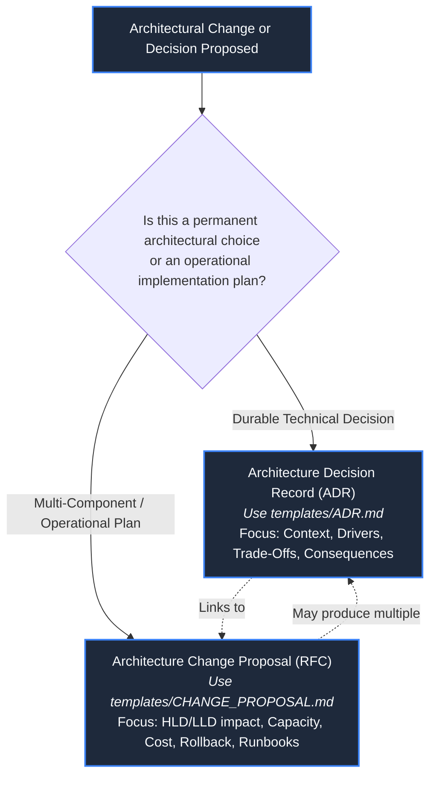
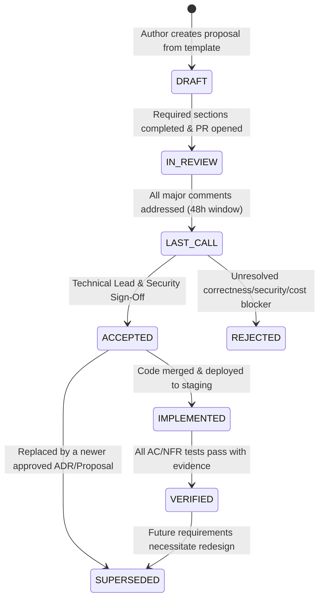

# Architecture Template & Governance Guide

**Status: Production Engineering Standard. Template Pack Revision 3. Updated: 2026-10-26.**

This guide defines the engineering standards, lifecycle governance, evidence requirements, and document archetypes for proposing, recording, and reviewing architectural decisions in Chat App.

---

## 1. Document Archetype Selection Matrix

Engineering proposals must use the appropriate standardized template to ensure consistency, traceability, and rigorous review:

| Document Archetype | Template Source | When to Author | Key Deliverables & Required Work |
| :--- | :--- | :--- | :--- |
| **Architecture Decision Record (ADR)** | [`templates/ADR.md`](ADR.md) | Selecting a specific technology, protocol choice, state model, or invariant that future maintainers must respect. | Context, decision drivers, evaluated alternatives, trade-offs, consequences, revisit conditions. |
| **Change Proposal (RFC)** | [`templates/CHANGE_PROPOSAL.md`](CHANGE_PROPOSAL.md) | Multi-faceted upgrades involving Kubernetes topology, schema evolution, capacity re-sizing, or multi-stage migrations. | HLD/LLD diffs, capacity models, AWS cost estimates, failure analysis, 8-gate migration runbooks. |

---

## 2. Document Governance & Lifecycle State Machine

Architectural records transition through a formal review and delivery lifecycle:

### State Definitions & Governance Rules
1. **`DRAFT`:** Work in progress. May contain explicit `TBD` markers. Not ready for voting.
2. **`IN_REVIEW`:** Formally submitted via GitHub Pull Request. Requires review from at least one Backend Engineer, one Infrastructure Engineer, and the Technical Lead.
3. **`LAST_CALL`:** All technical objections addressed. A final 48-hour commentary window before formal acceptance.
4. **`ACCEPTED`:** The architectural direction is locked. Authorizes code implementation. *Acceptance does NOT imply that code exists or cloud funds have been spent.*
5. **`IMPLEMENTED`:** Software and infrastructure manifests are merged and running in staging/test environments.
6. **`VERIFIED`:** Empirical evidence (benchmark logs, test runs) attached, proving all stated acceptance criteria have passed.
7. **`REJECTED`:** The proposal was evaluated and declined. The document is archived in Git history with recorded rationale to prevent re-proposing rejected patterns without new evidence.
8. **`SUPERSEDED`:** A previously accepted decision has been replaced by a subsequent ADR. Maintains a bidirectional link to the superseding record.

---

## 3. Strict Evidence Quality & Classification Rubric

To prevent unverified assumptions from being treated as demonstrated facts, all claims in proposals and ADRs must be explicitly classified:

| Classification | Definition & Required Documentation | Disallowed Wording |
| :--- | :--- | :--- |
| **[FACT]** | A mathematically proven theorem, documented language contract, or empirical benchmark with attached reproducible logs. | "FastAPI is extremely fast." |
| **[ASSUMPTION]** | An unverified premise. Must state the owner, validation methodology, and fallback if proven false. | "AWS will never throttle our instance." |
| **[MODEL / ESTIMATE]** | A calculated value derived from formal equations (see [Capacity Planning](../CAPACITY_PLANNING.md)). Must specify inputs, units, and uncertainty bounds. | "Memory will be around a few gigabytes." |
| **[TARGET]** | A desired service-level objective or acceptance criterion. Not proof of capability. | "The app handles 10,000 users effortlessly." |
| **[NOT MEASURED]** | Work or telemetry that does not yet exist. Acknowledges an empirical gap. | Leaving blank or writing "N/A" without explanation. |

---

## 4. Naming Conventions & File Placement

1. **Working Copies:** Always copy templates to `docs/design/` (never modify the master templates in `docs/design/templates/`).
2. **Standardized File Naming:**
   * ADRs: `docs/design/ADR-<id>-<short-slug>.md` (e.g., `ADR-22-k3s-servicelb-ingress.md`).
   * Proposals: `docs/design/PROPOSAL-<id>-<short-slug>.md` (e.g., `PROPOSAL-04-dragonfly-broker-migration.md`).
3. **Relative Markdown Link Corrections:**
   Because master templates live inside `templates/`, copy operations shift the relative path depth by one level:

| Target Document | Relative Link from `templates/` | Correct Relative Link when Copied to `docs/design/` |
| :--- | :--- | :--- |
| Main Requirements | `../../REQUIREMENTS.md` | `../REQUIREMENTS.md` |
| Kubernetes Guide | `../../KUBERNETES.md` | `../KUBERNETES.md` |
| High-Level Design (HLD) | `../HLD.md` | `HLD.md` |
| Low-Level Design (LLD) | `../LLD.md` | `LLD.md` |
| Design Review Checklist | `../DESIGN_REVIEW_CHECKLIST.md` | `DESIGN_REVIEW_CHECKLIST.md` |
| Template Guide | `README.md` | `templates/README.md` |

---

## 5. Architectural Document Pre-Submission Checklist

Before requesting formal review on a proposal or ADR, the author must verify:

- [ ] Every assumption is labeled `[ASSUMPTION]` with an assigned validation owner and due date.
- [ ] Explicit non-goals are listed; no unintended functional scope creep.
- [ ] System invariants (single-writer pattern, bounded queues, default-deny policies) are preserved or formally modified.
- [ ] Mathematical capacity models demonstrate CPU, memory, and bandwidth compliance under peak load.
- [ ] Total recurring and migration cloud costs are calculated against the $\$100$ credit boundary.
- [ ] Failure analysis includes RTO/RPO objectives, MTTR expectations, and data loss boundaries.
- [ ] Rollback procedures include executable bash runbooks and automated PromQL abort triggers.
- [ ] Acceptance criteria (AC) and non-functional requirements (NFR) traceability is fully populated.
- [ ] All internal markdown links resolve correctly from the destination directory.
